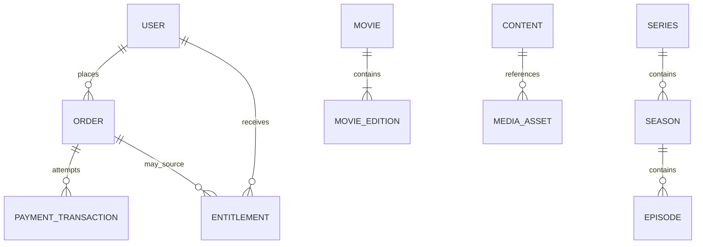

# Domain Modeling and Database Architecture

> **Document ID:** ARCH-002 · **Status:** Architecture guidance · **Depends on:** ARCH-001

## Purpose and authority

This document defines the domain vocabulary and ownership boundaries before persistence design. It does not specify tables, ORM models, migrations, or a final physical schema. ARCH-001 is authoritative if guidance here appears to conflict with it. Product behavior that remains unsettled is marked **REQUIRES VALIDATION** or **UNKNOWN**.

## Domain map and ownership

The modular monolith owns domain rules within the following modules. A module owns writes to its records; other modules use its exported contracts and do not write its tables directly.

| Domain | Owns | Boundary notes |
| --- | --- | --- |
| Auth / Users | Customer and staff identities, credentials, account status, roles, database-backed sessions, recognized devices | Session lifecycle is defined in ARCH-003. Device, session, and active stream are separate concepts. |
| Catalog / Taxonomies / DJs | Titles, movie editions, flexible series hierarchy, categories, countries, commentator/translator identities, publication visibility and readiness | Media Team can request controlled taxonomy; Admin governs canonical taxonomy. Content readiness policy is backend-defined. |
| Media Team / Playback | Intake and asset lifecycle coordination / authorization to play and progress state | Raw media and delivery state are provider concerns; domain stores references and normalized state only. |
| Payments | Authenticated purchase intent, order, payment attempts, normalized provider facts, payment settlement, fulfillment state | Provider payloads remain adapter data; successful payment state is separate from fulfillment processing. |
| Entitlements | Individual grants, purchased subscription periods and immutable terms, capabilities, validity, quota usage, revocation | A successful payment is evidence for fulfillment, not itself the grant or access decision. |
| Admin | Administrative policy/configuration and privileged operations | Cross-domain operations use domain contracts and produce audit records. It must not become a catch-all owner. |
| Notifications | Persistent in-app notification history/read state, email notification intents and delivery attempts | Domain modules request approved notifications through a contract; channel delivery/provider detail stays here. |
| Audit | Immutable record of privileged and security-relevant actions | May be implemented as a shared infrastructure capability. Preserve according to applicable retention requirements; exact periods remain pending. |

## Domain concepts

### Content hierarchy

**Content** is the discoverable logical item. A **Movie** has one or more **Movie Editions** where an edition represents a distinct packaged presentation (including an embedded commentator/translator mix when applicable). Replacing its underlying media must not silently change the identity of an edition already referenced by access grants or history. Whether editions can be versioned in place or must be superseded is **REQUIRES VALIDATION**.

An episodic **Series** may contain seasons and episodes, but the hierarchy is flexible and does not require every level. Supported purchase units are episode, season, and full series; applicable prices are Admin-controlled. Season access covers eligible episodes in that season; full-series access covers eligible seasons/episodes. Categories, countries, and DJs/voice commentators are separately managed reference concepts. Media Team submits taxonomy requests; Admin reviews and creates canonical values, with request/review history auditable.

Catalog status and customer access are independent. **Unpublish** removes public discovery; **archive** retires content from the active catalog; neither removes valid customer access. **Delete** is restricted by commercial/audit safeguards. **Revoke Access** is a separate exceptional operation requiring authorization, reason, audit trail, and customer notification. Content unavailability does not imply entitlement expiry/revocation. Refund or compensation behavior is outside V1.

### Media asset

A **Media Asset** is a logical reference to an uploaded or externally processed object, with purpose (for example artwork, source master, playback rendition, or download package), provider-neutral identifier, observed metadata, lifecycle state, and association to the relevant content/edition. It is not the binary itself. Provider-specific URLs, credentials, processing identifiers, and webhook payloads are not domain identity. Asset states and validation policy are detailed in ARCH-005.

### Identity, role, and ownership

A **User** is an account identity. Confirmed role names are `customer`, `media_team`, and `admin` (ARCH-001). Purchases require an authenticated customer; guest orders are not supported. Whether an unverified pending account can authenticate or purchase remains **PENDING**. An opaque cookie identifies a database-backed **Session**. A recognized **Device** can have multiple sessions; an **Active Stream** is a separate leased playback record. Limits on devices and streams are independently Admin-configured. Device metadata identifies practical platform/type without invasive fingerprinting. Multiple concurrent sessions are allowed. Role cardinality beyond the stated account model remains **UNKNOWN**.

### Commerce and access

Keep the following concepts distinct:

* **Purchase Intent:** requested commercial action and item/access type, with a server-validated quote reference or price snapshot.
* **Order:** business record of what was requested and the amount/currency agreed at creation. It is not proof of payment or access.
* **Payment Intent:** attempt to collect the order amount through a provider adapter.
* **Payment Attempt:** normalized attempt/settlement facts with provider reference and one of `PENDING`, `SUCCEEDED`, `FAILED`, `CANCELLED`, `EXPIRED`; preserve attempt history. `SUCCEEDED` is payment state, separate from fulfillment state.
* **Entitlement:** explicit grant to a user for a defined resource and capability, with validity, source, and revocation state. Individual access starts immediately after successful payment and entitlement activation; the backend owns `starts_at` and `expires_at`. Pending or failed payment never starts access.
* **Subscription Plan and Version:** Admin-managed offer policy. A successful subscription purchase captures an immutable versioned snapshot, at minimum price, currency, duration/validity, download limit/type, applicable policy/version, and where applicable device and concurrent-stream policy. Plan changes apply to future purchases; manual renewal after expiry receives current terms. No recurring billing.
* **Purchased Subscription:** customer-specific period with immutable purchased terms. It grants unlimited streaming/viewing of eligible catalog content during its validity; downloads are limited by configured policy. Individual purchases remain independent and survive subscription expiry.
* **Download Attempt / Usage:** backend-authorized and auditable download attempt. Quota use is atomic; a UI click alone does not consume quota. `UNIQUE_TITLES` counts a title once even if downloaded again; `DOWNLOAD_ACTIONS` counts each authorized attempt. Delivery failure and customer interruption remain distinguishable for retry handling.

One order may result in zero or more payment attempts; exact cardinality and partial-payment support are **UNKNOWN**. A successfully settled eligible order may authorize entitlement issuance through the Entitlements module. An entitlement records the access decision independently, including its source order/payment reference when applicable. Payment success never means perpetual access.

### Administrative, media operations, notifications

Administrative actions are commands with actor, target resource, outcome, reason where required, and audit context. Admin alone manages pricing, subscription plans, and customer accounts. Media Team uses capability-based permissions; publishing requires the member's `CONTENT_PUBLISH` capability and 100% backend-validated readiness. Notifications have persistent in-app history with read/unread state and confirmed email delivery capability. Exact event/channel mapping and email templates remain **PENDING**.

## Relationships and lifecycle boundaries

The diagram is conceptual: `CONTENT` is a shared abstraction, not a prescribed table or inheritance strategy. An entitlement can target a movie edition, episode, season, plan, or other approved resource only after the purchasable/access units are confirmed.

### Aggregate boundaries and invariants

Treat the following as transaction-sized consistency boundaries, not necessarily implementation classes:

1. **Catalog aggregate:** title hierarchy, edition identity, ordering, classification references, and publication state changes. A referenced edition cannot be deleted in a way that erases purchase or audit history.
2. **Order/payment settlement boundary:** payment callbacks are verified and normalized before settlement. A settlement transition and its durable follow-up intent must commit atomically where both are database-owned. Never hold a database transaction open across provider network calls.
3. **Entitlement aggregate:** grants are unique/idempotent according to a domain key that must distinguish resource, capability, source, and validity policy as required. The exact uniqueness key is **REQUIRES VALIDATION**. Revocation/expiry changes must be auditable.
4. **Session boundary:** session issuance/revocation follows ARCH-003; session storage is not process memory.

Core invariants: amounts are non-negative and currency explicit; foreign references are valid; published customer-facing content has required approved metadata/assets according to a yet-to-be-approved readiness policy; one callback cannot cause duplicate settlement or duplicate grants; resource access requires a valid entitlement or another explicitly approved access rule; ordering is deterministic; audit history is not silently rewritten.

## Persistence principles

PostgreSQL is accepted (ARCH-001). Model domain relationships relationally and normalize to avoid duplicated authority. Use controlled denormalization only for measured read hotspots with a defined source of truth and reconciliation approach. Drizzle remains **PROVISIONAL**; domain language and transaction boundaries must not depend on an ORM.

Enforce invariants in both domain services and database constraints where expressible: `NOT NULL`, foreign keys, uniqueness, checks, and appropriate delete rules. Prefer restrictive deletion for referenced financial/catalog history; use explicit archival or soft deletion where the business needs reversible removal. Do not blanket-soft-delete every table without a lifecycle reason. Account deletion/deactivation does not cascade-delete all related data. Distinguish account/customer data, commercial records, security/audit records, and operational/transient data. Preserve payment, order, entitlement, audit, and other commercial/security records needed for reconciliation, accounting, fraud investigation, disputes, legal obligations, or operational integrity according to applicable retention requirements. Expired sessions/tokens and other transient security data may have shorter retention; notifications and other non-critical history may follow separate policy. Delete or anonymize PII when no longer required where this does not compromise records that must be retained. Exact retention durations are **PENDING** operational/legal policy, not architectural constants.

Use explicit transactions for settlement and entitlement issuance. Keep them short and do not mix remote calls with locks. Protect concurrent transitions through conditional updates, uniqueness constraints, or row locking appropriate to the operation; every retry path must be idempotent. Define isolation and locking only for demonstrated race conditions, with tests.

Index measured query patterns: foreign keys and unique identifiers, composite filters/orderings, and partial indexes only with immutable predicates. PostgreSQL full-text search is the accepted initial direction; language configuration, ranking, stemming, and searchable fields require product/content validation. Never promise ranking behavior until defined. All lists are bounded and deep feeds should prefer keyset/cursor pagination where stable ordering permits.

## Evolution, retention, and verification

Schema changes are additive or explicitly migrated with a reviewed compatibility and rollback/forward-recovery plan. Preserve old records needed for financial, entitlement, and audit interpretation. Purpose-based retention and the separation of account, commercial, security/audit, and transient data are **ACCEPTED**. Exact legal/business retention periods, privacy deletion/anonymization criteria, and asset cleanup windows remain **PENDING**; do not invent time periods. Backfills must be restartable and observable. Tests should validate domain invariants in memory and database constraints/transactions against PostgreSQL-compatible integration environments (ARCH-011).

## Open decisions

**ACCEPTED:** authenticated-only purchases; episode/season/full-series purchase units; one-time subscription purchases with immutable terms; Tanzania/TZS; immediate post-payment individual access duration; fixed backend readiness and publishing revalidation; capability-based Media Team policy; content lifecycle/access separation; atomic download quota semantics; purpose-based retention/deletion. **PENDING:** provider selection, subscription-plan snapshot identity/version representation, exact download retry edge cases, role cardinality, exact retention periods/deletion criteria, and search language/ranking. **DEFERRED:** refund/chargeback features and workflows (outside V1); preserve extensible payment history without designing those features. Tax treatment remains **UNKNOWN**; do not infer it from TZS.

## Related documents

ARCH-001 foundation · ARCH-003 security · ARCH-005 media · ARCH-006 payments/entitlements · ARCH-011 testing · ARCH-014 recovery.
