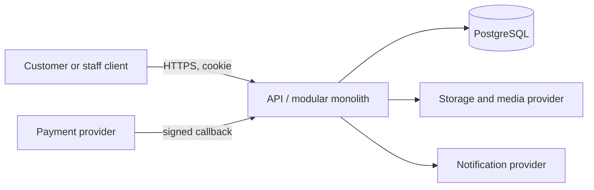

# Authentication, Authorization, and Security

> **Document ID:** ARCH-003 · **Status:** Architecture guidance · **Depends on:** ARCH-001, ARCH-002

## Security posture and trust boundaries

Security is enforced at the backend and provider boundaries; frontend route hiding is only presentation. The main trust boundaries are browser/client to API, API to PostgreSQL, API to payment provider/webhook caller, API to object storage/media delivery, and staff operator to privileged administrative functions. Treat all client input, callback bodies, uploaded media, and provider responses as untrusted until validated.

Each boundary uses least privilege, explicit validation, and auditable state transitions. Provider credentials and signing keys are secrets (ARCH-012).

## Authentication lifecycle

Customer identity uses email/password as accepted by ARCH-001. Registration and login must return generic, non-enumerating errors where exposing account existence creates abuse risk. Passwords are stored only as strong one-way hashes using the accepted Argon2id direction; plaintext passwords and reset secrets are never logged or returned. Hash parameters should follow current maintained library guidance and be revisited through dependency/security review, not hard-coded here.

Authentication uses database-backed server-side sessions. The cookie is opaque, `HttpOnly`, `Secure`, narrowly scoped, and uses an appropriate `SameSite` policy; it does not carry complete authentication state. Every session has server-enforced inactivity and absolute timeouts. Session IDs are regenerated after authentication and appropriate security-sensitive transitions. Multiple concurrent sessions are allowed and independently revocable. Logout invalidates the current server session and clears the cookie; logout-all invalidates all sessions. Password reset/security recovery invalidates existing sessions. High-risk operations may require reauthentication; sensitive Admin/Media Team operations should use stronger reauthentication controls where appropriate. Exact timeout values are configuration/security-policy values, not hardcoded architectural constants. Activity tracking should avoid unnecessary writes through an efficient, throttled strategy.

Email verification is required. Registration creates an unverified/pending account; the backend issues a secure, single-use, expiring verification token and sends it by email. Verification proves mailbox control, not real-world identity. Password recovery is email-based and uses separate tokens and lifecycle from verification. Token expiry/retention and abuse controls must be specified in implementation without conflating the two flows. Customers must authenticate before any purchase; guest checkout and guest-session bridging are not supported.

The handoff does not specify whether a pending unverified account may authenticate or initiate a purchase. Keep that gate **PENDING**; do not treat “email verification required” alone as a complete purchase eligibility rule.

## Authorization model

ARCH-001 establishes `customer`, `media_team`, and `admin` roles. Authorization is deny-by-default and evaluates both action and target object. Role membership alone does not grant access to another customer's order, entitlement, playback progress, or download capability. Every read and mutation of user-owned resources verifies ownership in the domain boundary; every staff operation checks explicit staff permission and scope.

| Principal | Baseline boundary |
| --- | --- |
| Customer | Public catalog and own account, orders, entitlements, playback state, and authorized media only. |
| Media team | Content intake and maintenance actions expressly granted by policy; no implied access to customer financial or payment details. |
| Admin | Privileged governance and administrative actions, limited to explicit capabilities and audited. |

Media Team authorization is capability-based rather than per-content-type. Capabilities include `CONTENT_CREATE`, `CONTENT_EDIT`, `CONTENT_UPLOAD`, `CONTENT_PUBLISH`, `CONTENT_UNPUBLISH`, `CONTENT_ARCHIVE`, and `CONTENT_DELETE` where granted. Backend authorization is authoritative; UI visibility is not a security boundary. Publishing requires both the member's publishing capability and 100% backend-validated readiness. Without publishing capability, Media Team prepares content for review. Admin alone manages prices, subscription plans, customer accounts, and canonical taxonomy. Media Team may submit taxonomy requests for Admin review but cannot create canonical taxonomy directly. Media Team cannot search or access customer account/personal data through staff APIs. Commercial/audit safeguards can block or route destructive lifecycle operations for Admin review; staff capability alone does not bypass those rules. Exact role cardinality and staff MFA policy remain **UNKNOWN**; high-risk reauthentication is required by policy where applicable.

## Browser and API defenses

Cookie-authenticated state-changing requests require CSRF protection appropriate to the deployment: validate origin/fetch metadata where available and use a synchronizer or equivalent anti-CSRF mechanism when needed. `SameSite` is defense-in-depth, not the sole CSRF control. CORS should allow only configured trusted origins, the required methods/headers, and credential behavior; wildcard origins cannot be combined with credentialed access. Exact origins are environment configuration.

Prevent XSS through context-appropriate output encoding, safe rendering, a restrictive Content Security Policy where compatible, and avoiding unsafe HTML injection. Client-side validation improves usability but never replaces server validation. Validate body, query, and path values at the transport boundary with strict DTOs; reject unexpected fields. Use parameterized database operations and vetted ORM/driver interfaces to prevent SQL injection; never concatenate user values into SQL structure.

Apply rate limiting and abuse detection to login, registration, password recovery, checkout initiation, and other sensitive operations. Thresholds and lockout/captcha policy are **REQUIRES VALIDATION** and must account for NAT/mobile networks and provider constraints. Avoid permanent account lockout that attackers can weaponize. Responses should avoid leaking whether credentials/accounts exist.

Use secure transport (HTTPS) at public boundaries, security headers appropriate to the web/API deployment, bounded request sizes, explicit timeouts, and safe error serialization. Uploaded files require server-side type/content/size policy validation, malware/content inspection if required by risk assessment, and isolation from public delivery until approved. Exact upload restrictions are **REQUIRES VALIDATION**.

## Payment, media, and webhook security

Payment callbacks require cryptographic signature verification over the provider-defined raw representation, secret/key rotation support, timestamp/replay controls where supported, and idempotent processing. A callback is not trusted merely because it names a known transaction. Do not store or log card authentication secrets or unnecessary payment credentials; payment data scope and provider tokenization model are **REQUIRES VALIDATION**.

Media is private by default. The backend checks authentication, entitlement/access validity, resource, and operation before issuing a short-lived, cryptographically protected authorization scoped to a specific media resource and operation. Streaming and downloads use separate authorization paths; download checks entitlement, eligibility, and atomic quota before issuing access. Streaming authorization permits the multiple HTTP Range requests needed for seeking/resume within the valid playback session. Expiry prevents new access but cannot remove bytes already buffered by a client. Do not bind tokens permanently to IP addresses by default, include unnecessary customer data, or log token values. Token TTL and reuse policy remain **PENDING**; offline licensing/DRM remains **REQUIRES VALIDATION**. Signed access is not DRM or a guarantee against copying.

For provider webhooks, verify authenticity before enqueuing or applying business changes. Keep raw payload retention minimal and access-controlled. Protect administrative actions, payment settlement, entitlement grants/revocations, and security events against CSRF and object-reference attacks.

## Security events, threat cases, and logging

Threat cases include credential stuffing, session theft, CSRF, XSS, IDOR/BOLA, staff privilege misuse, forged/replayed callbacks, duplicate settlement, malicious uploads, signed URL sharing, secret leakage, and denial-of-service through oversized or repeated requests. Mitigations belong at the relevant trust boundary and are verified by tests (ARCH-011).

Record security-relevant outcomes such as repeated authentication failures, session revocation, role/permission changes, denied privileged operations, webhook verification failures, and suspicious access patterns, subject to privacy and retention policy. Logs must exclude passwords, session cookies, bearer/signature tokens, full payment credentials, reset codes, and unnecessary personal data. Audit records are append-only at the domain level and access-controlled (ARCH-010).

## Unresolved security decisions

**PENDING / REQUIRES VALIDATION:** exact session timeout values; staff MFA policy; CSRF token mechanism; trusted origins; rate-limit policy; provider signature algorithms/rotation; payment data handling scope; media token TTL/reuse; upload inspection and limits; privacy obligations and retention constraints applicable to launch market. Database-backed sessions, email verification, separate password recovery, no guest checkout, and the stated capability/ownership boundaries are **ACCEPTED**. No compliance certification or legal conclusion is asserted here.

## Related documents

ARCH-001 · ARCH-002 · ARCH-004 API contracts · ARCH-005 media · ARCH-006 payments/access · ARCH-010 observability · ARCH-012 configuration.
