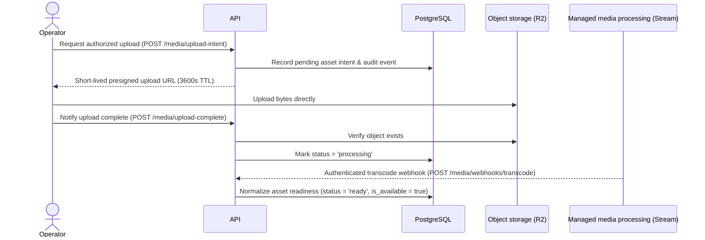

# Media Architecture and Delivery

> **Document ID:** ARCH-005 · **Status:** Architecture guidance · **Depends on:** ARCH-001–004 · **Authority:** ARCH-015 (ADR-010, ADR-011, ADR-036, ADR-037)

## Boundary and principles

The application is a metadata, workflow, and authorization coordinator. It does not store video binaries in PostgreSQL, stream raw video, proxy large uploads, or become a custom transcoding farm. Media binaries live in managed storage/delivery infrastructure; the database stores provider-neutral references, ownership, and normalized lifecycle metadata.

Per Product Owner Approval POD-02, **Cloudflare Stream** ([ADR-010](file:///Users/furahamogela/Desktop/WINDOWSEVEN/GIFTEDproMovies3/docs/architecture/15-ARCHITECTURE-DECISIONS-AND-TRADEOFFS.md)) and **Cloudflare R2** ([ADR-011](file:///Users/furahamogela/Desktop/WINDOWSEVEN/GIFTEDproMovies3/docs/architecture/15-ARCHITECTURE-DECISIONS-AND-TRADEOFFS.md)) are promoted to **ACCEPTED** for managed media delivery and object storage. Cloudflare Stream delivers managed HLS adaptive-bitrate streaming with signed token verification and zero egress bandwidth fees. Cloudflare R2 provides S3-compatible direct-to-storage master video and offline download package storage with zero egress fees. The application domain abstracts media operations behind ports (`MediaStoragePort`, `PlaybackSignerPort`), keeping bulk video transit off application compute.

> **Operational Boundary Note:** Promotion of ADR-010 and ADR-011 establishes the architectural and interface contract. The live provider sandbox upload-and-processing round-trip remains **BLOCKED / PENDING OPERATIONAL GATE** until real Cloudflare Stream/R2 credentials and staging infrastructure are provisioned in Phase 8 without incurring unapproved vendor spend.

Provider capabilities vary; the diagram describes responsibilities and verified contracts, not an unchangeable vendor protocol.

## Ingestion and upload lifecycle

An authorized media-team operation requests an upload for a specific asset purpose and content target via `POST /api/v1/media/upload-intent`. The API validates actor permissions (`@Roles("media_team", "admin")`), expected purpose, upload policy, content hierarchy, and target lifecycle, then issues a short-lived (3600s TTL), narrowly scoped direct upload authorization. Master video bytes travel directly between client and storage. The server never exposes reusable storage credentials or allows arbitrary destination keys.

The domain tracks an upload intent and correlates verified completion with the intended object. A client-side “upload finished” signal alone is insufficient proof that an object exists and matches the target. The client calls `POST /api/v1/media/upload-complete`, where the backend validates that the uploaded object exists in storage via `verifyObjectExists(storageKey)`. Expired, abandoned, mismatched, or duplicate completions are safe to retry and do not make content public.

Media states are normalized in PostgreSQL schema as `pending`, `processing`, `ready`, and `failed`. Transitions are monotonic: once an asset reaches `ready`, it cannot regress to `processing` or `failed`. Permanent transcode failures set `failed` and keep the asset unavailable (`is_available = false`). A ready asset requires verified storage existence and provider confirmation, not merely a client-side database flag.

## Assets, editions, and content identity

Assets have an intended role (artwork, source master, playback output, download package, or other approved purpose), a provider-neutral asset identity, content association, observed technical metadata, and normalized state. Store provider-specific ids and raw webhook details only within infrastructure boundaries with restricted access. Avoid persisting signed delivery URLs as durable asset identity.

A movie edition identifies a distinct presentation whose audio/video may be a separate packaged asset. An existing edition must not silently point to a different editorial cut or embedded voice mix when that would alter what a customer purchased.

Per Product Owner Approval POD-03 ([ADR-036](file:///Users/furahamogela/Desktop/WINDOWSEVEN/GIFTEDproMovies3/docs/architecture/15-ARCHITECTURE-DECISIONS-AND-TRADEOFFS.md)), **Model B: versioned, auditable media-asset supersession** is **ACCEPTED** and enforced:
- **Application Guard:** `assertMediaCanBeModified` blocks overwriting or mutating ready assets with active commercial customer entitlements, returning `409 Conflict` (`ACTIVE_COMMERCIAL_ENTITLEMENT_EXISTS`).
- **Database Engine Triggers:** PostgreSQL triggers `trg_movie_editions_supersession_guard` and `trg_episodes_supersession_guard` reject direct SQL mutations on ready assets with active entitlements (`DIRECT_SQL_MUTATION_DENIED`).
- **Authorized Supersession Workflow:** Authorized operators replace assets via `POST /api/v1/media/supersede`, recording historical versions in `media_asset_supersessions` with actor ID, reason, previous and new storage keys, and emitting structured audit event `MEDIA_ASSET_SUPERSEDED`.

## Validation and processing

Validate declared file purpose, measured size/type, object ownership, and required metadata server-side. Keep unreviewed uploads private (`is_available = false`). Processing uses managed provider capability (Cloudflare Stream); no self-hosted transcoding cluster is approved.

Processing callbacks arrive at `POST /api/v1/media/webhooks/transcode`. Callbacks are authenticated using HMAC SHA-256 signatures (`x-transcode-signature`) or secret header (`x-transcode-secret`) with timing-safe comparisons. Callbacks are correlated to an asset and expected transition, deduplicated, and treated as at-least-once delivery. A transient provider failure may be retried or reconciled by querying provider state. Permanent failures remain visible to operators with a recoverable action; do not mark an asset ready on timeout. Provider outages must not corrupt content identity or cause public access to incomplete assets.

## Playback authorization and delivery

Playback flow: authenticate caller; load the requested resource/edition; evaluate entitlement/access validity via `CommercialAccessService`, content/media availability, account concurrent-stream limit, and requested operation; then issue short-lived, cryptographically protected access scoped to the specific media resource and streaming operation. Authorization denial must not reveal protected origin identifiers. Every edition switch is separately checked against access scope. Backend authorization precedes media access; the CDN/provider delivers the bytes. The application does not proxy heavy video bytes.

- **Staff Media Preview:** Authorized editorial operators preview transcoded media via `POST /api/v1/staff/media/:editionId/preview-token`, guarded by `@Roles("media_team", "admin")` and `@RequireCapability("MEDIA_PREVIEW")`. Generates a short-lived (300s TTL) signed token and records audit event `STAFF_MEDIA_PREVIEW_GENERATED` ([ADR-036](file:///Users/furahamogela/Desktop/WINDOWSEVEN/GIFTEDproMovies3/docs/architecture/15-ARCHITECTURE-DECISIONS-AND-TRADEOFFS.md), GPM-AUDIT-016).
- **Customer Streaming Playback:** Customer playback requests via `POST /api/v1/playback/authorize` verify active commercial entitlements and issue signed tokens with a default 900s TTL. Streaming access supports normal HTTP Range requests needed for player seeking and resume. Expiry prevents new access; it cannot remove bytes already buffered by a client. Tokens are not bound permanently to IP by default. Device count, session count, and active stream count are distinct; active streams use backend leases/heartbeats, and stale streams are released after lease expiry. Concurrent-stream enforcement is atomic. Origin edge verification (`verifyOriginAccess`) rejects requests without a valid cryptographic signature.
- **Security Boundaries:** Media tokens are cryptographically protected HMAC-SHA256 JWTs, expire quickly, and are scoped to a specific media resource and customer. Token values are never logged. Signed short-lived access is an authorization mechanism, not DRM and not a guarantee against copying or piracy.

Download authorization is distinct from streaming. Per Product Owner Approval POD-05 ([ADR-037](file:///Users/furahamogela/Desktop/WINDOWSEVEN/GIFTEDproMovies3/docs/architecture/15-ARCHITECTURE-DECISIONS-AND-TRADEOFFS.md)), **Model B: atomic download-attempt accounting and retry grace** is **ACCEPTED**:
- **Authorization & Atomic Quota:** For every download request (`POST /api/v1/download/authorize`), the backend checks authentication, entitlement, download eligibility (`download_limit !== 0`), and quota under serial database row locking (`SELECT id FROM orders WHERE id = :id FOR UPDATE`). Quota enforcement follows ARCH-006: `UNIQUE_TITLES` counts distinct titles once per order; action counting limits total attempts.
- **24-Hour Retry Grace Window:** Provider delivery failures or network interruptions do not permanently consume customer quota. Customers report delivery outcomes via `POST /api/v1/download/report-delivery` (`COMPLETED` or `FAILED`). Reporting `FAILED` keeps a 24-hour retry grace window active (`retryGraceExpiresAt`), permitting a re-download of the same title without consuming an additional quota slot.
- **Decoupled Delivery Token:** Issuance of a download token is decoupled from completion. Signed download URLs expire in 900 seconds. Protected URLs are not unrestricted permanent access.

## Failure handling, cleanup, and provider replacement

Upload interruption, duplicate completion, processing delay, callback loss, provider outage, expired authorization, and corrupted metadata are explicit operational cases. Retriable operations are idempotent and bounded; a reconciliation process can compare local state with provider state. Cleanup may delete abandoned objects only after a defined retention and reference check. Cleanup window and deletion semantics remain operational policy.

Keep domain contracts expressed in terms of asset identity, state, and authorized playback capability. Domain port adapters (`LocalSimulatorMediaAdapter` for development/testing and Cloudflare adapters for production) translate provider APIs, identifiers, webhook signatures, and URL formats. Replacing a vendor may require reprocessing/migration of media, but does not rewrite catalog, payment, or entitlement semantics.

Cloudflare Stream and Cloudflare R2 are **ACCEPTED** (ADR-010, ADR-011). Local and automated testing executes against provider-agnostic adapters (`LocalSimulatorMediaAdapter`, `JwtPlaybackSignerAdapter`). Real Cloudflare Stream/R2 staging and production round-trip execution is an operational gate that remains pending cloud infrastructure provisioning in Phase 8.

## Related documents

ARCH-001 media separation · ARCH-002 domain ownership · ARCH-003 security · ARCH-006 entitlement checks · ARCH-007 durable processing · ARCH-009 CDN/performance · ARCH-014 recovery · ARCH-015 decisions (ADR-010, ADR-011, ADR-036, ADR-037).
