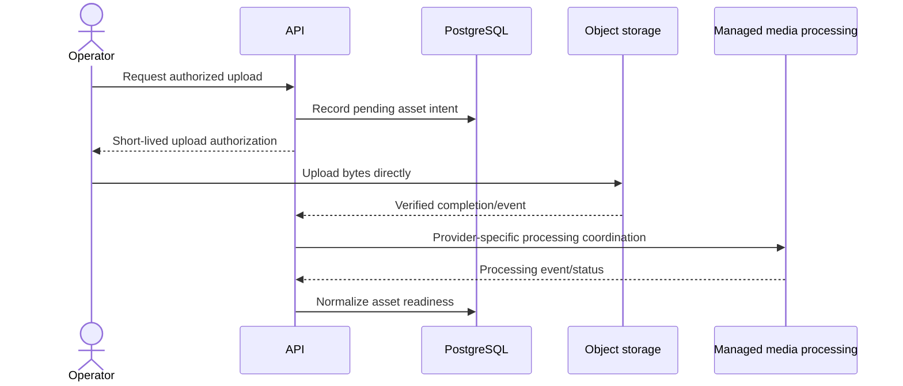

# Media Architecture and Delivery

> **Document ID:** ARCH-005 · **Status:** Architecture guidance · **Depends on:** ARCH-001–004

## Boundary and principles

The application is a metadata, workflow, and authorization coordinator. It does not store video binaries in PostgreSQL, stream raw video, proxy large uploads, or become a custom transcoding farm. Media binaries live in managed storage/delivery infrastructure; the database stores provider-neutral references, ownership, and normalized lifecycle metadata. Cloudflare Stream and R2 remain **PROVISIONAL** (ARCH-001).

Provider capabilities vary; the diagram describes responsibilities, not a selected vendor protocol.

## Ingestion and upload lifecycle

An authorized media-team operation requests an upload for a specific asset purpose and content target. The API validates actor permission, expected purpose, upload policy, and target lifecycle, then issues a short-lived, narrowly scoped upload authorization. Large bytes travel directly between client and storage. The server must not expose reusable storage credentials or allow arbitrary destination keys.

The domain tracks an upload intent and correlates verified completion with the intended object. A client-side “upload finished” signal alone is insufficient proof that an object exists and matches the target. Completion verification may use a trusted storage callback or server-side metadata check, depending on provider capability. Expired, abandoned, mismatched, or duplicate completions are safe to retry and do not make content public.

Media states should distinguish at minimum a pending upload, uploaded/awaiting validation, processing, ready, failed, and retired/superseded concepts; the exact state machine is **PROVISIONAL** until provider capability and workflow are validated. Keep transitions explicit, monotonic where possible, and auditable. A ready asset requires applicable media metadata and provider confirmation, not merely a database flag set by the browser.

## Assets, editions, and content identity

Assets have an intended role (artwork, source master, playback output, download package, or other approved purpose), a provider-neutral asset identity, content association, observed technical metadata, and normalized state. Store provider-specific ids and raw webhook details only within infrastructure boundaries with restricted access. Avoid persisting signed delivery URLs as durable asset identity.

A movie edition identifies a distinct presentation whose audio/video may be a separate packaged asset. An existing edition must not silently point to a different editorial cut or embedded voice mix when that would alter what a customer purchased. Replacement, supersession, and historical playback rules are **REQUIRES VALIDATION**. Series/season/episode assets are associated at the level approved by the content model; do not assume series-wide DJ continuity.

## Validation and processing

Validate declared file purpose, measured size/type, object ownership, and required metadata server-side. Exact codec, resolution, duration, image dimensions, file size, malware inspection, and quality thresholds are **REQUIRES VALIDATION**; no unsupported media profile is prescribed here. Keep unreviewed uploads private. Processing uses managed provider capability consistent with ARCH-001; no self-hosted transcoding cluster is approved.

Processing callbacks are authenticated, correlated to an asset and expected transition, deduplicated, and treated as at-least-once delivery. A transient provider failure may be retried or reconciled by querying provider state. Permanent failures remain visible to operators with a recoverable action; do not mark an asset ready on timeout. Provider outages must not corrupt content identity or cause public access to incomplete assets.

## Playback authorization and delivery

Playback flow: authenticate caller; load the requested resource/edition; evaluate entitlement/access validity, content/media availability, account concurrent-stream limit, and requested operation; then issue short-lived, cryptographically protected access scoped to the specific media resource and streaming operation. Authorization denial must not reveal protected origin identifiers. Every edition switch is separately checked against access scope. Backend authorization precedes media access; the CDN/provider delivers the bytes. The application does not proxy heavy video bytes.

Streaming access supports normal HTTP Range requests needed for player seeking and resume. A valid short-lived authorization may be used for multiple Range requests in that playback session. Expiry prevents new access; it cannot remove bytes already buffered by a client. Exact TTL and reuse policies remain **PENDING**. Do not bind tokens permanently to IP by default. Device count, session count, and active stream count are distinct; active streams use backend leases/heartbeats, and stale streams are released after lease expiry. Concurrent-stream enforcement is atomic and applies to individual purchases as well as subscription access. CDN cache behavior must not make private manifests or protected assets public.

Media tokens are cryptographically protected, expire, and are scoped to a specific media resource and intended operation. They must not contain unnecessary customer data or be modifiable to authorize another resource. Token values are never logged. Signed short-lived access is an authorization mechanism, not DRM and not a guarantee against copying or piracy.

Download authorization is distinct from streaming. For every download request, the backend checks authentication, entitlement, download eligibility, and applicable quota before issuing protected access. Quota enforcement is atomic and follows ARCH-006: `UNIQUE_TITLES` counts a title once; `DOWNLOAD_ACTIONS` counts each authorized download attempt. A UI click alone consumes no quota. Attempts are auditable; provider delivery failure is distinguished from customer interruption and handled by explicit retry rules. Frontend displays backend-reported usage only. Download licensing/DRM details remain **REQUIRES VALIDATION**; protected URLs are not unrestricted permanent access.

## Failure handling, cleanup, and provider replacement

Upload interruption, duplicate completion, processing delay, callback loss, provider outage, expired authorization, and corrupted metadata are explicit operational cases. Retriable operations are idempotent and bounded; a reconciliation process can compare local state with provider state. Cleanup may delete abandoned objects only after a defined retention and reference check. Cleanup window and deletion semantics are **UNKNOWN** until approved.

Keep domain contracts expressed in terms of asset identity, state, and authorized playback capability. A provider adapter translates provider APIs, identifiers, webhook signatures, and URL formats. Replacing a vendor may require reprocessing/migration of media, but must not rewrite catalog, payment, or entitlement semantics. Cloudflare Stream/R2 stay **PROVISIONAL** pending cost, feature, upload, and playback validation.

## Related documents

ARCH-001 media separation · ARCH-002 domain ownership · ARCH-003 security · ARCH-006 entitlement checks · ARCH-007 durable processing · ARCH-009 CDN/performance · ARCH-014 recovery.
