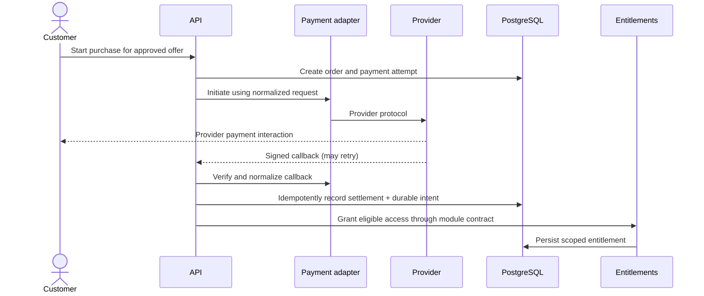

# Payment and Entitlement Architecture

> **Document ID:** ARCH-006 · **Status:** Architecture guidance · **Depends on:** ARCH-001–005

## Core separation

Payment answers whether a requested amount was collected. Order records the commercial request and immutable amount/currency snapshot. Entitlement answers what a customer may access, for which resource/capability, and under what validity conditions. These are separate domain records and lifecycles. **Payment success never means access forever.** Launch market is Tanzania and currency is TZS; pricing, taxes, fees, and provider remain unresolved. Refund/chargeback features are **DEFERRED outside V1**.

External calls must not occur while holding database locks. Settlement and durable follow-up work must be transactionally recorded so process failure cannot lose a grant decision.

## Purchase, order, and payment lifecycle

Customers authenticate before initiating or completing purchases; guest checkout is not supported. Before collection, the server resolves an Admin-managed valid offer, authenticated owner, amount, TZS currency, and applicable commercial-term version. The client is not authoritative for price or target ownership. Supported content purchase units are movie, episode, season, and full series where applicable. Flexible series hierarchies do not require every level; season access covers eligible episodes in that season, and full-series access covers eligible seasons/episodes.

An order records the requested item/access intent and immutable monetary snapshot. A payment intent requests collection through one configured provider. A payment attempt records each attempt and normalized provider reference/status. Core payment states are exactly `PENDING`, `SUCCEEDED`, `FAILED`, `CANCELLED`, and `EXPIRED`; provider-specific states map to these values in the adapter. Never overwrite earlier attempts to make the order appear to have had only one outcome. Fulfillment-processing status is separate from payment state.

The core payment states are `PENDING`, `SUCCEEDED`, `FAILED`, `CANCELLED`, and `EXPIRED`; provider-specific states map to these values in the adapter. Only `SUCCEEDED` can trigger fulfillment; late/out-of-order events cannot regress a successful state. Provider is **PENDING** selection after evaluation of integration, settlement, fees, reliability, KYC/business requirements, webhook and reconciliation capabilities, and operational constraints. Provider names, error codes, and payloads do not enter core domain rules.

## Webhook verification, idempotency, and reconciliation

Verify callback signatures against the exact representation required by the provider before interpreting business fields. Check timestamp/replay evidence when supported, correlate provider merchant/reference identifiers to a locally known attempt, and reject or quarantine unmatched callbacks. Persist provider event identity (or a safe equivalent) under a uniqueness constraint. Repeated callbacks return a successful acknowledgement once safely handled, without duplicate settlement, entitlement, or notification effects.

Settlement is a guarded state transition. Verified provider confirmation is authoritative for payment success; frontend redirects/callbacks are not. A successful payment must match its payment attempt, order, customer, expected amount, TZS currency, provider reference, and applicable state. A wrong amount cannot grant the intended higher-value access. The customer receives access once the system securely establishes successful payment for the valid order, even if browser redirect, frontend callback, or fulfillment processing fails. Reconciliation detects missing/delayed webhook processing and successful payments with incomplete fulfillment. Raw callback storage and retention are minimized and access-controlled.

Expose payment and fulfillment as separate customer-facing status facts: payment succeeded; access still processing; access available; or fulfillment failure requiring operational recovery. A successful payment with delayed fulfillment must never be shown as a failed payment or require another purchase. Fulfillment work is recoverable and notifications are emitted after the relevant transaction commits (ARCH-007/008).

## Entitlement lifecycle and access evaluation

An individual entitlement is an explicit grant to a customer for a target resource and capability, with source, status, audit context, backend-owned `starts_at` and `expires_at`. Its configured duration starts immediately after successful payment and entitlement activation, never on first use. Failed or pending payment never starts the clock. Access expiry is checked at authorization time; catalog unpublish/archive does not itself revoke an existing valid entitlement. Revocation is exceptional, separate, authorized, reasoned, audited, and accompanied by customer notification.

Access evaluation considers identity, resource, capability, entitlement status and time window, resource/media availability, account concurrent-stream limit, and eligible subscription access. Catalog visibility and entitlement status are separate: unpublish removes public discovery; archive retires from active catalog; both preserve existing valid access. `Content unavailable` is not `Entitlement expired/revoked`. Delete cannot silently erase commercial/audit history. Revocation is not automatic on unpublish/archive/delete. Expiry is checked when authorizing media; already-issued short-lived access may remain usable until expiry, and expiry cannot retract already buffered bytes.

Manual grants/revocations, if permitted, require an authorized actor, reason, target, and immutable audit event. Entitlements are not deleted merely to hide revoked/expired history. Deduplication key and treatment of repeated valid purchases are **REQUIRES VALIDATION**.

## Subscription purchase and immutable terms

Subscriptions are confirmed one-time/manual purchases with no automatic recurring billing. Admin alone manages plan price, duration, active state, eligible catalog, streaming policy, download limit and type, device policy, and concurrent-stream policy. Each plan configuration that can be purchased has an immutable policy/version identity. A successful purchase captures an immutable snapshot of price, currency, duration/validity, download limit/type, applicable policy/version, and where applicable device/concurrent-stream policy. Plan changes affect future purchases only. After expiry, manual renewal purchases the then-current terms.

An active purchased subscription grants unlimited streaming/viewing of eligible catalog content during its validity period. Subscription downloads are limited according to the purchased terms and the atomic quota rules in ARCH-005. Subscription expiry ends subscription-based access but does not revoke individually purchased entitlements. Device, session, and active-stream counts remain separate; subscription expiry does not remove registered devices. Exact plan version representation and download retry edge cases remain **PENDING**.

## V1 refund scope

Refunds, partial refunds, chargebacks, and refund-specific entitlement workflows are **DEFERRED and outside V1**. Do not design refund UI, workflows, state machines, services, or tables unless required by the generic payment architecture. Preserve immutable payment/order/entitlement history, auditability, and provider-agnostic boundaries so a future separately approved capability remains possible. No refund or compensation behavior is implied.

## Consistency, concurrency, and audit

Use database constraints and transactions to prevent duplicate provider references and inconsistent settlement/grant state. Where possible, record verified success, order confirmation, entitlement grant, and durable follow-up atomically within PostgreSQL while preserving module ownership through exported domain operations. If all fulfillment cannot be completed in that transaction, atomically persist success plus a durable outbox/job intent. Fulfillment is idempotent, retryable, and recoverable; duplicate webhooks/jobs cannot create duplicate entitlements. Keep `SUCCEEDED` payment distinguishable from fulfillment pending, available, or operational recovery failure. Reconciliation finds succeeded payments with missing/incomplete fulfillment and safely retries without charging again. Emit notifications only after the relevant transaction commits. Lock or conditionally transition only the affected order/attempt; avoid a global payment lock. Concurrent callback/status requests must converge on one canonical transition.

Record actor/source, provider event reference, transition, timestamp, and correlation ID without logging credentials or unnecessary payment data (ARCH-010). Purpose-based preservation of commercial/security records is accepted; exact financial retention durations and operational reconciliation ownership remain policy decisions.

## Related documents

ARCH-001 payment abstraction · ARCH-002 domain model · ARCH-003 webhook/security · ARCH-007 jobs/retries · ARCH-010 audit · ARCH-011 tests.
