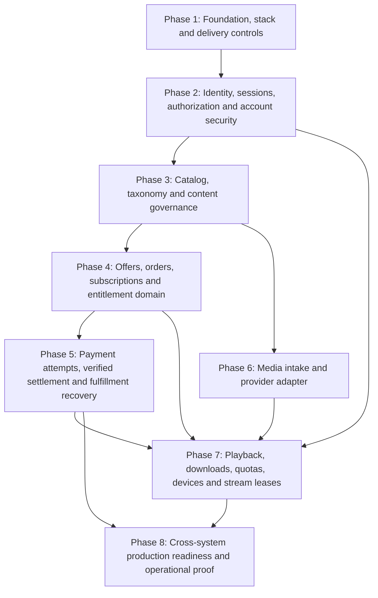

# Backend Implementation Plan

> **Document ID:** ARCH-017 · **Status:** Planning proposal · **Authority:** ARCH-001–016 and accepted product decisions · **Scope:** Backend sequencing only

## 1. Purpose and constraints

This document converts the accepted architecture into a dependency-aware implementation sequence. It is a planning artifact, not authorization to begin implementation. ARCH-001 remains the architectural foundation; product behavior is governed by ARCH-002–016 and the accepted clarification decisions recorded there. `docs/frontend/UI-FIXES-AND-ALIGNMENT.md` is reference material for later frontend integration, not a backend contract.

No application code, migrations, provider integration, frontend changes, or infrastructure changes are in scope here. NestJS/Fastify, Drizzle, Cloudflare Stream/R2, payment provider, hosting, and numerical performance targets retain their existing statuses. The plan treats provider selection and policy values as gates for the capabilities they affect, rather than selecting them by implication.

Where repository documents conflict, this plan records a blocker and does not create a new product rule. In particular, ARCH-002 still describes publication readiness as depending on a “yet-to-be-approved readiness policy,” while ARCH-016 and the accepted decision state that readiness requirements are fixed by the backend and publication requires 100% server-validated readiness. That sentence must be reconciled before implementing content publishing (Phase 3). ARCH-002 also conditions targetable entitlements on purchase units being confirmed even though the purchase units are confirmed; correct that stale qualifier before Phase 4. These are documentation blockers, not permission to infer a replacement rule.

## 2. Architecture-to-implementation dependency map

| Capability | Owns / provides | Depends on | Critical boundary |
| --- | --- | --- | --- |
| Foundation | Configuration, database access boundary, API validation/errors, request correlation, health and quality gates | Accepted runtime/persistence choices; PostgreSQL access | No domain module bypasses its own contracts or writes another module’s records. |
| Identity and security | Accounts, verification, recovery, sessions, devices, roles/capabilities, object authorization | Foundation; email delivery port for account messages | Opaque server session is authoritative; UI visibility is not authorization. |
| Catalog and governance | Flexible content hierarchy, editions, taxonomy, readiness, publication, staff workflow | Identity/authorization; audit capability | Catalog availability is separate from entitlement validity. |
| Commerce and entitlements | Admin offers, orders, subscription plans/versions, purchase terms, access grants/policies | Identity, catalog purchasable resources, audit, durable transaction support | Order, payment, fulfillment, entitlement and subscription period remain distinct concepts. |
| Payment and fulfillment | Payment attempts, normalized state, verified provider events, durable fulfillment/reconciliation | Commerce model; selected provider before live integration | External calls never run inside database transactions; success is authoritative and idempotently fulfilled. |
| Media intake | Upload intents, asset metadata/lifecycle, processing coordination | Identity/capabilities, catalog, selected storage/media provider for live operation | Application coordinates metadata and authorization; provider stores/processes media. |
| Playback and downloads | Access checks, device/stream enforcement, media grants, download quota, progress | Identity, entitlements, catalog, media assets and provider, durable audit | Backend owns every authorization/quota decision; media bytes stay off application compute. |
| Production readiness | Release, restore, alerting, workload measurement, end-to-end proof | All production capabilities and selected providers/hosting | Backups do not establish recovery targets; prove restore and record RPO/RTO. |

Email and in-app notification capabilities are built where their confirmed use cases first occur: account verification/recovery in Phase 2, taxonomy review in Phase 3, payment/fulfillment outcomes in Phase 5. Event/recipient/channel mappings beyond already-confirmed workflows remain pending; do not add triggers by analogy.

## 3. Reusable phase operating loop

Every phase follows the required loop, with a gate that prevents scope from accumulating across unstable phases:

**BUILD → FUNCTIONAL TEST → SECURITY TEST → FIX → RETEST → REGRESSION → DOCUMENT → GATE → NEXT PHASE**

Functional tests establish domain behavior and failure handling. Security tests attempt to bypass the relevant trust boundary. Fixes are followed by targeted retests and the complete regression suite from all prior phases. Documentation is updated from the implemented behavior and approved decisions. The exit gate is recorded before work begins on a dependent phase. A failed gate returns the phase to fix/retest; it does not defer known failures to a final hardening pass.

## 4. Reusable Definition of Done (DoD)

Apply this checklist to every phase, adding the phase-specific checks listed below.

- **Code quality:** Typecheck, lint, and production build pass. Responsibilities remain focused; module ownership and exported contracts are clear. No avoidable dead code, duplication, or oversized service/controller has been introduced. Temporary debt is labeled `TODO: [ARCH-DEBT]`, documented with an owner/condition and remediation path.
- **Functional behavior:** Happy paths, validation failures, relevant negative paths, and expected state transitions are tested. Business rules are tested without network dependencies. Error/status behavior is deliberate.
- **Security:** Backend authorization is exercised for allowed and denied actors/resources. Phase-relevant abuse cases are tested. No known unresolved critical/high security defect remains; sensitive data is not exposed in responses, logs, traces, or examples.
- **Database:** PostgreSQL constraints, delete behavior, indexes, transaction boundaries, and concurrency properties are reviewed and tested where introduced. Migrations are reviewed, repeatable, observable, and compatible with the documented rollout/rollback strategy.
- **API:** OpenAPI is updated from the actual implementation. Authentication and capability requirements, request/response schemas, status codes, validation and error responses, pagination/idempotency behavior, and examples where useful match the live contract.
- **Regression:** All previous phase unit, database integration, HTTP/API, security, and contract tests pass.
- **Operations:** Structured logs and request correlation are usable; required audit records exist; errors are visible. Durable jobs introduced by the phase are bounded, idempotent, retryable, and recoverable, with observable attempt state.
- **Performance/resource safety:** Lists and expensive inputs are bounded; query shape, indexes, payload projection, connection use, and resource limits are reviewed. Measurements are recorded for meaningful hot paths without claiming unsupported universal targets.
- **Documentation:** Applicable architecture/phase documents, OpenAPI, configuration notes, operational notes, security findings, known limitations, and pending decisions are updated. No pending decision is presented as resolved without approval and an ADR update.
- **Gate record:** The phase owner records scope, evidence, known limitations, unresolved non-blocking work, and an explicit pass/fail decision.

## 5. Recommended implementation phases

### Phase 1 — Backend foundation and implementation-tool validation

**Objective:** Establish a deployable, verifiable backend foundation and resolve provisional implementation tooling before domain schema work begins. Completion yields a small service that starts with validated configuration, connects to PostgreSQL, exposes the agreed API envelope/health behavior, and passes automated quality gates; it is not a customer feature release.

**Scope:** Confirm NestJS + Fastify through a small representative spike and record the decision in ARCH-015; evaluate Drizzle (or an alternative) for PostgreSQL constraints, transactions, migration workflow, and team operability, then record the decision before domain schema implementation. Establish module/folder conventions, strict TypeScript/build/lint/typecheck, typed startup configuration validation, dependency boundaries, database connection/pool ownership, centralized errors, request/correlation IDs, versioning/validation approach, liveness/readiness, structured redacted logs, migration review/run ownership, CI quality gates, and unit/integration/HTTP test harness. Use PostgreSQL for database integration tests. Do not add domain CRUD or prebuild a generic job framework without its first real consumer.

**Dependencies:** Architecture docs reviewed; product ambiguity phase closed for accepted behavior. Stack selection is a Phase 1 decision because NestJS/Fastify and Drizzle remain provisional. Database engine is accepted. If evaluation rejects a provisional choice, update the ADR and dependent implementation plan before proceeding.

**Database impact:** No domain schema. Validate connection management, transactional API capability, migration generation/review/ordering and rollback/forward-fix documentation with a minimal disposable schema or test fixture only if needed for tool evaluation; this is not a production domain migration. Define how generated migration artifacts are reviewed and how one coordinated process applies them.

**API surface:** Establish version prefix, uniform success/error envelope, validation behavior, request ID behavior, health/readiness contract, and OpenAPI generation workflow. No business resource endpoints.

**Security:** Fail startup on missing/invalid required production configuration; redact errors; bound request bodies; set trusted proxy/origin assumptions explicitly; do not expose secrets in logs or health endpoints. Establish CSRF/CORS/security-header implementation approach for later authenticated routes.

**Async/background work:** None beyond process lifecycle. Document the durable PostgreSQL outbox/job pattern for its first use; do not build an unused worker framework.

**External dependencies:** PostgreSQL is required. NestJS/Fastify and Drizzle are provisional and must be decided by recorded evaluation. Hosting and secrets vendor remain pending; local/CI execution must not assume a production vendor.

**Testing:** Unit tests for configuration parsing/error redaction and common response behavior; PostgreSQL integration test for connectivity and transaction/migration harness; HTTP tests for health, versioning, validation, error envelope and request ID; build/lint/typecheck CI gates.

**Security testing:** Invalid/missing secrets, accidental secret exposure, oversized/malformed input, spoofed forwarding/request IDs, origin/CORS behavior, health endpoint information leakage, dependency and build artifact secret scanning at the level supported by the selected tooling.

**Documentation:** Create this plan’s Phase 1 execution record; update ARCH-015 with stack and persistence decision/evidence; document local/test configuration, migration workflow, API bootstrap/OpenAPI conventions, and any security findings. Preserve other pending decisions.

**Phase-specific DoD:** Reusable DoD plus reproducible clean startup in development/test, deterministic configuration failure, successful PostgreSQL integration, documented migration ownership, and confirmed provisional-tool decisions in ADRs.

**Exit gate:** Architecture and provisional-tool decisions are recorded; quality gates run reliably; no critical/high foundation security issue is open; database tests and migration review procedure are reproducible. Do not begin domain schema work while the persistence/migration decision is unresolved.

#### Phase 1 Execution Record & Exit Gate Status
* **Status:** **PHASE 1 COMPLETE — READY FOR REVIEW**
* **Evaluated Choices:**
  * **ADR-003 (NestJS + Fastify):** Validated in foundation spike. High-performance Fastify adapter, strict CORS/Helmet, global validation pipe, standard error envelopes, and correlation ID tracking verified. Status promoted to **ACCEPTED**.
  * **ADR-005 (Drizzle ORM + PostgreSQL Pool):** Validated via `pg.Pool` connection management, typed SQL queries, and disposable fixture migrations (`drizzle-kit`). Domain invariants remain strictly decoupled from persistence. Status promoted to **ACCEPTED**.
* **Automated Quality Gates:**
  * `pnpm run build`: Clean TypeScript compilation with zero errors (`tsc -p tsconfig.build.json`).
  * `pnpm run typecheck`: Strict mode verification passed (`tsc --noEmit -p tsconfig.json`).
  * `pnpm run lint`: ESLint with strict TypeScript rules passed cleanly (`eslint .`).
  * `pnpm run test`: 11 passing automated unit, environment, and HTTP foundation tests; 0 failing; 1 disposable DB integration test gracefully skipped when external DB is unconfigured.
* **Security & Operational Boundaries:**
  * Startup fails fast on invalid or missing environment variables with credentials redacted from error logs.
  * Payloads strictly bounded; oversized inputs rejected with `413 PAYLOAD_TOO_LARGE`; malformed JSON caught without exposing internal stack traces.
  * Sensitive keys (`password`, `token`, `secret`, `authorization`, `cookie`) redacted recursively in structured Pino logs.
  * Clean scope containment: Zero Phase 2 domain entities, authentication flows, or business tables introduced.

### Phase 2 — Accounts, authentication, sessions, devices, and authorization foundation

**Objective:** Provide trustworthy customer/staff identity and backend-enforced authorization for all later business capabilities.

**Scope:** Customer registration, email verification, login/logout/logout-all, password recovery/reset, account status, opaque database-backed independently revocable sessions, accepted session invalidation behavior, session rotation at authentication/security transitions, recognized-device registration/removal, roles and capability checks, resource ownership checks, admin/staff account operations within approved boundaries, sensitive-operation reauthentication hooks, security/audit events, and the email delivery port plus persistent in-app notification storage/read/history primitives needed by confirmed workflows. No unapproved event mapping or notification preference behavior is implied.

**Dependencies:** Phase 1. Before finalizing account state and purchase authorization, resolve whether unverified pending accounts may authenticate and which actions they may take. Resolve role cardinality where schema/assignment rules depend on it. Exact session inactivity/absolute durations are policy/configuration values; they must be approved before production but may be configuration-driven during implementation. Admin-configured device capacity is required before device admission policy is live.

**Database impact:** Identity/account state; password hash and verification/reset token records or equivalent secure token representation; session records and revocation/expiry indexes; recognized devices; role/capability assignments; notification history/read state; security/audit events. Separate transient token/session cleanup from account deletion and commercial history. No cascade deletion of all account-related records.

**API surface:** Account registration/verification/login/logout/logout-all; password recovery/reset; current authenticated account/session context; device list/register/remove; administrative account/status and role/capability operations within confirmed policy; notification history/read operations only as backend-owned persistent primitives. Exact paths are determined during implementation and documented in OpenAPI, not prescribed here.

**Security:** Cookie is opaque, HttpOnly, Secure, narrowly scoped and uses an appropriate SameSite policy; enforce inactivity and absolute timeouts server-side. Regenerate session identifiers; invalidate all sessions on logout-all and password reset/security recovery. Remove device revokes associated sessions. Protect CSRF, CORS, credential stuffing, account enumeration, reset/verification replay, session fixation/theft, privilege escalation, and BOLA/IDOR. Media Team cannot query customer personal/account records through staff APIs. Admin/Media Team sensitive actions apply approved reauthentication controls.

**Async/background work:** Verification and recovery email delivery use durable jobs/outbox, with idempotent token consumption and bounded retry. Persistent in-app notifications are records, not transient toasts. Cleanup of expired sessions/tokens is safe to defer until the retention/operations policy establishes execution cadence; expired records must still be rejected synchronously.

**External dependencies:** Email provider is not selected; implement a domain-owned delivery interface and test adapter. Do not use SMS. Database sessions and PostgreSQL are accepted.

**Testing:** Domain unit tests for token lifecycle, session revocation and capability evaluation; PostgreSQL tests for uniqueness, one-time token use, expiry, logout-all, password-reset invalidation, device/session relation and concurrent device registration; API tests for anonymous/authenticated/verified/unverified paths once policy is resolved; regression of Phase 1.

**Security testing:** Authentication bypass, brute-force/rate abuse, account enumeration, CSRF, session fixation/replay/manipulation, cookie flags/scope, stale session use, reset/verification token replay, privilege escalation, cross-account device/session BOLA, customer-data access by Media Team, secret/token leakage.

**Documentation:** Update ARCH-003/004/008/010/012, OpenAPI, identity/session policy configuration notes, security findings and the phase record. Record unresolved role-cardinality and unverified-account policy if not settled; do not proceed to purchase enforcement with an ambiguous verified-account gate.

**Phase-specific DoD:** Reusable DoD plus session, reset, device, account and capability invariants proven against PostgreSQL and HTTP boundary; every administrative/account operation has actor and audit treatment.

**Exit gate:** Customer and staff identity flows are secure and stable; authorization is enforced server-side; session and device operations are atomic and independently represented. Purchase authentication policy and account/role data shape are resolved before Phase 4.

### Phase 3 — Catalog, taxonomy governance, and content lifecycle

**Objective:** Let authorized staff create and govern the flexible catalog, and provide customer-facing discovery over published content.

**Scope:** Movies, movie editions, series, optional seasons/episodes, categories, countries, DJs/commentators/translators, taxonomy requests and Admin review, content metadata, content statuses Draft → In Progress → Ready → Published, backend-fixed per-type readiness checklist and 100% revalidation on publish, capability-based Media Team operations, Admin pricing ownership boundary (commercial management is introduced with offers in Phase 4), unpublish/archive/delete safeguards, public catalog/search/detail/list contracts, and catalog audit. Content lifecycle never implicitly removes a valid entitlement; exceptional access revoke remains separate.

**Dependencies:** Phase 1 and 2; readiness wording conflict in ARCH-002 must be reconciled first. Content-type readiness rules must be specified sufficiently to implement fixed backend criteria; if exact checklist is not present in accepted product requirements, obtain owner clarification rather than inventing fields. Taxonomy request approval flow and audit are accepted.

**Database impact:** Flexible content hierarchy, edition identity and media references, controlled taxonomy and request/review history, publication/readiness state, actor/audit history, commercial-safety references for purchase/order/entitlement checks. Model optional hierarchy without assuming every series has every level. Use restrictive deletion/archival for referenced records. PostgreSQL full-text search direction is accepted; searchable fields/ranking/language remain pending.

**API surface:** Admin/Media Team content management and readiness/publish lifecycle; taxonomy request/review; customer catalog browse/search/detail with bounded pagination and selective projections. Paths and exact filter/sort parameters are derived from actual UI/product contracts during implementation.

**Security:** Capability checks on every operation; object-level scope; public reads only published/visible items; Admin-only canonical taxonomy/pricing/account boundaries; Media Team cannot create canonical taxonomy or modify prices; protect destructive operations from commercial history loss; reject publication when readiness fails even if UI reports 100%.

**Async/background work:** Persistent Admin notification for taxonomy requests through existing notification capability; trigger mapping is limited to this confirmed workflow. Search indexing may use PostgreSQL native facilities; do not introduce external search. No heavy processing before media provider phase.

**External dependencies:** PostgreSQL FTS is initial direction; exact language/ranking remain pending. Media asset state can be represented provider-independently; no live media provider required for catalog metadata.

**Testing:** Domain tests for flexible hierarchy, readiness by content type, publication, taxonomy workflow and lifecycle; DB constraints and commercial reference protections; API permission/status tests; search/pagination query tests; regression.

**Security testing:** Staff privilege escalation, cross-content BOLA, unauthorized draft disclosure, publish without capability/readiness, taxonomy direct-write bypass, unpublish/archive/delete against purchased/pending commercial records, mass-assignment/validation, search-based data exposure/resource exhaustion.

**Documentation:** Reconcile ARCH-002 readiness wording; update ARCH-004/009/010/011 and OpenAPI; add approved content lifecycle/readiness definitions to phase record; record search language/ranking as pending.

**Phase-specific DoD:** Reusable DoD plus approved per-type readiness behavior, auditable taxonomy review, safe lifecycle behavior, and query plans/index rationale for actual browse/search operations.

**Exit gate:** No content can be published without backend readiness and authorization; customer discovery exposes only intended published content; unpublish/archive/delete and entitlement lifecycle remain separate. Do not enter commerce work until purchasable content target IDs and hierarchy resolution are stable.

#### Phase 3 Execution Record & Exit Gate Status
* **Status:** **PHASE 3C COMPLETE — ACCEPTED BY PRODUCT OWNER & CLOSED**
* **Evaluated & Verified Choices:**
  * **ADR-031 (9-Point Readiness Checklist & Approval Gate):** Implemented in `PublishingReadinessService` and `CatalogService`. Verified in automated unit, functional (37/37 pass), and adversarial (26/26 pass) test suites. Status promoted to **ACCEPTED**.
  * **ADR-032 (Multi-Edition DJ Architecture & Series Hierarchy):** Implemented in `MovieEditionService`, `episodesTable`, `movieEditionsTable`. Outage fallback Cases A & B and canonical row locking protocol verified under concurrent load. Status promoted to **ACCEPTED**.
  * **ADR-033 (Taxonomy Governance & Smart Deletion Safeguards):** Implemented in `CatalogTaxonomyService` and `categoriesTable` / `countriesTable` / `djVoiceArtistsTable`. Verified 409 Conflict deletion safeguards and safe deactivation. Status promoted to **ACCEPTED**.
  * **ADR-034 (Option C Polymorphic Domain Integrity):** Implemented via transactional application validation with canonical row locking. Direct-SQL residual risk explicitly accepted by Product Owner. Status: **ACCEPTED by Product Owner**.
* **Automated Quality Gates:**
  * `pnpm run build`: PASS (Exit 0)
  * `pnpm run typecheck`: PASS (Exit 0)
  * `pnpm run lint`: PASS (Exit 0)
  * `pnpm run test`: Full regression suite passes (248 PASS / 0 FAIL / 1 SKIPPED across 249 tests).
* **Boundaries & Scope Containment:**
  * Zero scope contamination from Phase 4+ (no commerce, pricing, payments, or DRM code).
  * Phase 3C formally closed on 2026-10-06. Ready for Phase 4 authorization.

### Phase 4 — Commercial offers, orders, finite access plans, and entitlement rules

**Objective:** Define the server-owned commercial transaction and access rules independently of any payment vendor.

**Scope:** Admin-controlled offers for exactly MOVIE, SERIES, SEASON, EPISODE, and CATALOG scopes; finite-duration Admin-defined access plans with immutable versions; purchase orders and policy snapshots; catalog eligibility; individual access starts at entitlement activation and has backend-owned finite expiry; grants/revocation; access evaluation; commercial status and audit. V1 access-plan duration units are HOUR and DAY. No recurring plan or auto-billing model and no refund/chargeback workflow.

**Dependencies:** Phases 1–3. Purchases require verified authenticated customer accounts. Preserve exact-target entitlement uniqueness and extension/idempotency semantics. Currency is integer TZS (`1` stored unit = `1` TZS); tax treatment remains outside this schema design. This phase may define payment-ready orders before a provider is chosen.

**Database impact:** `access_plans`, immutable `plan_versions`, `offers`, `offer_catalog_policy_category_members`, `offer_catalog_policy_content_members`, order-owned `commercial_policy_snapshots` and their category/content members, `orders`, `payment_attempts`, `settlements`, `fulfillments`, `entitlements`, and `entitlement_order_effects`; one purchase per order (no order items). Constraints preserve immutable purchased terms and separate catalog state, payment state, fulfillment state, and grant state. The [Phase 4 schema design](./PHASE_4_SCHEMA_DESIGN.md) records the approved entity and state contract. The [Phase 4 migration plan](./PHASE_4_MIGRATION_PLAN.md) maps that contract onto the actual Phase 3C migration head at `0004`; it is planning only and does not authorize migration or implementation.

**API surface:** Admin offer/access-plan management; verified customer offer quote and order creation/status; customer-owned entitlement/library view; access evaluation contract for internal Playback module. No guessed endpoint paths. Never accept client-supplied authoritative price, terms, expiry, or eligibility.

**Security:** Verified, authenticated and non-suspended customer purchase; ownership enforcement on orders/entitlements/library; Admin-only commercial edits; immutable snapshot protection; avoid price tampering/replay; audit manual grant/revoke and plan edits; prevent access checks from leaking another account’s library.

**Async/background work:** No payment fulfillment yet. Durable events may be recorded only as needed for later payment integration; do not mark an order paid from client actions. Expiry is evaluated from server-owned timestamps; a cleanup job is not required for correctness.

**External dependencies:** No live payment provider required. Provider selection becomes a hard blocker at the start of Phase 5 live payment work. Drizzle/query layer decision must already be recorded in Phase 1.

**Testing:** Unit tests for eligibility, scope inheritance (movie editions, series/season/episode hierarchy, and catalog policy), immutable plan-version terms, finite expiry and exact-target extension, integer TZS snapshots, and lifecycle-independent access; PostgreSQL constraints and transaction tests; owner/Admin API tests; concurrency tests for duplicate order/grant attempts; regression.

**Security testing:** Price/term tampering, cross-customer order BOLA, unauthorized Admin pricing, duplicate request/replay, privilege escalation, access through unpublished/archived content where entitlement remains valid, entitlement overgrant through hierarchy confusion.

**Documentation:** Update ARCH-002/004/006/015/016 and OpenAPI; document approved exact-target uniqueness and entitlement effect idempotency; preserve refund feature as deferred.

**Phase-specific DoD:** Reusable DoD plus immutable commercial snapshot verification and successful tests demonstrating catalog unpublish/archive does not revoke valid customer access.

**Exit gate:** Order and entitlement behavior is explicit, auditable, provider-independent, and constraint-backed. No paid access can be granted from a frontend claim. Resolve every entitlement uniqueness and verified-account blocker before Phase 5 fulfillment.

### Phase 5 — Payment attempts, verified settlement, fulfillment, and reconciliation

**Objective:** Accept provider-confirmed payments and reliably grant the corresponding access despite duplicate, delayed, missing, or retried callbacks/jobs.

**Scope:** Provider adapter contract; payment attempts and normalized states `PENDING`, `SUCCEEDED`, `FAILED`, `CANCELLED`, `EXPIRED`; webhook authenticity/replay verification; durable webhook receipt where appropriate; amount/currency/customer/order/reference validation; controlled non-regressing state transitions; atomic payment/order/fulfillment state changes where possible; transactional outbox/job; idempotent entitlement fulfillment; recoverable operational failure state; reconciliation for success with missing/incomplete fulfillment; customer-visible distinction of paid, processing, available, and operational recovery. Notifications emitted after transaction commit. No refund/chargeback feature.

**Dependencies:** Phase 4. **Payment provider is a blocker for live integration** and must be chosen against integration, settlement, fees, reliability, KYC/business, webhook, reconciliation and operational requirements. Payment confirmation/settlement contract and applicable tax/amount rules must be approved. Provider-independent domain state, adapter contract, and test strategy can be prepared before selection, but must not be represented as production payment capability.

**Database impact:** Payment attempts, provider references and mapped state, durable webhook/event receipts, fulfillment state, outbox/job records, idempotency keys, reconciliation outcomes and audit. Unique constraints on provider/event references and fulfillment source prevent duplicate work/grants. Keep external HTTP calls outside locks/transactions. Payment SUCCEEDED remains separate from fulfillment status.

**API surface:** Authenticated checkout/payment initiation; customer order/payment/fulfillment status; provider webhook ingress; operational/admin reconciliation or exception review contract with strict role boundary. Exact path and provider payload schema are established after provider choice.

**Security:** Verify signature/authenticity using provider’s supported mechanism over the correct raw request representation; replay protection and idempotency; reject amount/currency/order/customer mismatch; never fulfill on redirect/client success; minimize raw payload retention; protect operational recovery from unauthorized grants; do not log secrets or payment credentials.

**Async/background work:** Durable webhook processing, fulfillment, email/in-app outcome intents and reconciliation use PostgreSQL-backed jobs/outbox, after-commit emission, bounded retry, observable attempts and operational recovery. Duplicate delivery is safe. No standalone queue unless measured requirements later justify it.

**External dependencies:** Provider selection required now for live behavior. Sandbox/simulation may validate the adapter contract without replacing the selected provider’s contract tests. Email vendor remains unselected behind an interface. PostgreSQL durable jobs are the accepted initial approach.

**Testing:** Domain unit tests for state transitions and mapping; PostgreSQL transaction/integration tests for settlement plus outbox, idempotent fulfillment and recovery; provider adapter contract tests; HTTP webhook tests; amount/currency/customer/order validation; concurrent duplicate webhook/job tests; missing/delayed webhook reconciliation tests; regression.

**Security testing:** Forged webhook, signature mismatch, replay, duplicate/out-of-order events, wrong amount/currency/order/customer, provider reference collision, payment-state regression, unauthorized manual recovery, job payload tampering, race conditions and sensitive payment data exposure.

**Documentation:** Update ARCH-003/004/006/007/008/010/012/013/015, provider ADR, OpenAPI, webhook runbook, reconciliation/operational recovery notes and security findings. Keep refund/chargeback deferred and provider coupling in adapters.

**Phase-specific DoD:** Reusable DoD plus demonstrated proof that a verified successful payment is never lost due to redirect failure, duplicate events never double-fulfill, and persistent failure can be safely detected/retried without asking the customer to pay again.

**Exit gate:** Provider integration is verified in its supported test environment; payment and fulfillment state are separately observable; reconciliation recovers intentionally injected missing/failed processing; no unresolved critical/high payment security defect remains.

### Phase 6 — Media intake, asset lifecycle, and processing coordination

**Objective:** Allow authorized Media Team members to stage media assets through direct-to-provider upload and track normalized processing state without coupling domain logic to a vendor.

**Scope:** Media asset metadata and linkage to content/edition/episode; upload authorization intent; direct-to-storage upload coordination; provider-neutral validation/processing state; trusted processing callbacks; replacement/supersession safeguards; failed/retryable processing state; readiness integration; operational audit. Application server does not receive bulk video bytes and no custom transcoding farm is created.

**Dependencies:** Phases 1–3. Provider adapter requires media/storage decision; Cloudflare Stream/R2 remain provisional and require capability, security, upload/playback, durability, cost and margin validation. Upload validation limits and asset replacement policy must be decided where not already specified.

**Database impact:** Asset metadata, provider-neutral asset references, upload intent/expiry, processing state/event identity, content linkage and audit; no binary media in PostgreSQL. Cleanup/retention rules for abandoned uploads remain policy work, not arbitrary TTLs.

**API surface:** Capability-protected upload intent, metadata/finalization and processing status; provider callback ingress; Admin/Media Team review surface. API returns short-lived upload grants only after authorization. Paths and exact provider payloads await adapter decision.

**Security:** Media Team capability/object checks; narrow short-lived direct upload scope; provider callbacks authenticated; validate content and upload metadata server-side; prevent public origin access; prevent replacing a media asset referenced by commercial history without a safe supersession rule; redact signed upload grants.

**Async/background work:** Provider processing notifications update durable normalized state idempotently; retries/reconciliation for processing states as provider permits. Use PostgreSQL-backed jobs when durable coordination is needed; no custom transcoder.

**External dependencies:** Selected media/storage provider required for production uploads and processing. Cloudflare remains provisional. No local application streaming/proxying.

**Testing:** Domain state transition tests; DB reference/supersession constraints; upload intent authorization and expiry tests; adapter/callback contract tests; failed/duplicate processing callback and retry tests; regression.

**Security testing:** Unauthorized upload, cross-content upload BOLA, stolen/expired presigned grant, callback forgery/replay, public-origin exposure, content-type/metadata spoofing, asset replacement abuse, sensitive signed URL leakage.

**Documentation:** Update ARCH-005/007/010/012/013/015; document chosen provider ADR and media processing state mapping; OpenAPI upload/callback contract; operations for stalled/failed assets and media recovery boundary.

**Phase-specific DoD:** Reusable DoD plus actual provider sandbox proof for upload and processing lifecycle; application process memory/network use does not carry master video payloads.

**Exit gate:** Media provider decision and secure upload/processing contract are recorded; assets become available to playback only after trusted processing and content readiness checks. Provider-independent domain tests pass regardless of adapter.

### Phase 7 — Playback, protected streaming, downloads, quota, devices, and concurrent streams

**Objective:** Enforce customer access at each media authorization request and issue protected scoped access while keeping media delivery off application compute.

**Scope:** Streaming entitlement evaluation; eligible subscription catalog checks; individual purchase grants; protected stream authorization with Range-capable playback; download eligibility and separate authorization; atomic `UNIQUE_TITLES` / `DOWNLOAD_ACTIONS` quota usage and auditable attempt ledger; device admission/removal integration; account-level concurrent stream lease/heartbeat and stale lease release; resume/progress state; distinct catalog status and entitlement status; access logging without token values.

**Dependencies:** Phases 2, 4, 5, and 6. Exact media token TTL/reuse and provider Range behavior must be validated before production access is issued. Download quota consumption/retry handling for delivery failure versus customer interruption must be resolved before finalizing attempt transitions. Offline DRM/licensing remains a separate validation gate for any offline package capability. Device/concurrent stream admin policy values must be configured; subscription-specific applicable terms come from immutable purchased terms.

**Database impact:** Stream leases/heartbeat and active/released states, download attempts/quota accounting, device linkage, access authorizations/audit, playback progress. Atomic conditional updates/locks/constraints protect device/stream/download caps. Individual purchase does not bypass account-level concurrent stream policy. Expired subscription does not remove registered devices or individual entitlements.

**API surface:** Authorization/start/heartbeat/end playback operations; separate download authorization/status; customer view/manage recognized devices and active playback sessions where appropriate; resume/progress. Exact route names are determined with API contracts. Every download request rechecks backend entitlement, policy and quota before granting access.

**Security:** Authenticate and authorize resource and operation before issuing short-lived resource-scoped protected access; no public media; token cryptographic integrity, expiry and minimal claims; do not bind permanently to IP by default; distinguish stream versus download grant; no quota bypass via direct URL; backend controls Range-capable playback session; expiry cannot revoke bytes already buffered and is not DRM.

**Async/background work:** Lease expiry/reconciliation and safe stale stream release; download delivery result reconciliation where provider can report it; bounded idempotent cleanup. Ensure job and synchronous authorization race safely. No access-critical fire-and-forget work.

**External dependencies:** Media provider remains provisional until validated; provider adapter must deliver protected bytes and required Range behavior. Offline licensing provider/DRM is pending and must not be implied by signed URLs.

**Testing:** Unit access-policy tests; PostgreSQL concurrency tests for device caps, concurrent streams, quota consumption and duplicate requests; integration tests for entitlement evaluation across individual/subscription access, expiry/revocation, content archive/unpublish, Range/provider behavior and delivery failures; API tests for limit errors and owned resources; regression.

**Security testing:** IDOR/BOLA across media resources, expired/reused/tampered/cross-resource token, direct origin bypass, subscription eligibility bypass, download quota race/replay/direct-URL bypass, device vs stream-limit confusion, lease theft/stale lease abuse, account entitlement leakage, token log leakage.

**Documentation:** Update ARCH-003/004/005/006/007/009/010/011/012/015; OpenAPI playback/download/session contracts; provider-specific Range and TTL/reuse decision; download retry/quota policy; UI alignment stays a future task.

**Phase-specific DoD:** Reusable DoD plus race tests demonstrate hard account/device/download limits, Range requests work through protected delivery, expired authorization denies new access, and no claim is made that buffered media can be recalled.

**Exit gate:** No client state or unprotected URL grants access; all access/quota/stream/device decisions are backend-authoritative and concurrency-tested; provider and unresolved media/download policy decisions are closed for the launched capability.

### Phase 8 — Integrated operational readiness and release evidence

**Objective:** Demonstrate that completed business capabilities can be operated, restored, observed and released safely at an agreed initial scale.

**Scope:** Cross-module end-to-end flows; launch notification event/channel map and approved email content; deployment and environment separation; secrets delivery/rotation ownership; graceful shutdown/job draining; migration rollout/rollback or forward-fix procedure; automated protected backups, backup failure alerts, restore runbook and periodic restore exercise; media recovery responsibility; health/operational alerts; workload measurement for API/database/jobs/media authorization; cost and pool capacity review; security review and incident procedures.

**Dependencies:** All launched feature phases and selections for payment/media/hosting/email. Define production RPO/RTO before claiming recovery readiness; establish exact retention policy values and operational owners. Production readiness does not retroactively invent product behavior.

**Database impact:** Verify backup/restore, constraints after restore, migration ordering and data integrity; do not add a second database or read replica without measured need. Test anonymization/deletion against preserved commercial/audit records when policy is approved.

**API surface:** Final cross-phase OpenAPI review, operational health/readiness and documented error contracts; no public operational/admin endpoint absent an approved need. Confirm CORS, cache, request sizing, pagination and rate controls against deployment boundaries.

**Security:** Production secret isolation, least privilege, trusted proxy/origin, cookie policy, webhook secrets, media signing key controls, backup access controls/encryption, log redaction, staff/admin access, incident response and restore environment isolation.

**Async/background work:** Verify durable job claiming, retry bounds, stuck-job visibility, shutdown behavior, replay/reconciliation, notification delivery, and recovery after process/database interruption. Maintain PostgreSQL-backed jobs unless actual measurements justify another infrastructure decision.

**External dependencies:** Hosting/provider and selected payment, email, media/storage vendors must be recorded and operationally tested. No Kubernetes/Redis/search infrastructure is added without a separate evidence-based ADR.

**Testing:** End-to-end authenticated browse → order → verified payment → entitlement → protected playback/download where in scope; failure/recovery injections; migration upgrade/restore; performance load profiles derived from expected workload; security assessment and regression suite.

**Security testing:** Production configuration leakage, backup access control, privilege boundaries, webhook and media provider outage behavior, abuse/rate controls, recovery environment isolation, sensitive data after account deletion/anonymization, operational endpoint exposure.

**Documentation:** Update ARCH-010/012/013/014/015/016, environment/runbook docs, OpenAPI release, approved retention and RPO/RTO policy, incident/recovery evidence, performance observations, remaining known limitations. Keep UI fixes in `docs/frontend/UI-FIXES-AND-ALIGNMENT.md` for separate later frontend work.

**Phase-specific DoD:** Reusable DoD plus successful restore exercise, verified backup alert path, demonstrated payment/media/job recovery, recorded workload measures and capacity assumptions, and an explicit production-readiness decision by the responsible owner.

**Exit gate:** No production-readiness claim without tested restore and approved RPO/RTO values; all selected providers and operational owners are known; unresolved risks are explicitly accepted or block release. No unapproved infrastructure expansion.

## 6. Cross-phase testing strategy

Testing grows with each stabilized capability rather than being postponed to the end:

| Layer | Use | Required evidence |
| --- | --- | --- |
| Unit/domain | Pure policy, transitions, eligibility, permission and state logic | No network/database required; cover boundary and negative cases, not only happy paths. |
| Database integration | PostgreSQL constraints, repositories, transactions, locking and migrations | Use PostgreSQL-compatible tests for uniqueness, FKs, rollback, concurrency and restartable jobs; do not rely on a different database’s semantics. |
| API/HTTP | Real framework route, guards, validation, cookies, serialization and error behavior | Exercise anonymous, authenticated, permitted and denied callers; assert OpenAPI behavior matches responses. |
| Provider adapter/contract | Payment, email, media/storage external boundary | Verify normalized mapping and error behavior against provider contracts/sandbox once selected. Domain tests remain provider-independent. |
| Security/adversarial | Abuse at trust boundaries | Threat categories are attached to each phase above; verify both allowed and denied actor/resource combinations. |
| Concurrency | Races affecting money/access/quotas/limits | Parallel requests and duplicate/reordered messages against PostgreSQL with assertions on exactly-once effect and bounded state. |
| End-to-end | Critical customer/staff workflows across modules | Add journeys when dependencies are stable; inject redirect loss, callback delay, job crash, provider failure, session expiry and media denial. |
| Performance | Workload-specific profiling | Measure latency distribution, throughput, errors, response bytes, query plans, connection use, job delay, and media authorization overhead; numerical budgets require workload/owner approval. |
| Regression | Protect completed phases | Every gate reruns prior unit, DB, API, security, contract and critical E2E suites. |

Test doubles belong only at declared provider boundaries and do not substitute for tests of business behavior against PostgreSQL. CI should run fast unit/lint/typecheck on change, appropriate database/API tests before merge, and broader security/performance/E2E suites at a cadence suited to runtime and risk. Exact CI products and deployment pipeline remain unselected.

## 7. API documentation strategy

API documentation is generated and reviewed alongside each endpoint group. The specification is a view of the implementation contract, not a parallel hand-maintained guess. Each endpoint entry records method/path, authentication and capability requirements, request parameters/body, response schema, deliberate status/error cases, pagination/filter/idempotency behavior where relevant, and safe examples that contain no real secrets or personal data.

Because NestJS + Fastify is **PROVISIONAL**, select a framework-integrated OpenAPI generator only after the Phase 1 framework decision. If NestJS is confirmed, the official [`@nestjs/swagger` OpenAPI integration](https://docs.nestjs.com/openapi/introduction) can generate the document from route metadata and DTO schemas. Keep runtime validation and the generated schema aligned: TypeScript types alone do not validate requests at runtime. If the stack decision changes, retain the same contract-first-in-implementation principles using that stack’s maintained generator.

For every completed endpoint group: generate/update OpenAPI in the same change, review auth/status/schema/error examples, run contract checks (including generated-document diff or deterministic generation in CI), and update the phase record. Swagger UI/document delivery is non-production or access-controlled according to deployment/security policy. Do not add unconfirmed endpoint paths to architecture docs; implementation/API review determines exact paths. Versioning remains `/api/v1`; breaking changes require an approved version strategy and compatibility review.

## 8. Security strategy across the lifecycle

Security foundations precede business value: typed secret/config validation and safe errors in Phase 1; identity/session/authorization and audit foundations in Phase 2; object-level and capability boundaries in every feature phase; webhook verification and financial idempotency in Phase 5; private asset access and scoped tokens in Phases 6–7; secret, backup and recovery controls in Phase 8.

For each phase, write test cases from the applicable threat boundary before implementation is considered complete. Include adversarial anonymous/low-privilege callers, cross-account/resource identifiers, malformed and oversized inputs, replayed requests/events, concurrency, and leakage checks as applicable. Fix → retest → regression is required. A phase cannot pass with a known critical/high vulnerability in its scope. Record findings, residual risks and accepted exceptions; do not call a code review or a passing happy-path suite a security assessment.

Security controls remain proportional: central validation, explicit capability/object checks, CSRF protections for cookie-authenticated mutations, rate/resource limits, structured redacted security events, and provider verification. No claim of regulatory compliance is implied. MFA and exact rate-limit/timeout values remain decisions in ARCH-016 until approved.

## 9. Database and migration strategy

### Tool selection and schema boundary

PostgreSQL is accepted. Drizzle remains **PROVISIONAL** until Phase 1 evaluates migration review, transaction behavior, constraints, testability and team operability. Record the selected tool in ARCH-015 before implementing domain schema. The persistence layer must express domain-owned writes and must not leak ORM models into module contracts.

### Incremental schema evolution

Introduce schema with the capability that owns it, in dependency order. Each migration is explicit, reviewed, repeatable in a fresh test database, and tested upgrading from the preceding supported version. Coordinate production migrations once rather than from every app instance. Prefer compatibility-aware expand/contract changes when application versions may overlap; destructive or irreversible data changes require a written backup/recovery and forward-fix plan. Backfills must be restartable and observable.

### Integrity, transactions and concurrency

Use PostgreSQL constraints as defense in depth: foreign keys, not-null, checks, uniqueness and restrictive delete behavior based on domain lifecycle. Keep payment/order/entitlement and quota/limit transaction scopes short; never call external providers while holding locks. Use conditional updates, uniqueness or row locking for actual race conditions. Test transaction rollback and concurrent operations using PostgreSQL, not assumptions based only on unit tests. Preserve immutable purchased subscription terms and required commercial/audit history.

### Indexing and search

Start with indexes justified by actual list/access queries: foreign keys/unique lookups, composite filter-sort patterns and applicable immutable-predicate partial indexes. Inspect query plans and realistic data volume; avoid speculative indexes. PostgreSQL full-text search is the initial direction, but language, fields and ranking remain pending. Cursor/keyset pagination is preferred for deep feeds where stable ordering permits; every list is bounded.

### Test and reference data

Use deterministic test fixtures and narrowly scoped reference data only where the domain requires canonical values. Do not seed invented countries, DJs, categories, prices, plans, or commercial defaults. Any required initial admin/bootstrap workflow and reference taxonomy must be explicitly approved and auditable. Migration tests verify constraints and preservation of purchased, payment, entitlement and audit interpretation.

## 10. Performance and observability in the plan

Instrumentation starts in Phase 1 and gains domain context as capabilities appear. Capture request IDs, route latency/status/size, validation/rate rejection, database query and pool behavior, job attempts/age/outcomes, authentication/security events, payment state and fulfillment delay, media authorization outcome/latency, and backup/restore outcomes without logging credentials, cookies, signed tokens, or unnecessary PII. Keep metrics/logging proportional; no expensive fleet is assumed.

Measure actual catalog query plans and response sizes in Phase 3; order/settlement transaction duration and job recovery in Phase 5; authorization latency, Range behavior, quota and lease contention in Phase 7; end-to-end workload/cost and restore in Phase 8. Use pagination/input limits, selective projection, bounded pool sizes, compression/caching where appropriate, and CDN media delivery before adding infrastructure. Targets are established from observed workloads and production requirements, not invented universal latency promises.

## 11. Pending decisions matrix

| Category | Decision | Planning treatment |
| --- | --- | --- |
| **Before implementation / Phase 1** | NestJS + Fastify choice; Drizzle or alternative and migration workflow | Resolve through representative evaluation and record ADR before domain schema. These are provisional tools, not accepted requirements. |
| **Before Phase 2 completion / purchases** | Whether unverified accounts may authenticate and which actions they may take; role cardinality where schema depends on it | Planning blocker. Clarify from product owner; do not infer from email verification alone. |
| **Before Phase 3 publishing** | Reconcile ARCH-002 stale “yet-to-be-approved readiness policy” wording and confirm concrete per-content-type checklist inputs | Planning/documentation blocker; fixed backend checklist and 100% server validation remain accepted. |
| **Before Phase 4 commerce** | Entitlement uniqueness/repeat purchase policy; subscription snapshot/version representation; tax/amount treatment needed to compute correct payable amount | Resolve only the required behavior. Price values themselves remain Admin-managed, not architectural constants. |
| **Before Phase 5 live payment** | Payment provider; provider operational requirements; payment data and settlement contract; amount/currency validation | Hard blocker for real provider integration. Provider-independent order/payment domain tests may precede selection. No refunds/chargebacks in V1. |
| **Before Phase 6 production media intake** | Storage/media provider; upload validation limits and replacement/supersession policy | Cloudflare Stream/R2 remain provisional. Domain model and adapter port can be developed independently. |
| **Before Phase 7 production access** | Media token TTL/reuse and provider Range behavior; download failure/retry quota consumption; offline licensing decision for any offline capability | Close for each launched capability. Do not invent policies or promise DRM. |
| **Before production release** | Hosting/provider; session timeouts and required operational controls; email vendor/event/template mapping; rate limits; retention periods; RPO/RTO; restore ownership; backup cadence/alert path; operational recovery | Establish from real business/operational needs; exact values cannot be fabricated. RPO/RTO must be restore-tested before a recovery claim. |
| **Can remain pending until relevant feature/release** | Search language/ranking; notification preferences/localization/channel mapping beyond confirmed triggers; staff MFA policy; exact performance budgets | Keep explicitly pending; resolve before the implementation point where the behavior becomes necessary. |
| **Provisional technology** | NestJS/Fastify; Drizzle; Cloudflare Stream/R2 | Evaluate and record in ADR. No silent finalization in this plan. |
| **Deferred** | Refund/chargeback feature; native push; SMS (not currently required); standalone Redis/queue/search infrastructure; microservices/Kubernetes; read replica/custom transcoding | Exclude unless later product requirements or measured workload justify a separate decision. Preserve clean extension boundaries only. |

## 12. Implementation risk register

| Risk | Consequence | Mitigation / gate |
| --- | --- | --- |
| Domain terminology or ownership is implemented differently across modules | Duplicated authority and costly rewrites | Use ARCH-002 ownership, module contracts and phase-specific aggregate boundaries; settle stale readiness/purchase-unit wording before dependent work. |
| Accepted requirements leave implementation-critical edge rules open | Inconsistent account, purchase, quota or access behavior | Keep explicit gates in §11; clarify only at the phase that needs the rule; never fill gaps with UI mock behavior. |
| ORM/migration choice is assumed prematurely | Schema/transaction tooling conflicts with team needs or domain boundaries | Phase 1 evidence-based spike and ADR before domain migrations. |
| Payment success and entitlement fulfillment are collapsed | Customer paid but no access, or duplicate grants | Separate payment and fulfillment states; transactional outbox, idempotent constraints, reconciliation and concurrent duplicate tests in Phase 5. |
| Authorization is implemented only in UI/routes but not object scope | IDOR/BOLA or staff privilege escalation | Central policy contracts plus per-operation object checks, negative API/security tests and phase gates. |
| Subscription terms use mutable current plan data | Existing paid rights silently change | Immutable purchased snapshot/version; test plan edits and manual renewal in Phase 4. |
| Download quota or stream/device cap uses read-then-write logic | Concurrent requests exceed limits | Atomic PostgreSQL enforcement and race tests before Phase 7 gate. |
| Provider SDK leaks into domain logic | Costly provider replacement and hard-to-test rules | Provider-neutral contracts; provider payload normalization at adapters; adapter contract tests. |
| Media signed access is treated as DRM or publicly reachable | Unauthorized sharing or unsupported security claims | Private origin, short-lived resource/operation scope, Range-specific tests and explicit anti-copy limitations. |
| Migrations or retention erase history/PII incorrectly | Broken audit, financial reconciliation or privacy handling | Purpose-based data categories, restrictive deletion, reviewed migrations, restore test and approved retention rules. |
| Async jobs are fire-and-forget or unrecoverable | Lost email, payment fulfillment or processing outcome | Durable PostgreSQL outbox, bounded retry, idempotency, stale-job visibility, crash/replay tests. |
| OpenAPI drifts from implementation | Frontend integration and security assumptions diverge | Generate/update per endpoint group from runtime contract metadata; CI generation/contract check and phase DoD. |
| Tests rely only on mocks or a non-PostgreSQL DB | Transaction, constraint and race defects escape | PostgreSQL integration/concurrency tests at relevant phases; mocks only at external adapter boundary. |
| Performance is “optimized” by adding infrastructure without evidence | Higher cost and operational failure surface | Measure query, payload, pool, job and media authorization behavior; add infrastructure only through justified ADR. |
| Frontend mocks are treated as confirmed backend behavior | Placeholder or legacy flows become accidental requirements | UI alignment tracker is reference only; implement accepted architecture/product contracts, then align frontend separately. |
| Operational backup exists but recovery is unproven | False readiness and unacceptable data loss | Phase 8 restore exercise, backup alert verification, approved RPO/RTO and documented recovery evidence. |

## 13. Recommended Phase 1 specification

**Phase 1 is exactly the Backend foundation and implementation-tool validation phase in §5.** It includes:

1. A time-bounded representative evaluation of NestJS + Fastify and a persistence/migration approach; record accepted/provisional/rejected outcome and rationale in ARCH-015.
2. A minimal backend application bootstrap with strict TypeScript quality gates, module conventions, typed configuration validation, PostgreSQL connectivity and controlled pool ownership.
3. Shared HTTP foundations: `/api/v1` version boundary, request/correlation ID, standard success/error envelope, strict runtime input validation approach, deliberate error mapping, and health/readiness behavior.
4. Structured, redacted logs and startup/shutdown behavior appropriate for a stateless monolith.
5. A repeatable test setup: unit, HTTP and PostgreSQL integration layers; CI typecheck/lint/build and phase regression mechanism.
6. A reviewed migration ownership/process decision and disposable proof that the selected persistence approach can express PostgreSQL transactions and constraints. No business schema or product endpoints.
7. A generated OpenAPI workflow decision tied to the selected HTTP framework, without inventing resource contracts.

**Why this is first:** Every domain phase relies on predictable configuration, request validation/errors, database transaction discipline, observability and regression gates. Choosing the provisional persistence tooling after domain schemas exist would risk letting it shape domain boundaries and make migration strategy expensive to change. Phase 1 tests these foundations without prematurely implementing a generic platform or business behavior.

**Phase 1 excludes:** Auth/business modules, domain tables, API resources, outbox/job framework without a consumer, selected payment/media/email/hosting vendors, frontend changes, Redis or any distributed infrastructure.

**Phase 1 exit gate:** The stack and migration approach have written ADR outcomes; clean setup/build/lint/typecheck/HTTP/PostgreSQL integration checks are repeatable; API/error/validation/OpenAPI approach is documented; secrets are validated/redacted; no critical/high foundation security issue remains. The user must separately authorize implementation before this phase begins.

## 14. Final planning gate

The roadmap is buildable as a sequence, but it does not imply that all features are ready to implement today. Start only after the user explicitly authorizes implementation and the Phase 1 scope is approved. Phase gates in §5 control later capability work. The currently identified documentation blockers (ARCH-002 readiness wording and stale purchase-unit qualifier) must be reconciled before their dependent phases. Other policy/provider decisions stay pending until their listed phase; production release remains blocked until provider, operational, retention, backup and recovery requirements are concretely approved.

### Plan acceptance checklist

- [ ] Phase order and dependency map accepted.
- [ ] Phase 1 scope and exit gate approved before implementation begins.
- [ ] ARCH-002 stale statements reconciled before Phases 3–4.
- [ ] Pending policy decisions are closed only at their specified gates.
- [ ] Provisional technologies remain provisional until ADR evidence is recorded.
- [ ] UI alignment remains a later frontend task.
- [ ] No refund/chargeback or deferred infrastructure has entered V1 scope.

## Related documents

ARCH-001 foundation · ARCH-002 domain/database · ARCH-003 security · ARCH-004 API · ARCH-005 media · ARCH-006 payments/entitlements · ARCH-007 async · ARCH-008 notifications · ARCH-009 performance · ARCH-010 observability · ARCH-011 testing · ARCH-012 configuration · ARCH-013 deployment · ARCH-014 recovery · ARCH-015 decisions · ARCH-016 readiness · `docs/frontend/UI-FIXES-AND-ALIGNMENT.md`.
