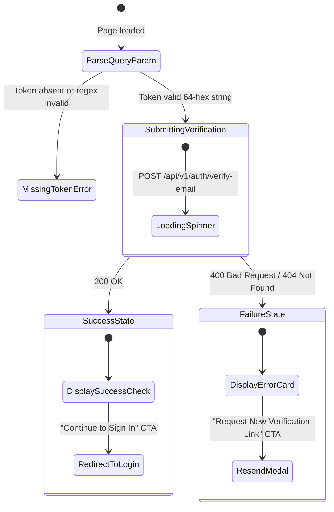
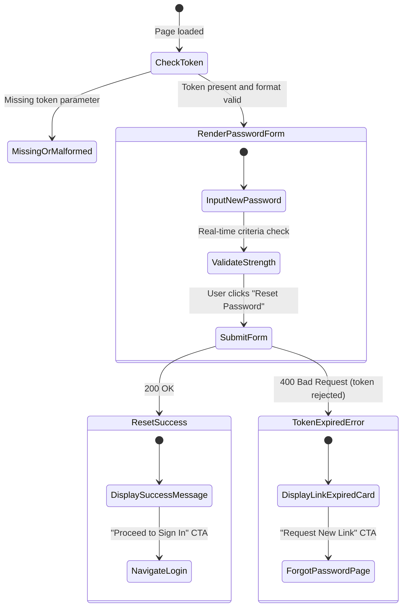

# 32. Email Verification & Password Reset Frontend Integration Contract

## 1. Overview & Architectural Principles

GIFTEDproMovies backend implements asynchronous, durable email delivery utilizing a **PostgreSQL Transactional Outbox** pattern. User registration and password recovery endpoints are strictly decoupled from external email service providers (Resend).

### Fundamental Rules
1. **Link-Based Authentication Flow:** Verification and password resets are driven exclusively by secure, single-use URL links delivered via email. Raw cryptographic tokens are **never** displayed as plain "verification codes" in email copy or UI inputs.
2. **Cryptographic Token Model:**
   * Tokens are generated with 256 bits of cryptographically secure random entropy (64 hexadecimal characters).
   * Plaintext tokens exist only in transit: in the outbox AES-256-GCM encrypted payload, within the generated email link, and in the HTTP request payload during consumption.
   * The database stores only SHA-256 digests (`token_hash`) in the `auth_tokens` table.
3. **Time-To-Live (TTL) & Single-Use:**
   * **Email Verification:** Expires in **24 hours**. Upon consumption, user status transitions from `pending_verification` to `active`, setting `email_verified_at = NOW()`.
   * **Password Reset:** Expires in **1 hour**. Upon consumption, user password hash is updated with Argon2id, and **all active user sessions and devices are revoked**.
   * Any token can only be consumed once (`used_at IS NOT NULL`). Replay attempts are rejected with `400 Bad Request`.
4. **Anti-Enumeration Contract:** `resend-verification` and `request-password-reset` endpoints always return identical `200 OK` generic success envelopes regardless of whether the email address exists in the database.

---

## 2. Page Routing & Query Parameter Specifications

The frontend router must support two dedicated top-level authentication routes:

### Route A: Email Verification Page (`/verify-email`)
* **Path:** `/verify-email`
* **Query Parameter:** `token` *(required)*
* **Example URL:** `https://giftedpromovies.com/verify-email?token=c715e679f7c392ca902efe3ef502c60482448535cb99ff5a47e6f2f1bce81944`

### Route B: Password Reset Page (`/reset-password`)
* **Path:** `/reset-password`
* **Query Parameter:** `token` *(required)*
* **Example URL:** `https://giftedpromovies.com/reset-password?token=a83b2d19ef4c890123456789abcdef0123456789abcdef0123456789abcdef01`

### Client-Side Parameter Validation
Before issuing API requests, the frontend must inspect the query string:
* Verify that `token` exists and matches the strict 64-character lowercase hexadecimal format:
  ```ts
  const TOKEN_REGEX = /^[a-f0-9]{64}$/;
  const isValidToken = typeof token === "string" && TOKEN_REGEX.test(token);
  ```
* If `token` is missing or fails format validation, immediately render the **Invalid Link** error state without sending a network request to the backend.

---

## 3. Backend API Contracts

All endpoints accept and return JSON conforming to the GIFTEDpro standard API envelope:
`{ "success": boolean, "data"?: T, "error"?: { "code": string, "message": string } }`

### Endpoint 1: Confirm Email Verification
Consumes the verification token and activates the account.

```http
POST /api/v1/auth/verify-email
Content-Type: application/json

{
  "token": "c715e679f7c392ca902efe3ef502c60482448535cb99ff5a47e6f2f1bce81944"
}
```

#### Success Response (`200 OK`)
```json
{
  "success": true,
  "data": {
    "message": "Email successfully verified."
  }
}
```

#### Error Responses
* **`400 Bad Request`** — Token is invalid, expired, or already used:
  ```json
  {
    "success": false,
    "error": {
      "code": "BAD_REQUEST",
      "message": "Invalid or expired verification token."
    }
  }
  ```
* **`404 Not Found`** — Account no longer exists:
  ```json
  {
    "success": false,
    "error": {
      "code": "NOT_FOUND",
      "message": "User not found."
    }
  }
  ```

---

### Endpoint 2: Resend Verification Link
Allows a user who lost or expired their link to request a fresh one. Atomically cancels any pending verification outbox delivery jobs and generates a fresh token.

```http
POST /api/v1/auth/resend-verification
Content-Type: application/json

{
  "email": "user@example.com"
}
```

#### Success Response (`200 OK`)
*Always returned, even if email is unregistered or already verified (anti-enumeration).*
```json
{
  "success": true,
  "data": {
    "message": "If an unverified account exists, a new verification link has been sent."
  }
}
```

---

### Endpoint 3: Request Password Reset
Enqueues a password reset email via the transactional outbox.

```http
POST /api/v1/auth/request-password-reset
Content-Type: application/json

{
  "email": "user@example.com"
}
```

#### Success Response (`200 OK`)
*Always returned, even if email does not exist (anti-enumeration).*
```json
{
  "success": true,
  "data": {
    "message": "If that email address is registered, a password reset link has been sent."
  }
}
```

---

### Endpoint 4: Confirm Password Reset
Validates the reset token, updates password hash with Argon2id, and invalidates all existing sessions.

```http
POST /api/v1/auth/reset-password
Content-Type: application/json

{
  "token": "a83b2d19ef4c890123456789abcdef0123456789abcdef0123456789abcdef01",
  "newPassword": "MyNewSecurePassword123!"
}
```

#### Success Response (`200 OK`)
```json
{
  "success": true,
  "data": {
    "message": "Password successfully reset. Please sign in with your new password."
  }
}
```

#### Error Responses
* **`400 Bad Request`** — Token invalid/expired or password does not meet requirements (minimum 8 characters, complexity rules):
  ```json
  {
    "success": false,
    "error": {
      "code": "BAD_REQUEST",
      "message": "Invalid or expired password reset token."
    }
  }
  ```

---

## 4. Frontend State Machine & UX Flow

### Email Verification UI State Flow (`/verify-email`)



#### UX Guidelines for Verification Page
1. **Immediate Execution:** The page should trigger verification automatically on mount using `useEffect` (guarding against React 18 double-invoke with an execution ref).
2. **Success Action:** Display a prominent success animation/badge and a high-contrast CTA button linking to `/auth/login`.
3. **Recovery Action:** If the token is invalid or expired, render clear guidance:
   *"This verification link is invalid or has expired. Links are valid for 24 hours and can only be used once."*
   Provide an inline input for their email with a "Resend Verification Link" button calling `POST /api/v1/auth/resend-verification`.

---

### Password Reset UI State Flow (`/reset-password`)



---

## 5. Security & Privacy Implementation Checklist

Frontend engineers must strictly enforce the following security precautions on `/verify-email` and `/reset-password`:

| # | Security Defense | Implementation Specification |
|---|---|---|
| 1 | **Referrer Leakage Prevention** | Set `<meta name="referrer" content="strict-origin-when-cross-origin">` (or `no-referrer`) in document head so query parameter tokens are NEVER leaked in HTTP `Referer` headers to external CDN assets or fonts. |
| 2 | **Browser History Token Stripping** | Once the token is captured into memory/component state, replace the browser history URL without reloading: <br>`window.history.replaceState({}, document.title, window.location.pathname);`<br>This prevents tokens from remaining visible in browser address bars or history. |
| 3 | **Analytics & Telemetry Scrubbing** | Ensure tracking tools (Google Analytics, Sentry, Datadog, Mixpanel) sanitize query strings: <br>Strip `token` before dispatching `page_view` or crash telemetry events. |
| 4 | **No Storage in Web Storage** | Do **not** store the verification/reset token in `localStorage`, `sessionStorage`, or unencrypted cookies. Keep exclusively in component memory. |
| 5 | **React 18 StrictMode Safety** | In React 18, `useEffect` runs twice in development. Use an `abortController` or `hasRunRef` flag so the single-use token is not consumed on the first mount and rejected on the second mount. |
