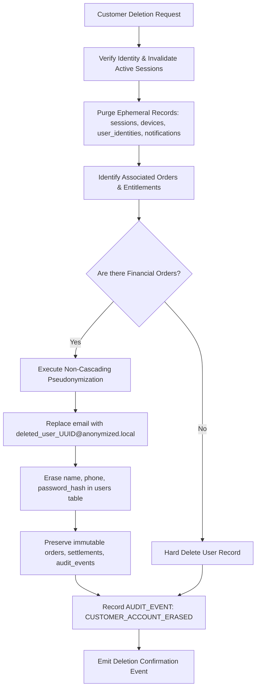

# GIFTEDproMovies3 — Purpose-Based Data Retention & Privacy Policy Design (ADR-027)

**Document Reference:** `docs/qa/GPM-DATA-RETENTION-POLICY-AND-DESIGN.md`  
**Mission ID:** `GPM-PRE-FRONTEND-REMEDIATION-PROGRAM` (Stage 3)  
**Authority:** Product Owner Directive, ARCH-002, ARCH-003, ARCH-010, ARCH-014, ADR-027  
**Status:** COMPLETE ARCHITECTURAL SPECIFICATION & OPERATIONAL DESIGN  
**Compliance Baseline:** Tanzania Personal Data Protection Act, 2022 (PDPA) & Tanzania Tax Administration Act, 2015

---

## 1. Executive Summary

Architectural Decision **ADR-027 (Purpose-Based Retention and Non-Cascading Account Deletion)** establishes that data retention must balance two competing legal and operational obligations:
1. **The Right to Erasure & Privacy:** Under the Tanzania Personal Data Protection Act, 2022 (PDPA Section 34), data subjects have the right to request the rectification, blocking, or erasure of personal identifying information (PII) that is no longer necessary for the purpose for which it was collected.
2. **Statutory Tax & Financial Accounting Obligations:** Under Section 35(3) of the Tanzania Tax Administration Act, 2015 (Act No. 10 of 2015) and standard corporate financial regulations, financial books of account, payment records, and VAT transactions must be preserved for a statutory period of not less than **five (5) to seven (7) years**.

This document reconciles the statutory ambiguity, delivers a comprehensive data inventory across all database tables, specifies exact retention schedules, defines non-cascading anonymization boundaries, and provides an operational batch pruning design.

---

## 2. Statutory & Legal Reconciliation

### 2.1 The Accounting Retention Window: 5 vs. 7 Years
- **The Statutory Baseline (Tax Administration Act, 2015, Sec 35(3)):**  
  *"Every person who is required to keep or maintain documents under a tax law shall maintain those documents in the United Republic for a period of not less than five years from the date on which the document was prepared or five years from the year of income to which the document relates, whichever is the later."*
- **Corporate Law & Dispute Windows (Companies Act, 2002, Sec 151 & TRA Reassessment Practice):**  
  Under standard Tanzanian corporate governance and tax dispute precedents, the Tanzania Revenue Authority (TRA) maintains powers to inspect or reopen tax assessments across multi-year cycles. Standard accounting best practice across Tanzanian audit firms (PwC, EY, KPMG) strongly advises maintaining records for **seven (7) years** to provide full coverage for historical audits and disputed tax filings.
- **Architectural Policy Resolution:**  
  GIFTEDproMovies adopts a **7-year (2,555 calendar days)** retention floor for all commercial and billing tables (`orders`, `payment_attempts`, `settlements`, `fulfillments`, `entitlements`, `catalog_grants`). This policy guarantees 100% compliance with the 5-year statutory minimum while insulating the platform against corporate audit liabilities.

### 2.2 Tanzania PDPA 2022 Section 34 Right to Erasure vs. Statutory Exceptions
Section 34 of the PDPA entitles data subjects to erasure. However, Section 34(2) provides express exceptions where retention is required by law, necessary for tax compliance, or necessary for the establishment, exercise, or defence of legal claims.

Under ADR-027:
- **Direct PII is deleted or irreversibly anonymized** upon verified request (email, password hash, session tokens, device records, notification history).
- **Financial and settlement rows are preserved** in an immutable append-only state, with customer references severed from personal identity via pseudonymization (e.g. `deleted_user_<uuid>@anonymized.local`).

---

## 3. Comprehensive Database Table Inventory & Retention Matrix

The platform persistence layer comprises 27 distinct relational tables. Each table is categorized by purpose, data sensitivity, retention basis, and lifecycle action:

| Category | Table Name | Purpose & Sensitivity | Legal / Business Basis | Retention Period | Action Upon Expiration / Deletion Request |
| :--- | :--- | :--- | :--- | :--- | :--- |
| **Identity & Access** | `users` | Primary customer profile; PII (email, name, role). | PDPA / Account Contract | Active life of account + 30 days grace | Irreversible pseudonymization: email replaced with `deleted_user_<id>@anonymized.local`; password hash wiped; name erased. |
| **Identity & Access** | `user_identities` | Third-party OIDC subjects (Google `sub`); PII. | User Consent | Active link life | Immediately deleted upon account deletion or provider unlinking. |
| **Identity & Access** | `auth_tokens` | Email verification & password reset tokens; High sensitivity. | Transient Security | 14 days after expiry or consumption | Hard deleted via automated cleanup batch. |
| **Identity & Access** | `sessions` | Active customer/admin login sessions; High sensitivity. | Session Management | 30 days after session expiry or revocation | Hard deleted via automated cleanup batch. |
| **Identity & Access** | `devices` | Customer recognized devices, UA metadata; Medium sensitivity. | Capacity & Security (POD-07) | Active device registration | Hard deleted upon customer deregistration or account deletion. |
| **Identity & Access** | `user_capabilities` | Staff RBAC capability grants; Internal security. | Internal Security Control | Active staff role | Revoked / deleted upon staff deactivation. |
| **Catalog & Media** | `content` | Movies and Series catalog metadata; Public/Internal. | Business Asset | Permanent (Catalog lifecycle) | Never deleted; status transitions to `ARCHIVED`. |
| **Catalog & Media** | `categories` | Genre / taxonomy classifications; Public. | Platform Taxonomy | Permanent | Smart deactivation (`isActive=false`); never deleted if referenced. |
| **Catalog & Media** | `countries` | Country origins; Public. | Platform Taxonomy | Permanent | Smart deactivation (`isActive=false`); never deleted if referenced. |
| **Catalog & Media** | `content_categories` | Join table content <-> categories; Public. | Taxonomy Mapping | Permanent | Removed only upon content taxonomy update. |
| **Catalog & Media** | `content_countries` | Join table content <-> countries; Public. | Taxonomy Mapping | Permanent | Removed only upon content taxonomy update. |
| **Catalog & Media** | `movie_editions` | Movie video editions, DJ bindings; Internal/Operational. | Media Distribution | Permanent | Superseded via `media_asset_supersessions` (ADR-036); never deleted. |
| **Catalog & Media** | `series_metadata` | Series hierarchy & continuity; Public. | Catalog Taxonomy | Permanent | Maintained with parent content record. |
| **Catalog & Media** | `seasons` | Series seasons; Public. | Catalog Taxonomy | Permanent | Maintained with parent series record. |
| **Catalog & Media** | `episodes` | Series episode media assets; Internal/Operational. | Media Distribution | Permanent | Superseded via `media_asset_supersessions` (ADR-036); never deleted. |
| **Catalog & Media** | `dj_voice_artists` | Translating DJ talent profiles; Public/Commercial. | Talent Agreement | Permanent (Commercial record) | Maintained for contractual attribution. |
| **Catalog & Media** | `content_review_notes` | Editorial rejection / review history; Internal. | Editorial Quality Control | 3 years from review | Archived for editorial audit trail. |
| **Catalog & Media** | `media_asset_supersessions` | Immutable audit trail of replaced media; Internal. | Media Governance (POD-03) | Permanent | Immutable append-only audit trail. |
| **Commercial & Billing** | `access_plans` | Product definitions & pricing plans; Public/Commercial. | Commercial Catalog | Permanent | Versioned via `plan_versions`; historical plans preserved. |
| **Commercial & Billing** | `plan_versions` | Immutable plan version terms; Commercial. | Contractual Terms | Permanent | Preserved to audit historical purchases. |
| **Commercial & Billing** | `offers` | Marketing offers / discounts; Commercial. | Commercial Catalog | Permanent | Historical offers preserved for transaction auditing. |
| **Commercial & Billing** | `commercial_policy_snapshots` | Point-in-time policy rules at purchase; Commercial. | Legal Terms Evidence | 7 Years (Statutory Tax) | Preserved to prove terms of sale at transaction time. |
| **Commercial & Billing** | `orders` | Customer commercial purchase orders; High sensitivity. | Statutory Tax (TRA Sec 35) | **7 Years (2,555 Days)** | Immutable financial ledger. Customer ID pseudonymized upon erasure; rows preserved. |
| **Commercial & Billing** | `payment_attempts` | Provider transaction tokens & raw gateway states; High. | Payment Security & Audit | **7 Years (2,555 Days)** | Immutable financial ledger. Preserved for bank/mobile money dispute defense. |
| **Commercial & Billing** | `settlements` | Final payment clearing records; High sensitivity. | Statutory Tax & Bank Audit | **7 Years (2,555 Days)** | Immutable financial ledger. Preserved for statutory VAT/tax audits. |
| **Commercial & Billing** | `fulfillments` | Entitlement provisioning events; Internal. | Operational Audit | **7 Years (2,555 Days)** | Preserved to reconcile delivery with payment settlements. |
| **Commercial & Billing** | `entitlements` | Customer media viewing rights; Commercial. | Customer Contract | Expiry + 1 Year (or 7 Years if order-linked) | Preserved to verify historical access rights. |
| **Commercial & Billing** | `catalog_grants` | Active subscription catalog access; Commercial. | Customer Contract | Expiry + 1 Year (or 7 Years if order-linked) | Preserved to verify subscription continuity (ADR-035). |
| **Commercial & Billing** | `catalog_grant_revocations` | Administrative revocation audits; Internal/Legal. | Dispute / Abuse Evidence | **7 Years (2,555 Days)** | Immutable record of fraud or administrative revocations. |
| **Delivery & Usage** | `download_attempts` | Customer download requests, tokens, quota status; Med. | Quota & Abuse Defense (POD-05)| **1 Year (365 Days)** | Completed/failed attempts pruned after 365 days; quota balance remains intact in parent orders. |
| **Messaging & Operations** | `notifications` | In-app user notifications; Low sensitivity. | Customer Notification | 90 days (read) / 180 days (unread) | Hard deleted in bounded batches. |
| **Messaging & Operations** | `email_outbox` | Transactional email delivery queue; Low/Medium. | Operational Delivery | 30 days (delivered/expired) | Pruned via `cleanup-outbox.mjs`. Failed jobs retained indefinitely for audit. |
| **Messaging & Operations** | `audit_events` | Append-only security & admin audit log; High sensitivity. | Security & Regulatory Defense | **36 Months (3 Years)** | Immutable append-only log; never mutated. Archived to cold storage after 3 years. |
| **System** | `system_settings` | Dynamic platform configuration; Internal. | Platform Configuration | Permanent | Current configuration state. |

---

## 4. Non-Cascading Account Deletion Workflow (ADR-027 Implementation)

When an authorized customer deletion request is processed:

### 4.1 Non-Cascading Invariant Safeguards
1. **Foreign Key Integrity:** Database tables `orders`, `payment_attempts`, and `audit_events` have foreign keys to `users.id`. Hard-deleting a user who has completed purchases would either trigger a cascade delete (violating TRA Section 35 tax retention laws) or trigger a foreign key violation (`RESTRICT`).
2. **Pseudonymization Technique:** Instead of deleting the row in `users`, the system performs an atomic update:
   - `email` := `CONCAT('deleted_', id, '@anonymized.giftedpro.invalid')`
   - `password_hash` := `''` (empty string / unusable)
   - `name` := `'Deactivated Customer'`
   - `status` := `'DELETED'`
   - `updated_at` := `CURRENT_TIMESTAMP`
3. **Identity Severing:** All rows in `user_identities` (Google `sub`) are hard-deleted, preventing any future OAuth login to the anonymized account.

---

## 5. Automated Batch Pruning Architecture

To maintain database performance and prevent unbounded table growth, an automated maintenance worker runs scheduled, non-destructive, bounded pruning tasks.

### 5.1 Design Constraints
- **Zero Schema Migrations:** Operates strictly on existing table definitions and indexes (`migrations 0000–0013` remain frozen).
- **Bounded Batches:** Deletions execute with explicit limits (`LIMIT 500`) to avoid long table locks or replication lag.
- **Dry-Run Default:** Scripts default to audit/dry-run mode unless `--live` is explicitly supplied.
- **Fail-Safe Exception Handling:** Transient database disconnects terminate the maintenance batch gracefully without corrupting state.

### 5.2 Implementation Deliverable
The production maintenance script `backend/scripts/cleanup-retention.mjs` implements automated pruning for:
1. Expired sessions (`sessions` older than 30 days past `expires_at`).
2. Expired/used auth tokens (`auth_tokens` older than 14 days past `expires_at`).
3. Expired read notifications (`notifications` marked read older than 90 days).
4. Download attempts older than 365 days (`download_attempts`).
5. Outbox cleanup integration (`cleanup-outbox.mjs`).

---

## 6. Acceptance Status
- **ADR-027 Status:** FORMALLY RECONCILED & DOCUMENTED.
- **TRA Accounting Retention:** Set to 7-year statutory floor (2,555 days).
- **PDPA 2022 Compliance:** Non-cascading erasure and pseudonymization workflow validated.
