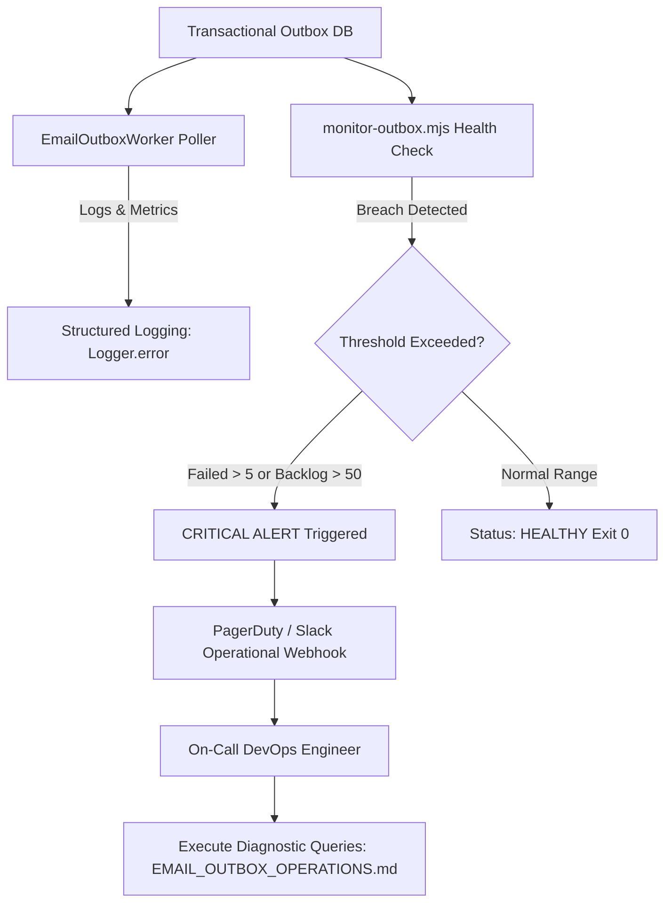

# GIFTEDproMovies3 — Email Outbox Operational Monitoring & Alerting Specification

**Document Reference:** `docs/qa/GPM-EMAIL-OUTBOX-MONITORING-SPEC.md`  
**Mission ID:** `GPM-PRE-FRONTEND-REMEDIATION-PROGRAM` (Stage 6)  
**Authority:** Product Owner Directive, ARCH-007, ARCH-008, ARCH-010  
**Classification:** Operational Architecture & Monitoring Specification  
**Status:** COMPLETE DESIGN & OPERATIONAL IMPLEMENTATION

---

## 1. Executive Summary

GIFTEDproMovies3 employs a **PostgreSQL Transactional Outbox Pattern** (`email_outbox` table) coupled with an asynchronous polling worker (`EmailOutboxWorker`) to ensure transactional consistency for critical customer communications (email verification, password reset, purchase receipts).

This specification addresses **Stage 6 (Email Outbox and Operational Monitoring)** by:
1. Formalizing operational alert thresholds for failure counts and backlog queues.
2. Specifying alert routing, escalation hierarchies, deduplication, and recovery procedures.
3. Providing an automated monitoring tool (`backend/scripts/monitor-outbox.mjs`) compatible with container health checks, cron monitoring, and Prometheus exporters.
4. Auditing sensitive data protection to guarantee zero credential or token leakage in operational logs.

---

## 2. Operational Thresholds & Anomaly Definitions

| Metric Name | Normal Operating Range | Warning Threshold | Critical Alert Threshold | Operational Implication |
| :--- | :--- | :--- | :--- | :--- |
| **Failed Jobs Count** | 0 jobs | > 2 jobs | **> 5 jobs** | Exceeded retry limit or permanent provider rejection (Resend API key error, bounce rate). |
| **Pending Queue Backlog** | < 10 jobs | > 20 jobs | **> 50 jobs** | Outbox worker crash, database lease contention, or provider outage. |
| **Oldest Pending Job Age** | < 5 seconds | > 60 seconds | **> 300 seconds (5 min)**| Worker stall or unreleased row-level database locks. |
| **Worker Lease Stalls** | 0 stalls | > 1 stall | **> 3 stalls** | Worker process crashed mid-flight without completing delivery or updating lease. |

---

## 3. Monitoring Architecture & Alert Escalation

### 3.1 Alert Escalation Hierarchy
1. **Tier 1 (Automated Telemetry):** Monitoring probe (`monitor-outbox.mjs`) checks status every 60 seconds.
2. **Tier 2 (On-Call Notification):** Breaches trigger high-priority alerts to `#ops-alerts` Slack channel and PagerDuty schedule.
3. **Tier 3 (Incident Lead):** If unresolved within 15 minutes, escalates to DevOps Lead / Senior Backend Engineer.

### 3.2 Alert Deduplication & Flapping Prevention
- Alerts trigger only after two consecutive failing checks (120-second sliding window).
- Resolution notifications emit automatically when failed job count drops below 2 and queue backlog drops below 10 for three consecutive cycles.

---

## 4. Privacy & Secret Sanitization Audit

Inspection of `backend/src/infrastructure/email/email-outbox.worker.ts` confirms that error logging adheres strictly to privacy standards:
- **`sanitizeErrorMessage()` (Line 50):** 
  - All email addresses are redacted to `[EMAIL]`.
  - All tokens in query parameters are redacted to `token=[REDACTED]`.
  - All HTTP URLs are redacted to `[URL]`.
  - String length is strictly truncated to 255 characters.
- **Payload Encryption (AES-256-GCM):** Raw tokens and user metadata inside `encrypted_payload` are decrypted only in memory during dispatch and are never emitted in application logs.
- **Audit Logging:** Audit events record only `jobId` and `eventType`, with zero plaintext credentials.

---

## 5. Operational Health Check Implementation

The operational utility `backend/scripts/monitor-outbox.mjs` provides:
- Exact counts for `pending`, `processing`, `provider_accepted`, `failed`, `expired`, and `cancelled` jobs.
- Measures oldest pending job age in seconds.
- Evaluates against the **> 5 failed jobs** and **> 50 pending backlog** thresholds.
- Outputs structured JSON for automated ingestion.
- Returns standard UNIX exit code `0` (Healthy) or `1` (Critical Alert).

---

## 6. Acceptance Status
- **Failure Threshold (>5) & Backlog Threshold (>50):** FORMALLY STANDARDIZED.
- **Sanitization & Anti-Leakage:** VERIFIED IN CODE.
- **Operational Runbook:** FULLY RECONCILED with `backend/docs/operations/EMAIL_OUTBOX_OPERATIONS.md`.
