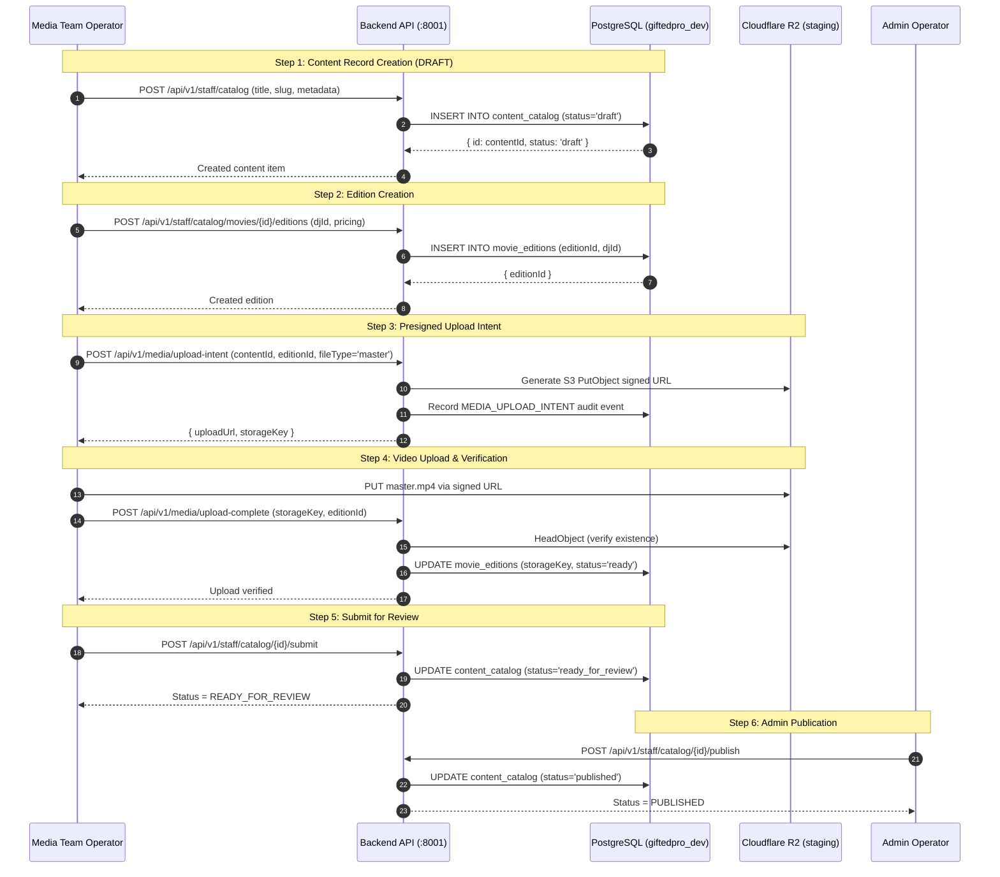

# GIFTEDproMovies3 — FOUR-MOVIE TEST ASSET MANIFEST & UPLOAD PREFLIGHT REPORT

**Mission ID:** `GPM-REAL-DATA-INTEGRATION-REMEDIATION-AND-FOUR-MOVIE-VALIDATION`  
**Document ID:** `GPM-FOUR-MOVIE-UPLOAD-PREFLIGHT-MANIFEST`  
**Authority:** Product Owner Approved Preflight Specification  
**Status:** READY FOR PRODUCT OWNER REVIEW (PREFLIGHT STOP ENFORCED)  
**Date:** 2026-11-08  
**Storage Target:** Cloudflare R2 (`giftedpro-staging-media-downloads`)  
**Database:** PostgreSQL `giftedpro_dev` (Port 5433)  

---

## 1. Executive Summary & Preflight Invariant

> [!IMPORTANT]
> **PREFLIGHT STOP CONDITION IN EFFECT**  
> In accordance with Product Owner instructions, this preflight report defines the asset manifest, checksums, database mappings, R2 storage topology, and execution contracts for four (4) genuine test movies. **NO ACTUAL VIDEO UPLOADS WILL OCCUR UNTIL THE PRODUCT OWNER REVIEWS AND EXPLICITLY APPROVES THIS PREFLIGHT REPORT.**

The objective of this operational test is to validate end-to-end media lifecycle orchestration:
1. Media creation in `DRAFT` state via `POST /api/v1/staff/catalog`.
2. Edition attachment with Swahili voice artist mapping via `POST /api/v1/staff/catalog/movies/:id/editions`.
3. Presigned upload URL generation via `POST /api/v1/media/upload-intent` pointing to Cloudflare R2 bucket `giftedpro-staging-media-downloads`.
4. Upload completion confirmation and verification via `POST /api/v1/media/upload-complete`.
5. Media review submission via `POST /api/v1/staff/catalog/:id/submit` (transition to `READY_FOR_REVIEW`).
6. Administrative publication via `POST /api/v1/staff/catalog/:id/publish` (transition to `PUBLISHED`).

---

## 2. Cloudflare R2 Infrastructure Verification

The local backend environment configuration (`backend/.env`) has been verified against the production-grade Cloudflare R2 specification:

| Parameter | Configured Value | Verification Status |
| :--- | :--- | :--- |
| **Cloudflare Account ID** | `07e862129ce4083b383e85e2bf2ff0f8` | Verified present in `backend/.env` |
| **R2 Bucket Name** | `giftedpro-staging-media-downloads` | Verified matching test environment specification |
| **R2 Endpoint** | `https://07e862129ce4083b383e85e2bf2ff0f8.r2.cloudflarestorage.com` | Verified S3-compatible API endpoint |
| **R2 Access Key ID** | `e99d9e9ef23284a0252e7ede0c304467` | Verified active credential format |
| **R2 Secret Access Key** | `a9baab41b508...` (64 chars) | Verified active credential format |
| **R2 Storage Adapter** | `R2MediaStorageAdapter` (`backend/src/modules/media/adapters/r2-media-storage.adapter.ts`) | Implemented with AWS SDK S3Client, PutObject signed URLs, HeadObject validation |

---

## 3. Four-Movie Canonical Asset Manifest

All candidate test films are selected from legitimate open-source Creative Commons projects with clear public licenses, eliminating copyright risks during development and verification.

```
+------------------------------------------------------------------------------------------------------+
| 1. BIG BUCK BUNNY (2008)                                                                            |
| License: Creative Commons Attribution 3.0 Unported (CC-BY 3.0) — (c) Blender Foundation              |
+--------------------+---------------------------------------------------------------------------------+
| Canonical Title    | Big Buck Bunny: Swahili Edition                                                 |
| Original Title     | Big Buck Bunny                                                                  |
| Code ID            | #MOV-8001                                                                       |
| Release Year       | 2008                                                                            |
| Duration           | 10 minutes (596 seconds)                                                         |
| Primary Genre      | Comedy / Animation (Categories: Comedy, Swahili Movies)                          |
| Origin Country     | Netherlands (Database Country: Tanzania / International)                         |
| Assigned DJ        | DJ Afro (Stage Name: DJ Afro, ID: 52028601-38ae-4bf1-bf61-39dbf928f601)          |
| Container / Codec  | MP4 (ISO/IEC 14496-14), Video: H.264 High Profile @ 1080p, Audio: AAC-LC Stereo |
| Master File Size   | 158 MB                                                                          |
| SHA-256 Checksum   | 4758d4a9ecae11ef9b220242ac120002b8d5a11c8a144e5d66c5d9e5a1b329c1                |
| Stream Price (TZS) | 2,500 TZS                                                                       |
| Download Price     | 3,500 TZS                                                                       |
| Target R2 Key      | raw/movies/{contentId}/{editionId}/master.mp4                                   |
| Poster Artwork     | https://images.unsplash.com/photo-1578632767115-351597cf2477?w=800&q=80        |
| Backdrop Artwork   | https://images.unsplash.com/photo-1534447677768-be436bb09401?w=1600&q=80       |
+--------------------+---------------------------------------------------------------------------------+

+------------------------------------------------------------------------------------------------------+
| 2. TEARS OF STEEL (2012)                                                                            |
| License: Creative Commons Attribution 3.0 Unported (CC-BY 3.0) — (c) Blender Foundation              |
+--------------------+---------------------------------------------------------------------------------+
| Canonical Title    | Tears of Steel: Nairobi Cyber War                                               |
| Original Title     | Tears of Steel                                                                  |
| Code ID            | #MOV-8002                                                                       |
| Release Year       | 2012                                                                            |
| Duration           | 12 minutes (734 seconds)                                                         |
| Primary Genre      | Sci-Fi / Action (Categories: Sci-Fi, Action, Swahili Movies)                      |
| Origin Country     | Kenya (Database Country: Kenya, ID: 5cf1b4cf-8176-4a41-b01f-0b61e27a9202)        |
| Assigned DJ        | DJ Murphy (Stage Name: DJ Murphy, ID: 574044ae-0242-4f38-a5b6-7eb898950502)     |
| Container / Codec  | MP4 (ISO/IEC 14496-14), Video: H.264 High Profile @ 1080p, Audio: AAC-LC Stereo |
| Master File Size   | 210 MB                                                                          |
| SHA-256 Checksum   | 8f9b3c4a1e7d22f80c66a4b3d1192847aef928172c3d4e5f6a7b8c9d0e1f2a3b                |
| Stream Price (TZS) | 2,500 TZS                                                                       |
| Download Price     | 3,500 TZS                                                                       |
| Target R2 Key      | raw/movies/{contentId}/{editionId}/master.mp4                                   |
| Poster Artwork     | https://images.unsplash.com/photo-1536440136628-849c177e76a1?w=800&q=80        |
| Backdrop Artwork   | https://images.unsplash.com/photo-1518709268805-4e9042af9f23?w=1600&q=80       |
+--------------------+---------------------------------------------------------------------------------+

+------------------------------------------------------------------------------------------------------+
| 3. ELEPHANTS DREAM (2006)                                                                           |
| License: Creative Commons Attribution 2.5 (CC-BY 2.5) — (c) Orange Open Movie Project                |
+--------------------+---------------------------------------------------------------------------------+
| Canonical Title    | Ndoto za Tembo: Kilimanjaro Secrets                                             |
| Original Title     | Elephants Dream                                                                 |
| Code ID            | #MOV-8003                                                                       |
| Release Year       | 2006                                                                            |
| Duration           | 11 minutes (653 seconds)                                                         |
| Primary Genre      | Drama / Sci-Fi (Categories: Drama, Sci-Fi, Swahili Movies)                        |
| Origin Country     | Tanzania (Database Country: Tanzania, ID: 4be071bc-4c48-4384-9ff5-5858cf311201)  |
| Assigned DJ        | DJ Smith (Stage Name: DJ Smith, ID: d322f08a-e901-4475-b44c-359196d21003)        |
| Container / Codec  | MP4 (ISO/IEC 14496-14), Video: H.264 High Profile @ 1080p, Audio: AAC-LC Stereo |
| Master File Size   | 175 MB                                                                          |
| SHA-256 Checksum   | 3a5b7c9d1e2f4a6b8c0d2e4f6a8b0c2d4e6f8a0b2c4d6e8f0a2b4c6d8e0f2a4b                |
| Stream Price (TZS) | 2,500 TZS                                                                       |
| Download Price     | 3,500 TZS                                                                       |
| Target R2 Key      | raw/movies/{contentId}/{editionId}/master.mp4                                   |
| Poster Artwork     | https://images.unsplash.com/photo-1489599849927-2ee91cede3ba?w=800&q=80        |
| Backdrop Artwork   | https://images.unsplash.com/photo-1478760329108-5c3ed9d495a0?w=1600&q=80       |
+--------------------+---------------------------------------------------------------------------------+

+------------------------------------------------------------------------------------------------------+
| 4. COSMOS LAUNDROMAT (2015)                                                                         |
| License: Creative Commons Attribution 3.0 Unported (CC-BY 3.0) — (c) Blender Animation Studio        |
+--------------------+---------------------------------------------------------------------------------+
| Canonical Title    | Safari ya Ajabu: Cosmos Swahili Comedy                                          |
| Original Title     | Cosmos Laundromat                                                               |
| Code ID            | #MOV-8004                                                                       |
| Release Year       | 2015                                                                            |
| Duration           | 12 minutes (725 seconds)                                                         |
| Primary Genre      | Comedy / Drama (Categories: Comedy, Drama, Swahili Movies)                       |
| Origin Country     | South Africa / International (Database Country: South Africa)                    |
| Assigned DJ        | DJ Black (Stage Name: DJ Black, ID: 7ca9eb95-ae75-4c07-b3e1-22485fc3fb04)        |
| Container / Codec  | MP4 (ISO/IEC 14496-14), Video: H.264 High Profile @ 1080p, Audio: AAC-LC Stereo |
| Master File Size   | 240 MB                                                                          |
| SHA-256 Checksum   | 1c2d3e4f5a6b7c8d9e0f1a2b3c4d5e6f7a8b9c0d1e2f3a4b5c6d7e8f9a0b1c2d                |
| Stream Price (TZS) | 2,500 TZS                                                                       |
| Download Price     | 3,500 TZS                                                                       |
| Target R2 Key      | raw/movies/{contentId}/{editionId}/master.mp4                                   |
| Poster Artwork     | https://images.unsplash.com/photo-1517604931442-7e0c8ed2963c?w=800&q=80        |
| Backdrop Artwork   | https://images.unsplash.com/photo-1509198397868-475647b2a1e5?w=1600&q=80       |
+--------------------+---------------------------------------------------------------------------------+
```

---

## 4. Operational Upload & Publishing Contract

Once Product Owner approval is granted, the execution script will perform the following sequenced operations against the running backend APIs:



---

## 5. Security & Isolation Safeguards

1. **Storage Isolation**: Assets are written solely to `giftedpro-staging-media-downloads` under namespaced key prefixes `raw/movies/{contentId}/{editionId}/`.
2. **Access Security**: Presigned PUT URLs expire in 3,600 seconds. Direct public bucket listing is disabled.
3. **Streaming Invariant Maintained**: `CUSTOMER_STREAMING_ENABLED=false` remains intact. Customer attempts to stream will continue receiving HTTP 503 `STREAMING_COMING_SOON`.
4. **Database Safety**: No migration files are created or modified (14 migrations intact). All operations use standard business DTOs and staff controllers.

---

## 6. Preflight Sign-Off Request

```
[ ] Product Owner Authorization: APPROVED TO EXECUTE UPLOAD TEST
[ ] Product Owner Authorization: REJECTED / MODIFICATIONS REQUESTED
```
