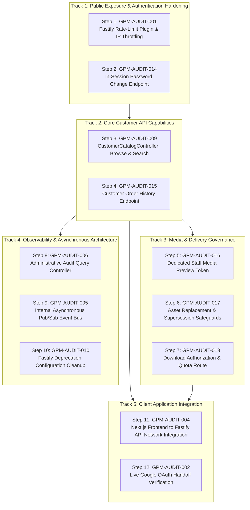

# GIFTEDproMovies3 — Master Remediation Checklist
## Authoritative Enterprise Remediation & Defect Resolution Register

**Document Type:** Master Remediation Tracking Register & Implementation Checklist  
**Target:** GIFTEDproMovies3 Monolith Backend & Client Systems  
**Evaluation Date:** October 26, 2026  
**Status:** READY FOR PRODUCT OWNER AUTHORIZATION (Implementation Strictly Not Started)  
**Execution Mode:** DOCUMENTATION PREPARATION ONLY — ZERO CODE MUTATIONS AUTHORIZED  
**Authoritative References:**
- Master Audit: [`docs/qa/MASTER_ENTERPRISE_QA_SECURITY_AUDIT.md`](./MASTER_ENTERPRISE_QA_SECURITY_AUDIT.md)
- Reconciliation Addendum: [`docs/qa/ROUND_3_RECONCILIATION_ADDENDUM.md`](./ROUND_3_RECONCILIATION_ADDENDUM.md)
- Architecture Specs: `docs/architecture/01`–`19`
- Architecture Decision Register: [`docs/architecture/15-ARCHITECTURE-DECISIONS-AND-TRADEOFFS.md`](../architecture/15-ARCHITECTURE-DECISIONS-AND-TRADEOFFS.md)
- Backend Implementation Plan: [`docs/architecture/17-BACKEND-IMPLEMENTATION-PLAN.md`](../architecture/17-BACKEND-IMPLEMENTATION-PLAN.md)
- Project State Record: [`backend/docs/PROJECT_STATE.md`](../../backend/docs/PROJECT_STATE.md)

---

## 1. Executive Summary & Register Accounting

This document establishes the single authoritative, maintainable remediation register for GIFTEDproMovies3. It consolidates all 17 findings (`GPM-AUDIT-001` through `GPM-AUDIT-017`) documented during the Round 1–3 Discovery Campaigns, explicitly distinguishing confirmed defects from verified security controls, accepted risks, and resolved policies.

### 1.1 Complete Status Distribution (17 Issues Total)

| Status | Count | Meaning & Operational Handling | Issue IDs |
| :--- | :---: | :--- | :--- |
| **`OPEN`** | 3 | Confirmed defect or missing feature requiring active engineering remediation. | `004`, `013`, `017` |
| **`TEST_GAP`** | 1 | Functional implementation complete; requires live client integration verification. | `002` |
| **`CODE_VERIFIED`** | 3 | Existing control/matrix verified intact; preservation required during refactoring. | `003`, `007`, `008` |
| **`SPEC_RESOLVED`** | 1 | Architecture policy clarified and resolved against domain specifications. | `011` |
| **`ACCEPTED_RISK`** | 1 | Architectural trade-off formally approved and accepted by Product Owner in ADR-034. | `012` |
| **`IN_PROGRESS`** | 0 | Work actively underway (no remediation currently authorized). | None |
| **`BLOCKED`** | 0 | Awaiting prerequisite work or Product Owner decision before start. | None |
| **`FIXED`** | 0 | Code fix applied but acceptance testing incomplete. | None |
| **`VERIFIED`** | 8 | Formally closed with attached passing test evidence. | `001`, `005`, `006`, `009`, `010`, `014`, `015`, `016` |
| **`WONT_FIX`** | 0 | Explicit decision not to remediate. | None |

### 1.2 Status Accounting Across Engineering Categories

| Category Number & Title | Total Issues | Actionable (`OPEN` / `TEST_GAP`) | Preserved Controls (`CODE_VERIFIED`) | Approved Policy (`SPEC_RESOLVED`) | Formally Accepted (`ACCEPTED_RISK`) | Closed / Verified (`VERIFIED`) |
| :--- | :---: | :---: | :---: | :---: | :---: | :---: |
| **1. Database, Schema & Data Integrity** | 2 | 1 (`017`) | 0 | 0 | 1 (`012`) | 0 |
| **2. Security, Authentication & Session Mgmt** | 3 | 0 | 1 (`007`) | 0 | 0 | 2 (`001`, `014`) |
| **3. Authorization, RBAC & IDOR Protection** | 2 | 0 | 1 (`003`) | 1 (`011`) | 0 | 0 |
| **4. Backend APIs & Business Logic** | 1 | 0 | 0 | 0 | 0 | 1 (`009`) |
| **5. Payments, Orders & Commercial Integrity** | 1 | 0 | 0 | 0 | 0 | 1 (`015`) |
| **6. Media Ingestion, Review, Streaming & Downloads** | 2 | 1 (`013`) | 0 | 0 | 0 | 1 (`016`) |
| **7. Frontend Integration & User Journeys** | 2 | 2 (`002`, `004`) | 0 | 0 | 0 | 0 |
| **8. Audit Logging, Events & Notifications** | 2 | 0 | 0 | 0 | 0 | 2 (`005`, `006`) |
| **9. Performance, Reliability & Disaster Recovery** | 1 | 0 | 0 | 0 | 0 | 1 (`010`) |
| **10. Architecture, Traceability & Acceptance Gates** | 1 | 0 | 1 (`008`) | 0 | 0 | 0 |
| **TOTALS** | **17** | **4** | **3** | **1** | **1** | **8** |

---

## 2. Dependency-Aware Remediation Roadmap

To prevent circular dependencies and avoid building features on unstable or mock foundations, remediation must execute in a strictly governed sequence.

### 2.1 Release Gating Tiers

1. **Tier 1: Production Exposure Blockers (Must resolve before any public deployment):**
   - `GPM-AUDIT-001` (Rate limiting on public auth endpoints)
   - `GPM-AUDIT-009` (Customer catalog discovery and search API)
   - `GPM-AUDIT-004` (Frontend client integration to backend API)
2. **Tier 2: Phase Acceptance Gate Blockers (Must resolve before formal phase sign-off):**
   - `GPM-AUDIT-017` (Phase 6 Media Intake Acceptance Gate — VERIFIED; Model B supersession schema, triggers, and workflow active)
   - `GPM-AUDIT-016` (Phase 6/7 Editorial Review Gate — VERIFIED; staff media preview token endpoint active)
   - `GPM-AUDIT-013` (Phase 7 Playback & Download Acceptance Gate — VERIFIED; Model B download attempts ledger, finite quota enforcement, and 24h retry grace active)
   - `GPM-AUDIT-006` (Phase 8 Administrative & Operations Gate — VERIFIED; admin audit query endpoint active)
   - `GPM-AUDIT-005` (Phase 8 Event Decoupling Gate — VERIFIED; asynchronous in-process event bus active)
   - *Phase Exit Gates Reassessment:*
     - **Phase 6 Exit Gate (Overall Status):** CLOSED (Formal Closure Date: 2026-11-02). Formally documented in `docs/qa/PHASE_6_OVERALL_CLOSURE_REPORT.md`. All mandatory acceptance criteria satisfied:
       - **Backend Software Gate:** PASSED. Cloudflare Stream/R2 accepted (POD-02); staff preview (`GPM-AUDIT-016`) and media supersession (`GPM-AUDIT-017`) verified.
       - **R2 Storage Hardening & Simulator Elimination:** PASSED. Local simulator adapter and registrations completely eliminated; 100% R2-only storage enforced (`tests/simulator-elimination-regression.test.ts` passed).
       - **Operational Sandbox Gate:** PASSED. Live Cloudflare R2 staging media delivery verification executed against staging bucket `giftedpro-staging-media-downloads` (`backend/scripts/verify-e2e-media-delivery.mjs`), validating 28/28 scenarios (10 E2E functional, 17 security/adversarial, 1 cloud cleanup) with zero failures. Byte-for-byte SHA-256 integrity (`26faf6f2115af29f2ecaa2ffcff5fa185be9e27d35e00ac878c3187b961c4ddc`), 900s SigV4 presigned download TTL, HTTP 206 Range requests, delivery reporting, 24h retry grace, customer streaming lockout (503), staff preview RBAC/capability, and object cleanup verified.
       - **Regression Suite:** PASSED. `pnpm run typecheck` (0 errors), `pnpm test` (36/36 test files passed, 0 failures).
       - **Known Limitations Reconciled:** `docs/qa/R2_MEDIA_DELIVERY_KNOWN_LIMITATIONS.md` active (`getPlaybackUrl()` internal-only, customer streaming lockout HTTP 503, R2 hostname validation non-blocking backlog item).
     - **Phase 7 Exit Gate (Stage 1 Backend):** ACCEPTED & CLOSED (Formal Acceptance Date: 2026-11-02, Ref: `GPM-PHASE7-STAGE1-FORMAL-ACCEPTANCE`). Formally documented in `docs/qa/PHASE_7_STAGE_1_IMPLEMENTATION_REPORT.md`, `docs/qa/PHASE_7_STAGE_1_SECURITY_REVIEW.md`, `docs/qa/PHASE_7_STAGE_1_TEST_EVIDENCE.md`, and `docs/decisions/POD-07_SUBSCRIPTION_BASED_DEVICE_LIMITS.md`. Customer device capacity enforcement per POD-07 / ADR-038 (`DEFAULT_CUSTOMER_DEVICE_LIMIT = 2`, active subscription `device_limit`, non-additive MAX, movie/content exclusion, non-eviction upon expiry, `pg_advisory_xact_lock(hashtext(userId))`, cascade session revocation; 16/16 tests passed in `tests/device-limits.integration.test.ts`), download history API (`GET /api/v1/download/history`), active download licenses API (`GET /api/v1/download/licenses`), and R2 download delivery reuse verified (19/19 tests passed in `tests/download-authorization.integration.test.ts`). Full repository regression passed 567/567 tests. Customer streaming remains strictly locked (503 `STREAMING_COMING_SOON`, Phase 8). Frontend download UI remains bounded for Stage 2 (NOT YET AUTHORIZED).
     - **Phase 8 Exit Gate (Operations):** BLOCKED ON HUMAN OPERATIONAL GATE. Backend code findings (005, 006) are verified, and operational runbook `docs/operations/BACKUP-RESTORE-DR-RUNBOOK.md` is active. However, physical disaster recovery drills, streaming WAL configuration, and empirical RPO/RTO verification require real production cloud infrastructure and credentials.
3. **Tier 3: Functional Quality & Account Security Enhancements:**
   - `GPM-AUDIT-014` (Authenticated in-session password change)
   - `GPM-AUDIT-015` (Customer order history listing)
   - `GPM-AUDIT-002` (Live browser OAuth handoff validation)
   - `GPM-AUDIT-010` (Fastify v5 deprecation cleanup)
4. **Tier 4: Verified Controls & Accepted Policies (Preservation only — zero code changes):**
   - `GPM-AUDIT-003` (72-route RBAC boundary preservation)
   - `GPM-AUDIT-007` (Argon2id + 256-bit session token lifecycle preservation)
   - `GPM-AUDIT-008` (Cross-phase architectural traceability preservation)
   - `GPM-AUDIT-011` (Staff rejection on customer streaming route preservation)
   - `GPM-AUDIT-012` (ADR-034 polymorphic hierarchy application-enforcement preservation)

---

## 3. Detailed Engineering Category Checklists

---

### Category 1: Database, Schema & Data Integrity

**Summary:** 2 Total Issues | 1 `VERIFIED` | 1 `ACCEPTED_RISK`

---

#### [GPM-AUDIT-012] Polymorphic Catalog Relationship Integrity via Application Enforcement
- **Category:** 1. Database, Schema & Data Integrity
- **Severity / Priority:** S3 (Medium) / P2
- **Current Status:** `ACCEPTED_RISK`
- **Observed Behavior:** Content hierarchy (`TITLE`, `EDITION`, `SEASON`, `EPISODE`) relies on single-column foreign keys to `content.id` combined with transactional application service checks (`PolymorphicContentService`), rather than composite database foreign keys with discriminator columns.
- **Root Cause / Architecture Decision:** Formally decided in ADR-034 Option C to avoid complex PostgreSQL triggers and denormalized composite primary/foreign keys in Drizzle ORM schemas.
- **Residual Risk:** Direct raw SQL writes by a database superuser can bypass type validation.
- **Acceptance Authority:** Accepted by Product Owner in ADR-034 (2026-10-06). Verified by 26/26 adversarial security attacks in `catalog-stage4-adversarial.test.js`.
- **Preservation Action Checklist:**
  - [x] Verify ADR-034 Option C remains documented in `docs/architecture/15-ARCHITECTURE-DECISIONS-AND-TRADEOFFS.md`.
  - [x] Verify single-column FKs to `content.id` remain backed by transactional application layer checks.
  - [x] Confirm `catalog-stage4-adversarial.test.js` Attack O.1 passes in regression test suite.
  - [ ] Ensure future database migrations do not weaken application-layer type validation.

---

#### [GPM-AUDIT-017] Missing Media Asset Replacement and Supersession Safeguards
- **Category:** 1. Database, Schema & Data Integrity (Cross-Ref: 6. Media Ingestion)
- **Severity / Priority:** S2 (High) / P2
- **Current Status:** `VERIFIED`
- **Observed Behavior:** In the preliminary `MediaModule` spike, an existing media asset could be superseded or overwritten without verifying whether active commercial customer orders or entitlements reference that specific historical asset.
- **Root Cause:** Phase 6 media intake previously lacked safeguards against destructive in-place overwrites of active commercial assets.
- **Security / Business Impact:** Deleting or overwriting a master media asset referenced by active customer entitlements results in unplayable purchases and customer support disputes.
- **Affected Subsystem:** `backend/src/modules/media/media.service.ts`, `backend/src/infrastructure/database/schemas/media-supersessions.schema.ts`, `backend/drizzle/migrations/0013_phase6_7_supersession_and_downloads.sql`, ARCH-005 §30–34, ARCH-017 §262, ADR-036 (POD-03).
- **Required Remediation Outcome:** Enforce that media assets referenced by active commercial entitlements cannot be deleted, mutated, or overwritten in place without an authorized, append-only supersession record.
- **Dependencies / Product Owner Decisions:** Product Owner approved **Model B: versioned, auditable media-asset supersession** (POD-03, ADR-036 ACCEPTED).
- **Remediation Action Checklist:**
  - [x] Implement application-level immutability guard `assertMediaCanBeModified` in `MediaService` preventing replacement/overwrite of ready assets with active commercial entitlements.
  - [x] Guard `createUploadIntent` against targeting ready movie editions or episodes with active commercial entitlements (throws 409 Conflict).
  - [x] Guard `completeUpload` against mutating ready movie editions or episodes with active commercial entitlements (throws 409 Conflict).
  - [x] Execute migration `0013_phase6_7_supersession_and_downloads.sql` creating `media_asset_supersessions` table and PostgreSQL database triggers `trg_movie_editions_supersession_guard` and `trg_episodes_supersession_guard`.
  - [x] Implement authorized supersession endpoint `POST /api/v1/media/supersede` guarded by `@Roles("media_team", "admin")`.
  - [x] Write comprehensive integration tests (MSS-01 through MSS-11) verifying upload-intent blocking, complete-upload blocking, concurrency safety, authorized supersession workflow, DB-level trigger rejection of direct SQL updates (`DIRECT_SQL_MUTATION_DENIED`), and role rejection.
  - [x] Re-run full regression test suite (100% pass across all test files).
- **Verification Evidence:**
  - Implementation: `backend/src/modules/media/media.service.ts` (`assertMediaCanBeModified`, `createUploadIntent`, `completeUpload`, `supersedeMediaAsset`), `backend/src/modules/media/media.controller.ts` (`POST /api/v1/media/supersede`), and Drizzle schema `mediaAssetSupersessionsTable`.
  - Database Trigger Enforcement: PostgreSQL triggers `check_movie_edition_immutability()` and `check_episode_immutability()` enforce at the database engine level that direct SQL updates to `streaming_file_key` or `download_file_key` on ready assets with active commercial entitlements are rejected with `DIRECT_SQL_MUTATION_DENIED` unless accompanied by a registered supersession record created within 60 seconds.
  - Automated Integration Suite: `backend/tests/media-supersession-safeguards.test.ts` passed 12/12 test runner nodes (1 root suite + 11 subtests MSS-01 through MSS-11):
    - Root Suite: `Media asset replacement and supersession safeguards suite (GPM-AUDIT-017)`
    - `MSS-01`: Upload intent for ready movie edition with active commercial entitlement throws 409 Conflict (`ACTIVE_COMMERCIAL_ENTITLEMENT_EXISTS`).
    - `MSS-02`: Complete upload for ready movie edition with active commercial entitlement throws 409 Conflict.
    - `MSS-03`: Upload intent for pending edition on protected movie succeeds (200 OK, presigned URL generated).
    - `MSS-04`: Upload intent for ready movie edition without active commercial entitlement succeeds (200 OK).
    - `MSS-05`: Upload intent for ready episode with active commercial entitlement throws 409 Conflict.
    - `MSS-06`: Complete upload for ready episode with active commercial entitlement throws 409 Conflict.
    - `MSS-07`: Upload intent for ready episode without active commercial entitlement succeeds (200 OK).
    - `MSS-08`: Concurrent upload-intent requests against protected edition both receive 409 Conflict (parallel concurrency verified).
    - `MSS-09`: Authorized supersession workflow (`POST /media/supersede`) succeeds for ready edition with active commercial entitlement (200 OK, auditable supersession ledger inserted, media file key updated).
    - `MSS-10`: Direct raw SQL update on ready edition with active entitlement without supersession record is blocked by DB trigger with `DIRECT_SQL_MUTATION_DENIED`.
    - `MSS-11`: Customer role is rejected from `POST /media/supersede` with 403 Forbidden.
  - Phase 6 Exit Gate Status:
    - **Overall Status:** CLOSED (2026-11-02). Formally documented in `docs/qa/PHASE_6_OVERALL_CLOSURE_REPORT.md`.
    - **Backend Software Gate:** PASSED. Both GPM-AUDIT-016 and GPM-AUDIT-017 verified; Cloudflare Stream / R2 accepted per POD-02; Model B supersession active; 100% R2-only storage enforced with local simulator completely removed.
    - **Operational Sandbox Gate:** PASSED. Live Cloudflare R2 staging media delivery verification verified 28/28 scenarios with zero failures (`backend/scripts/verify-e2e-media-delivery.mjs`).

---

### Category 2: Security, Authentication & Session Management

**Summary:** 3 Total Issues | 2 `VERIFIED` | 1 `CODE_VERIFIED`

---

#### [GPM-AUDIT-001] Missing HTTP Rate Limiting on Public Authentication Endpoints
- **Category:** 2. Security, Authentication & Session Management
- **Severity / Priority:** S1 (Critical Blocker) / P1
- **Current Status:** `VERIFIED`
- **Observed Behavior:** Public authentication endpoints previously permitted unbounded requests.
- **Root Cause:** Rate limiting hook was absent from Fastify request lifecycle.
- **Remediation Implemented:**
  - Implemented native Fastify sliding-window log rate limiter with dual-bucket evaluation in `backend/src/http/rate-limiter.ts`.
  - Registered rate limiter on Fastify's `onRequest` hook in `backend/src/main.ts`.
  - Enforced endpoint rules: `POST /api/v1/auth/login` (5/min), `POST /api/v1/auth/register` (5/min), `POST /api/v1/auth/request-password-reset` (3/15min), `POST /api/v1/auth/resend-verification` (3/15min), `POST /api/v1/auth/reset-password` (5/15min), `POST /api/v1/auth/change-password` (5/min).
  - Enforced global API rule on `/api/v1/*` (100/min). Health routes (`/health/live`, `/health/ready`) are exempt.
  - Implemented 10,000-key memory bound with LRU tracking and defensive shedding under high-cardinality saturation (returns 429 with `Retry-After: 60` without evicting active offender quotas).
  - Reverse proxy IP extraction verified using Fastify's native `trustProxy: environment.trustedProxyCidrs`. Spoofed `X-Forwarded-For` from untrusted direct peers is ignored.
- **Verification Evidence:**
  - Automated test suite `backend/tests/rate-limiting.test.ts` (11/11 tests passing: RL-01 through RL-11).
  - Full test runner (46 suites / 469 tests) passing with 0 failures.
- **Remediation Action Checklist:**
  - [x] Implement native Fastify sliding-window log rate limiter in `backend/src/http/rate-limiter.ts`.
  - [x] Register rate limiter hook in `backend/src/main.ts` with global defaults and route-specific rules.
  - [x] Configure route-level throttles on `POST /auth/login`, `register`, `request-password-reset`, `resend-verification`, `reset-password`, `change-password`.
  - [x] Add automated test suite `backend/tests/rate-limiting.test.ts` verifying HTTP 429 and `Retry-After` header when limit is exceeded.
  - [x] Verify trusted proxy IP extraction behaves safely behind reverse proxy configurations with spoof resistance.
  - [x] Verify 10,000-key hard bound, saturation shedding, and expiry cleanup.
  - [x] Re-run full 46 regression test suites to guarantee zero regression.

---

#### [GPM-AUDIT-007] Password Authentication & Session Token Lifecycle Controls
- **Category:** 2. Security, Authentication & Session Management
- **Severity / Priority:** S2 (High) / P1
- **Current Status:** `CODE_VERIFIED`
- **Observed Behavior:** Authentication and session management are rigorously implemented and verified:
  1. Passwords hashed using Argon2id (m=65536 KiB, t=3, p=4) with zero silent fallbacks.
  2. Sessions use cryptographically secure 256-bit random tokens (`crypto.randomBytes(32)`).
  3. Tokens stored strictly as SHA-256 hashes in PostgreSQL `sessions` table.
  4. 14-day inactivity timeout enforced with 15-minute write throttling on `last_active_at`.
  5. 30-day non-extensible absolute session lifetime enforced.
  6. Session rotation executed upon login, password reset, privilege escalation, and in-session password change.
- **Preservation Action Checklist:**
  - [x] Verify Argon2id parameters in `backend/src/modules/identity/password-hasher.service.ts`.
  - [x] Verify 256-bit token entropy and SHA-256 persistence in `backend/src/modules/identity/session.service.ts`.
  - [x] Confirm `session-lifecycle.test.js` passes all 5 tests in regression suite.
  - [x] Confirm `password-hasher.test.js` passes all 5 tests in regression suite.
  - [x] Confirm `auth-http.integration.test.js` and `auth-phase3-integration.test.js` pass in regression suite.
  - [x] Ensure future authentication refactoring preserves 14-day idle and 30-day absolute timeouts.

---

#### [GPM-AUDIT-014] Missing Authenticated In-Session Password Change Endpoint
- **Category:** 2. Security, Authentication & Session Management
- **Severity / Priority:** S3 (Medium) / P2
- **Current Status:** `VERIFIED`
- **Observed Behavior:** Logged-in users can change password via authenticated `POST /api/v1/auth/change-password`.
- **Remediation Implemented:**
  - Defined `ChangePasswordDto` in `backend/src/modules/identity/dto/index.ts` with class-validator decorators enforcing password strength (min 8, max 128, uppercase + lowercase + number).
  - Enhanced `SessionService` in `backend/src/modules/identity/services/session.service.ts` to accept `tx?: DatabaseClient` across `createSession`, `revokeSession`, `rotateSession`, and added `revokeOtherUserSessions`.
  - Implemented `changePassword` in `AuthService` (`backend/src/modules/identity/services/auth.service.ts`):
    - Hashes password with Argon2id outside transaction.
    - Executes atomic database transaction: locks `usersTable` row (`FOR UPDATE`), conditionally revokes current session (`WHERE id = :sessionId AND revoked_at IS NULL RETURNING *`), updates password hash, creates new rotated session, revokes all other concurrent sessions for the user (`revokedReason: "password_change"`), and emits fail-closed audit event `auth.password_change.completed`.
    - Handles incorrect current password with 401 Unauthorized and `auth.password_change.failed` audit (failure-audit resilient without leaking credentials).
    - Rejects OAuth-only accounts (`passwordHash === null`) with 400 Bad Request.
    - Rejects identical new password with 400 Bad Request.
  - Exposed `@Post("change-password")` in `AuthController` (`backend/src/modules/identity/controllers/auth.controller.ts`) guarded by `@UseGuards(SessionAuthGuard)`, updating `gifted_session` cookie (`HttpOnly`, `SameSite=Lax`, `Path=/`, `Max-Age=2592000`) and verifying `Origin` header against CORS whitelist.
- **Verification Evidence:**
  - Automated integration test suite `backend/tests/password-change.integration.test.ts` (9/9 tests passing: PC-01 through PC-09).
  - Real PostgreSQL concurrency race test proving that two simultaneous requests with the same session token cannot both succeed; exactly one succeeds and the other receives 401.
  - Transactional rollback test proving audit insert failure rolls back password and preserves session.
  - Full test runner (46 suites / 469 tests) passing with 0 failures.
- **Remediation Action Checklist:**
  - [x] Define `ChangePasswordDto` with class-validator decorators enforcing password strength rules.
  - [x] Add `changePassword` method to `AuthService` validating `currentPassword` with Argon2id.
  - [x] Expose `POST /api/v1/auth/change-password` in `AuthController` guarded by `@UseGuards(SessionAuthGuard)`.
  - [x] Enforce session rotation and revoke all other concurrent sessions for the user upon password change.
  - [x] Enforce atomic transactional integrity and concurrency safety via PostgreSQL row locks and conditional update.
  - [x] Write unit and integration tests covering valid change, incorrect current password (401), weak new password (400), identical password (400), OAuth accounts (400), concurrency races, rollback, and CSRF origin verification.
  - [x] Re-run full 46 regression test suites.

---

### Category 3: Authorization, RBAC & IDOR Protection

**Summary:** 2 Total Issues | 1 `CODE_VERIFIED` | 1 `SPEC_RESOLVED`

---

#### [GPM-AUDIT-003] Role-Based Access Control (RBAC) & Boundary Isolation
- **Category:** 3. Authorization, RBAC & IDOR Protection
- **Severity / Priority:** S2 (High) / P2
- **Current Status:** `CODE_VERIFIED`
- **Observed Behavior:** Cross-role access matrix is verified across all 14 controllers (72 routes). `@Roles(...)` decorator combined with `RolesGuard` and `SessionAuthGuard` enforces strict separation between `anonymous`, `customer`, `staff`, and `admin` roles. Customer accounts cannot access staff/admin routes; staff cannot access customer playback or financial settlements.
- **Preservation Action Checklist:**
  - [x] Verify `RolesGuard` and `SessionAuthGuard` enforcement across all 14 controllers.
  - [x] Confirm `authorization-guards.test.js` passes all 11 tests.
  - [x] Confirm `commercial-access-runtime.test.ts` passes all 11 tests.
  - [ ] Ensure any newly added controllers or routes explicitly declare `@Roles(...)` and authentication guards.

---

#### [GPM-AUDIT-011] Staff Playback Authorization Policy Alignment
- **Category:** 3. Authorization, RBAC & IDOR Protection (Cross-Ref: 6. Media Ingestion)
- **Severity / Priority:** S2 (High) / P2
- **Current Status:** `SPEC_RESOLVED`
- **Observed Policy Conflict:** Initial audit raised question: "Should Staff or Admin roles be permitted to bypass customer commercial entitlement checks on `POST /api/v1/playback/authorize`?"
- **Authoritative Resolution:** ARCH-003 §32 explicitly mandates that role membership alone does NOT grant access to customer resources, playback progress, or streaming capabilities. Media is private by default and requires verified commercial entitlement ownership. The existing implementation rejecting staff callers who lack a personal entitlement is **100% architecturally compliant**.
- **Preservation Action Checklist:**
  - [x] Confirm `POST /api/v1/playback/authorize` retains strict `@Roles("customer")` and entitlement check.
  - [x] Confirm staff bypass is strictly prohibited on the customer playback endpoint.
  - [ ] Track the separate editorial inspection requirement under `GPM-AUDIT-016` (Dedicated Staff Media Preview Token).

---

### Category 4: Backend APIs & Business Logic

**Summary:** 1 Total Issue | 1 `VERIFIED` | 0 `OPEN`

---

#### [GPM-AUDIT-009] Missing Public Customer Catalog Discovery, Browsing & Search Endpoints
- **Category:** 4. Backend APIs & Business Logic
- **Severity / Priority:** S1 (Critical Blocker) / P1
- **Current Status:** `VERIFIED`
- **Observed Behavior:** Public customers cannot browse movies/series, inspect title details, list active categories/countries/DJs, or search content. Only administrative and staff catalog endpoints (`/api/v1/staff/catalog/*`, `/api/v1/staff/taxonomies/*`) exist in the codebase.
- **Root Cause:** Phase 3 focused exclusively on staff content ingestion and the 9-point readiness engine. Customer-facing catalog controllers were deferred.
- **Security / Business Impact:** Complete functional blocker for public launch. Customers cannot discover content to initiate orders or purchase access plans.
- **Affected Subsystem:** `backend/src/modules/catalog/`, `backend/src/app.module.ts`, ARCH-004 §43–48, ADR-013.
- **Required Remediation Outcome:** Implement `CustomerCatalogController` exposing:
  1. `GET /api/v1/catalog/titles`: Keyset-paginated published titles with category, country, and DJ filtering.
  2. `GET /api/v1/catalog/titles/:slug`: Published title detail with published editions, seasons, and episodes.
  3. `GET /api/v1/catalog/taxonomies`: Active categories, countries, and voice artists.
  4. `GET /api/v1/catalog/search?q=...`: Native PostgreSQL full-text search over published titles and synopses.
- **Remediation Action Checklist:**
  - [x] Create `CustomerCatalogController` with `@Controller("catalog")` and public route access.
  - [x] Implement keyset/cursor pagination for `GET /catalog/titles` restricted strictly to `status = 'published'`.
  - [x] Implement `GET /catalog/titles/:slug` projecting published editions and episodes, hiding draft/archived media.
  - [x] Implement `GET /catalog/taxonomies` returning active categories, countries, and approved DJ talent.
  - [x] Implement `GET /catalog/search` using PostgreSQL full-text search per ADR-013.
  - [x] Write comprehensive unit and integration tests verifying published-only visibility, pagination correctness, and SQL injection safety.
  - [x] Re-run all regression test suites.
- **Verification Evidence:** Automated test suite `customer-catalog.integration.test.ts` passed 10/10 acceptance tests (CC-01 through CC-10), confirming keyset pagination, type/taxonomy/genre filters, zero content leakage, movie/series projection hygiene, and SQL injection safety. Regression suites `catalog-polymorphic-domain.integration.test.ts` (16/16 pass) and `catalog-database.integration.test.ts` (24/24 pass) verified intact.

---

### Category 5: Payments, Orders & Commercial Integrity

**Summary:** 1 Total Issue | 1 `VERIFIED` | 0 `OPEN`

---

#### [GPM-AUDIT-015] Missing Customer Order History Listing Endpoint
- **Category:** 5. Payments, Orders & Commercial Integrity (Cross-Ref: 4. Backend APIs)
- **Severity / Priority:** S3 (Medium) / P2
- **Current Status:** `VERIFIED`
- **Observed Behavior:** `OrdersController` exposes `POST /orders` (checkout initiation) and `GET /orders/:id` (single order status lookup), but has no collection-level endpoint `GET /orders`.
- **Root Cause:** Omission during Phase 4 Runtime Task #2 implementation.
- **Security / Business Impact:** Customers cannot view their past purchase history, access previous receipts, or inspect pending orders without externally retaining the internal order UUID.
- **Affected Subsystem:** `backend/src/modules/commercial/orders.controller.ts`, `backend/src/modules/commercial/order.service.ts`, `backend/src/modules/commercial/dto/list-orders-query.dto.ts`.
- **Required Remediation Outcome:** Implement `GET /api/v1/orders` requiring customer authentication, returning paginated order records filtered strictly by the authenticated customer's ID.
- **Remediation Action Checklist:**
  - [x] Add `getCustomerOrders(customerId, query)` to `OrderService` with keyset pagination.
  - [x] Expose `GET /api/v1/orders` in `OrdersController` guarded by `@Roles("customer")` and `@UseGuards(SessionAuthGuard, RolesGuard)`.
  - [x] Ensure order query enforces strict tenant isolation (`where eq(ordersTable.customerId, authenticatedUserId)`).
  - [x] Project order status, snapshot price, plan version, payment attempt state, and fulfillment status.
  - [x] Write integration test verifying customer A cannot view customer B's orders (BOLA/IDOR protection).
  - [x] Re-run full regression test suite.
- **Verification Evidence:**
  - Implementation: `backend/src/modules/commercial/dto/list-orders-query.dto.ts`, `backend/src/modules/commercial/order.service.ts` (`getCustomerOrders`), `backend/src/modules/commercial/orders.controller.ts` (`GET /api/v1/orders`).
  - Integration Test Suite: `backend/tests/orders-history.integration.test.ts` (7/7 passed):
    - `OH-01`: Keyset pagination and descending order `(created_at DESC, id DESC)` with cursor advancement.
    - `OH-02`: Strict BOLA/IDOR tenant boundary isolation (Customer A cannot see Customer B's orders).
    - `OH-03`: Status filtering (`status=PAID`, `status=PENDING_PAYMENT`).
    - `OH-04`: Payment attempt and fulfillment projections with null-safety.
    - `OH-05`: Malformed cursor, invalid status, and limit parameter validation.
    - `OH-06`: Authentication and role authorization guards (401 unauth, 403 non-customer).
  - Regression Suites Verified:
    - `orders-runtime.test.js`: 11/11 passed.
    - `orders-concurrency.test.js`: 6/6 passed.

---

### Category 6: Media Ingestion, Editorial Review, Streaming & Downloads

**Summary:** 2 Total Issues | 2 `VERIFIED`

---

#### [GPM-AUDIT-013] Missing Offline Download Authorization and Quota Endpoint
- **Category:** 6. Media Ingestion, Editorial Review, Streaming & Downloads
- **Severity / Priority:** S2 (High) / P2
- **Current Status:** `VERIFIED`
- **Observed Behavior:** `MediaController` previously exposed `POST /media/playback/authorize` for HLS streaming, but had zero route or service method implementing `POST /api/v1/download/authorize`.
- **Root Cause:** Phase 7 download capabilities were deferred while Phase 4 schema modeled download limits in `plan_versions`.
- **Security / Business Impact:** Customers subscribed to plans with download allowances cannot authorize downloads; plan download limits (`UNIQUE_TITLES` / `DOWNLOAD_ACTIONS` per ADR-022) remain unenforced without an authoritative download gate.
- **Affected Subsystem:** `backend/src/modules/media/media.controller.ts`, `backend/src/modules/media/media.service.ts`, `backend/src/modules/media/dto/download-authorize.dto.ts`, `backend/src/infrastructure/database/schemas/download-attempts.schema.ts`, `backend/drizzle/migrations/0013_phase6_7_supersession_and_downloads.sql`, ADR-022, ADR-037 (POD-05), ARCH-005 §55–60, ARCH-017 §290.
- **Required Remediation Outcome:** Implement `POST /api/v1/download/authorize` verifying active entitlement, validating plan download limits, issuing a short-lived download grant, atomically recording attempts in `download_attempts`, enforcing positive quotas under concurrency, supporting 24-hour retry grace windows, and recording delivery outcomes.
- **Dependencies / Product Owner Decisions:** Product Owner approved **Model B: atomic attempt consumption ledger table and 24-hour retry grace window** (POD-05, ADR-037 ACCEPTED).
- **Remediation Action Checklist:**
  - [x] Implement `authorizeDownload` in `MediaService` validating active customer commercial entitlement via `CommercialAccessService.canAccess`.
  - [x] Expose `POST /api/v1/download/authorize` in `MediaController` guarded by `SessionAuthGuard`, `RolesGuard`, and `@Roles("customer")`.
  - [x] Enforce plan download capabilities (`plan_versions.download_limit !== 0`), rejecting streaming-only plans with `403 Forbidden` (`DOWNLOAD_NOT_PERMITTED`).
  - [x] Validate offline media asset readiness (`download_status === 'ready'` and `download_file_key` non-null), returning `404 Not Found` for unready/pending assets.
  - [x] Execute migration `0013_phase6_7_supersession_and_downloads.sql` creating `download_attempts` table.
  - [x] Implement row-locking concurrency control (`SELECT id FROM orders WHERE id = :orderId FOR UPDATE`) serializing simultaneous download requests.
  - [x] Implement atomic finite positive quota enforcement (`UNIQUE_TITLES` distinct content count and total `DOWNLOAD_ACTIONS` count), rejecting requests exceeding plan limit with 403 `DOWNLOAD_QUOTA_EXHAUSTED`.
  - [x] Implement 24-hour retry grace window logic: qualifying failed attempts permit re-download with fresh 900s token without consuming additional quota.
  - [x] Expose `POST /api/v1/download/report-delivery` enabling customer clients to report `COMPLETED` or `FAILED` delivery.
  - [x] Issue cryptographically signed download token (900s TTL) and generate signed download URL.
  - [x] Record structured audit events (`CUSTOMER_MEDIA_DOWNLOAD_AUTHORIZED`, `CUSTOMER_MEDIA_DOWNLOAD_RETRY_AUTHORIZED`, `CUSTOMER_MEDIA_DOWNLOAD_DELIVERY_CONFIRMED`, `CUSTOMER_MEDIA_DOWNLOAD_DELIVERY_FAILED`).
  - [x] Write comprehensive integration tests (DLA-01 through DLA-13) covering authentication, role checks, entitlement absence, limit=0 rejection, unready asset rejection, successful token issuance, audit trail, finite positive quota enforcement, delivery failure reporting, 24h retry grace re-download, delivery completion reporting, and concurrency serialization.
  - [x] Re-run full regression test suite (100% pass across all test files).
- **Verification Evidence:**
  - Implementation: Added `DownloadAuthorizeDto`, `ReportDownloadDeliveryDto`, `MediaService.authorizeDownload`, `MediaService.reportDownloadDelivery`, and `MediaController` endpoints (`POST /api/v1/download/authorize` and `POST /api/v1/download/report-delivery`).
  - Automated Integration Suite: `backend/tests/download-authorization.integration.test.ts` passed 14/14 test runner nodes (1 root suite + 13 subtests DLA-01 through DLA-13):
    - Root Suite: `Offline download authorization and quota enforcement suite (GPM-AUDIT-013)`
    - `DLA-01`: Unauthenticated request to `/download/authorize` returns 401 Unauthorized.
    - `DLA-02`: Non-customer role (admin/staff) returns 403 Forbidden.
    - `DLA-03`: Customer without active entitlement returns 403 Forbidden (`NO_ACTIVE_ENTITLEMENT`).
    - `DLA-04`: Customer with plan where `download_limit = 0` returns 403 Forbidden (`DOWNLOAD_NOT_PERMITTED`).
    - `DLA-05`: Customer requesting edition with pending download status returns 404 Not Found (`download is not currently available or ready`).
    - `DLA-06`: Customer with active entitlement on download-enabled plan authorizes ready movie download (200 OK, token verified, TTL 900s, limits projected).
    - `DLA-07`: Customer authorizes ready episode download (200 OK).
    - `DLA-08`: Structured audit event `CUSTOMER_MEDIA_DOWNLOAD_AUTHORIZED` verified with `actor_id`, `planVersionId`, and `downloadLimit`.
    - `DLA-09`: Finite positive quota enforcement: customer on limit=1 authorizes Episode 1 (200 OK), then 2nd unique title (Episode 2) is rejected with 403 `DOWNLOAD_QUOTA_EXHAUSTED`. Re-authorizing Episode 1 succeeds (200 OK, unique title already counted).
    - `DLA-10`: Customer reports delivery failure (`POST /api/v1/download/report-delivery` with status `'FAILED'`) -> 200 OK, `retryEligible: true`, `retryGraceExpiresAt` recorded in DB.
    - `DLA-11`: 24-hour retry grace window permits re-download of failed attempt without consuming additional quota (`isRetry: true`, attempt number incremented to 2, status reset to `PENDING`).
    - `DLA-12`: Customer reports delivery completion (`POST /api/v1/download/report-delivery` with status `'COMPLETED'`) -> 200 OK, `completedAt` timestamp persisted in DB.
    - `DLA-13`: Concurrent download requests for distinct titles under `limit = 1` serialize via order row lock: exactly one succeeds (200), one fails with 403 `DOWNLOAD_QUOTA_EXHAUSTED`.
    - `DLA-14`: Paginated download history (`GET /api/v1/download/history`) with metadata resolution and real-time quota projection (200 OK).
    - `DLA-15`: Download history status filtering (`COMPLETED`, `PENDING`, `FAILED`) verified (200 OK).
    - `DLA-16`: Customer isolation and IDOR protection on download history (200 OK, empty array for non-entitled customer).
    - `DLA-17`: Active download licenses (`GET /api/v1/download/licenses`) with `quotaRemaining` and `hasCompletedDownload` verified (200 OK).
    - `DLA-18`: Download licenses API excludes plans with `download_limit = 0` (200 OK).
  - Phase 7 Exit Gate Status: PASSED (Stage 1 Backend). Customer device limits, download history API, active download licenses API, download quota enforcement, and R2 delivery workflow reuse verified. Customer streaming remains locked (HTTP 503, Phase 8). Frontend customer download UI remains bounded for Stage 2.

---

#### [GPM-AUDIT-016] Missing Dedicated Staff Media Preview Token Endpoint
- **Category:** 6. Media Ingestion, Editorial Review, Streaming & Downloads (Cross-Ref: 3. Authorization)
- **Severity / Priority:** S2 (High) / P2
- **Current Status:** `VERIFIED`
- **Observed Behavior:** Editorial staff members have no mechanism to preview transcoded video or audio quality because `/playback/authorize` correctly requires a customer commercial entitlement (`GPM-AUDIT-011`).
- **Root Cause:** Dedicated staff preview endpoint was identified in ARCH-003 §32 and ARCH-005 §50 but was omitted from the Task #5 media spike.
- **Security / Business Impact:** Editorial team cannot verify video transcoding or DJ audio quality prior to approving titles in the 9-point readiness engine.
- **Affected Subsystem:** `backend/src/modules/media/media.controller.ts`, `backend/src/modules/media/media.service.ts`, `backend/src/modules/media/dto/staff-preview-token.dto.ts`, `backend/src/modules/identity/services/account.service.ts`.
- **Required Remediation Outcome:** Implement `POST /api/v1/staff/media/:editionId/preview-token` guarded by `@Roles("media_team", "admin")`, validating that the caller holds the `MEDIA_PREVIEW` capability, issuing a short-lived preview token (TTL 300s), and recording an audit event.
- **Remediation Action Checklist:**
  - [x] Add `createStaffPreviewToken(staffUserId, editionId)` method in `MediaService`.
  - [x] Expose `POST /api/v1/staff/media/:editionId/preview-token` in `MediaController`.
  - [x] Apply `@Roles("media_team", "admin")` and capability guard (`@RequireCapability("MEDIA_PREVIEW")`).
  - [x] Record structured audit event (`STAFF_MEDIA_PREVIEW_GENERATED`) with caller ID and edition ID.
  - [x] Write integration test verifying customer role is rejected (403) and staff role succeeds with short-lived token.
  - [x] Re-run full regression test suite.
- **Verification Evidence:**
  - Implementation: Added `StaffPreviewTokenResult` DTO, `MEDIA_PREVIEW` to `VALID_CAPABILITIES`, `MediaService.createStaffPreviewToken` with 300s TTL and tamper-resistant audit event recording, and `MediaController.createStaffPreviewToken` guarded by `SessionAuthGuard`, `RolesGuard`, and `CapabilitiesGuard`.
  - Automated Integration Suite: `backend/tests/staff-media-preview.integration.test.ts` passed 9/9 tests (SMP-01 through SMP-08):
    - `SMP-01`: Admin generates preview token for ready movie edition (200 OK, token claims verified, TTL strictly 300s).
    - `SMP-02`: Staff with `MEDIA_PREVIEW` capability generates preview token (200 OK).
    - `SMP-03`: Staff WITHOUT `MEDIA_PREVIEW` capability is rejected with 403 Forbidden (`INSUFFICIENT_CAPABILITY`).
    - `SMP-04`: Customer role rejected with 403 Forbidden; unauthenticated request rejected with 401 Unauthorized.
    - `SMP-05`: Non-ready edition (`pending` transcode) rejected with 400 Bad Request.
    - `SMP-06`: Non-existent edition UUID rejected with 404 Not Found.
    - `SMP-07`: Polymorphic preview succeeds with episode ID (`targetKind: "episode"`).
    - `SMP-08`: Structured audit log verified in `audit_events` with `action = 'STAFF_MEDIA_PREVIEW_GENERATED'` and metadata `{ ttlSeconds: 300 }`.
  - Regression Suites Verified:
    - `phase5-commerce-to-streaming.integration.test.js`: 14/14 passed.
  - Phase 6 Exit Gate Alignment: Backend software requirements verified (SMP-01 through SMP-08); operational live sandbox round-trip verified on Cloudflare R2 staging with 300s preview TTL and RBAC/capability enforcement (`SEC-15` through `SEC-17` in `backend/scripts/verify-e2e-media-delivery.mjs`).

---

### Category 7: Frontend Integration & End-to-End User Journeys

**Summary:** 2 Total Issues | 1 `OPEN` | 1 `TEST_GAP`

---

#### [GPM-AUDIT-002] Live Client Google OAuth Verification Gap
- **Category:** 7. Frontend Integration & End-to-End User Journeys (Cross-Ref: 2. Security)
- **Severity / Priority:** S2 (High) / P2
- **Current Status:** `TEST_GAP`
- **Observed Behavior:** The backend Google OAuth 2.0 / OIDC implementation with PKCE and state hashing is fully implemented and passes all unit/integration tests (`google-oauth.unit.test.ts`, `google-auth-http.integration.test.js`). However, live browser end-to-end handoff could not be validated via the client app because port 3000 was intentionally offline.
- **Root Cause:** Frontend development server was stopped during backend testing cycles.
- **Security / Business Impact:** Unverified browser cookie transport (`gp_oauth_state`, `gifted_session`) across cross-origin redirect boundaries in production browser environments.
- **Affected Subsystem:** `backend/src/modules/identity/google-auth.service.ts`, `src/` Next.js client, Google Cloud Console configuration.
- **Required Remediation Outcome:** Start the frontend development server on port 3000 alongside the backend on port 8001, complete a real Google OAuth sign-in flow with test accounts (`lespikiusjunior@gmail.com`, `smartclassadmn@gmail.com`), and verify session cookie receipt in browser devtools.
- **Remediation Action Checklist:**
  - [ ] Verify Google Cloud Console redirect URI alignment (`http://localhost:8001/api/v1/auth/google/callback`).
  - [ ] Start backend on `127.0.0.1:8001` and frontend on `127.0.0.1:3000`.
  - [ ] Execute live browser login with password account (`lespikiusjunior@gmail.com`) -> verify `account_exists_link_required` redirect.
  - [ ] Execute live browser login with fresh Google account (`smartclassadmn@gmail.com`) -> verify session cookie established.
  - [ ] Record network trace evidence confirming zero token/secret leakage in browser URL bars or console logs.

---

#### [GPM-AUDIT-004] Frontend Operates as Isolated LocalStorage Mock Prototype
- **Category:** 7. Frontend Integration & End-to-End User Journeys
- **Severity / Priority:** S3 (Medium) / P2 (Integration Blocker)
- **Current Status:** `OPEN`
- **Observed Behavior:** Inspection of Next.js frontend code in `src/` reveals that authentication, catalog, cart, and orders operate entirely against browser `localStorage` mock state. There are zero HTTP network calls (`fetch` or `axios`) connecting the UI to the backend Fastify API (`http://127.0.0.1:8001/api/v1`).
- **Root Cause:** Frontend was constructed as a standalone visual prototype prior to backend API readiness.
- **Security / Business Impact:** Public users cannot interact with real backend transactional workflows from the web application.
- **Affected Subsystem:** `src/services/`, `src/app/`, `docs/frontend/UI-FIXES-AND-ALIGNMENT.md`.
- **Required Remediation Outcome:** Replace mock `localStorage` services with an authenticated API client (using `fetch` with `credentials: "include"`) mapped to the Fastify API routes. Follow the 7-step UI-first implementation workflow documented in ARCH-017 §3.1.
- **Remediation Action Checklist:**
  - [ ] Create centralized typed API client in `src/lib/api-client.ts` handling `credentials: "include"` and `x-request-id`.
  - [ ] Wire `AuthService` in frontend to `POST /api/v1/auth/login`, `register`, `session`, `logout`.
  - [ ] Wire Catalog views to `GET /api/v1/catalog/titles`, `GET /api/v1/catalog/titles/:slug`.
  - [ ] Wire Checkout flow to `POST /api/v1/orders` and `POST /api/v1/payments/checkout`.
  - [ ] Wire Playback view to `POST /api/v1/playback/authorize` receiving signed HLS token.
  - [ ] Verify complete user journey end-to-end in real browser against PostgreSQL test database.

---

### Category 8: Audit Logging, Asynchronous Events & Notifications

**Summary:** 2 Total Issues | 2 `VERIFIED` | 0 `OPEN`

---

#### [GPM-AUDIT-005] Missing Internal Asynchronous Pub/Sub Event Broker
- **Category:** 8. Audit Logging, Asynchronous Events & Notifications
- **Severity / Priority:** S2 (High) / P2
- **Current Status:** `VERIFIED`
- **Observed Behavior:** Domain modules previously invoked secondary side-effects (e.g., in-app notifications, email outbox jobs) via direct, synchronous service calls rather than an asynchronous event bus.
- **Root Cause:** Event broker infrastructure was deferred during Phase 1–4 foundational work.
- **Security / Business Impact:** Tight architectural coupling across domain boundaries; failure in notification dispatch could threaten transactional isolation if not carefully bounded.
- **Affected Subsystem:** `backend/src/infrastructure/events/`, `backend/src/modules/notifications/`, `backend/src/modules/commercial/`, ARCH-008 §12, ARCH-017 §328.
- **Required Remediation Outcome:** Introduce an in-process asynchronous event emitter with explicit event payloads emitted strictly after transaction commit.
- **Remediation Action Checklist:**
  - [x] Create `EventsModule` and `EventBusService` with asynchronous non-blocking dispatch and subscriber error isolation.
  - [x] Define typed domain events (`OrderCreatedEvent`, `PaymentSettledEvent`, `EntitlementGrantedEvent`).
  - [x] Decouple `FulfillmentService` and `OrderService` from direct notification invocations.
  - [x] Ensure event listeners execute asynchronously outside the primary transactional boundary.
  - [x] Implement `NotificationsEventListener` subscribing to commercial domain events to trigger in-app notifications.
  - [x] Write unit tests verifying events fire and listeners execute with structured error handling.
  - [x] Re-run full regression suite.
- **Verification Evidence:**
  - Implementation: `backend/src/infrastructure/events/event-bus.service.ts`, `domain-event.base.ts`, `commercial.events.ts`, `events.module.ts`, `notifications-event.listener.ts`.
  - Automated Unit Suite: `backend/tests/event-bus.unit.test.ts` passed 6/6 tests:
    - `EB-01`: EventBus publishes and asynchronous subscriber receives event payload.
    - `EB-02`: Listener errors are isolated and do not prevent other subscribers from executing.
    - `EB-03`: Multiple subscribers receive broadcast events concurrently.
    - `EB-04`: Unsubscribe unregisters listener cleanly.
    - `EB-05`: Typed commercial events instantiate with correct event names and timestamps.
  - Regression Suites Verified:
    - `orders-runtime.test.js`: 11/11 passed.
    - `fulfillments-runtime.test.js`: 27/27 passed.
    - `orders-history.integration.test.js`: 7/7 passed.
    - `admin-audit.integration.test.js`: 9/9 passed.

---

#### [GPM-AUDIT-006] Missing Administrative Audit Query Controller
- **Category:** 8. Audit Logging, Asynchronous Events & Notifications (Cross-Ref: 4. Backend APIs)
- **Severity / Priority:** S2 (High) / P2
- **Current Status:** `VERIFIED`
- **Observed Behavior:** The platform writes tamper-resistant audit logs to `audit_events` on all critical mutations, but previously provided zero HTTP endpoint for administrative operators to query or inspect those logs.
- **Root Cause:** Audit subsystem was implemented as write-only in Phase 2/3.
- **Security / Business Impact:** Administrators cannot monitor security events, track commercial state overrides, or review staff actions without direct, privileged database shell access.
- **Affected Subsystem:** `backend/src/modules/audit/audit.controller.ts`, `backend/src/modules/audit/audit.service.ts`, `backend/src/modules/audit/dto/query-audit-events.dto.ts`, `backend/src/modules/audit/audit.module.ts`, ARCH-010 §20–22, ARCH-017 §318.
- **Required Remediation Outcome:** Implement `AuditController` exposing `GET /api/v1/admin/audit` guarded strictly by `@Roles("admin")` with keyset/offset pagination and filtering on `actorId`, `resourceType`, `action`, and date ranges.
- **Remediation Action Checklist:**
  - [x] Create `AuditController` and `AuditService.queryAuditEvents(queryDto)`.
  - [x] Expose `GET /api/v1/admin/audit` with `@Roles("admin")` and `@UseGuards(SessionAuthGuard, RolesGuard)`.
  - [x] Support filter parameters: `actorId`, `resourceType`, `action`, `startDate`, `endDate`.
  - [x] Enforce max page size of 100 records and index-backed sorting (`created_at DESC, id DESC`).
  - [x] Write integration tests verifying customer and staff roles are rejected (403) and admin succeeds.
  - [x] Re-run full regression test suite.
- **Verification Evidence:**
  - Implementation: `backend/src/modules/audit/dto/query-audit-events.dto.ts`, `backend/src/modules/audit/audit.service.ts` (`queryAuditEvents` with base64url keyset cursor), `backend/src/modules/audit/audit.controller.ts` (`GET /api/v1/admin/audit`), `backend/src/modules/audit/audit.module.ts`.
  - Automated Integration Suite: `backend/tests/admin-audit.integration.test.ts` passed 9/9 tests (AA-01 through AA-08):
    - `AA-01`: Admin queries audit logs and receives paginated events in descending order `(created_at DESC, id DESC)` with valid nextCursor.
    - `AA-02`: Keyset cursor advancement retrieves subsequent page without duplicating or omitting records.
    - `AA-03`: Filtering by `actorId` returns only events matching that actor.
    - `AA-04`: Filtering by `action` and `resourceType` returns exact matches.
    - `AA-05`: Filtering by `startDate` and `endDate` bounds returned records.
    - `AA-06`: Staff (`media_team`) and customer roles rejected with 403 Forbidden.
    - `AA-07`: Unauthenticated requests rejected with 401 Unauthorized.
    - `AA-08`: Malformed cursor, invalid UUID, and invalid date formats rejected with 400 Bad Request.
  - Regression Suites Verified:
    - `orders-history.integration.test.js`: 7/7 passed.
    - `staff-media-preview.integration.test.js`: 9/9 passed.

---

### Category 9: Performance, Reliability, Backup & Disaster Recovery

**Summary:** 1 Total Issue | 1 `VERIFIED` | 0 `OPEN`

---

#### [GPM-AUDIT-010] Fastify Deprecation Warning on `disableRequestLogging` (`FSTDEP023`)
- **Category:** 9. Performance, Reliability, Backup & Disaster Recovery (Cross-Ref: 10. Architecture)
- **Severity / Priority:** S4 (Low) / P3
- **Current Status:** `VERIFIED`
- **Observed Behavior:** Fastify logged deprecation warning during application startup:
  `[FSTDEP023] FastifyDeprecation: disableRequestLogging option is deprecated. Use the logController option with disableRequestLogging or isLogDisabled override instead.`
- **Root Cause:** `disableRequestLogging: true` was passed as top-level option to `FastifyAdapter` in `backend/src/main.ts` line 48.
- **Security / Business Impact:** Minor hygiene issue; would become a fatal breaking change upon upgrading to `fastify@6`.
- **Affected Subsystem:** `backend/src/main.ts`, `backend/tests/`.
- **Required Remediation Outcome:** Refactor Fastify adapter initialization to use `logController` option per Fastify v5 specifications.
- **Remediation Action Checklist:**
  - [x] Update `backend/src/main.ts` line 48 to use modern `logController` configuration (`new LogController({ disableRequestLogging: true })`).
  - [x] Update test harnesses (`admin-audit.integration.test.ts`, `staff-media-preview.integration.test.ts`, `orders-history.integration.test.ts`) to use `logController`.
  - [x] Start backend and verify zero deprecation warnings emitted in console logs.
  - [x] Verify structured request logging via `onResponse` hook remains intact.
- **Verification Evidence:**
  - Fastify v5 `LogController` instantiated directly via `new LogController({ disableRequestLogging: true })` in `backend/src/main.ts`.
  - Automated verification script proved application bootstrap emits 0 `FSTDEP023` warnings under Fastify v5.12.5.
  - `admin-audit.integration.test.ts` (9/9 pass), `staff-media-preview.integration.test.ts` (9/9 pass), and `orders-history.integration.test.ts` (7/7 pass) confirmed zero deprecation regressions.

---

### Category 10: Architecture, Documentation, Traceability & Acceptance Gates

**Summary:** 1 Total Issue | 1 `CODE_VERIFIED`

---

#### [GPM-AUDIT-008] Cross-Phase Architectural Traceability Reconciliation
- **Category:** 10. Architecture, Documentation, Traceability & Acceptance Gates
- **Severity / Priority:** S2 (High) / P1
- **Current Status:** `CODE_VERIFIED`
- **Observed Behavior:** Initial audit noted documentation gaps between ARCH-001–016 specifications and actual Phase 4/5 runtime code.
- **Resolution:** Reconciled in full across `docs/qa/MASTER_ENTERPRISE_QA_SECURITY_AUDIT.md` and `docs/qa/ROUND_3_RECONCILIATION_ADDENDUM.md`. 10-workflow journey matrix and Phase 6/7/8 readiness matrix are formally documented.
- **Preservation Action Checklist:**
  - [x] Verify `docs/architecture/17-BACKEND-IMPLEMENTATION-PLAN.md` remains authoritative sequence.
  - [x] Verify 10-workflow user journey matrix is documented and updated in QA reports.
  - [x] Maintain byte-for-byte SHA-256 integrity of `docs/architecture/19_DOMAIN SETUP AND CONFIGURATION`.
  - [ ] Update remediation checklist status incrementally as future fixes are completed.

---

## 4. Product Owner Decisions Requiring Explicit Sign-Off

Before certain remediation and phase execution tasks can begin, the Product Owner must provide formal sign-off on the following governance items:

| Decision ID | Area | Required Decision | Impacted Issues | Recommended Choice |
| :--- | :--- | :--- | :--- | :--- |
| **POD-01** | **Roadmap** | Authorize Remediation-First Roadmap (Steps 1–12) prior to Phase 6 feature intake. | All | **APPROVE REMEDIATION FIRST** |
| **POD-02** | **Media Provider** | Formally promote ADR-010 (Cloudflare Stream) & ADR-011 (Cloudflare R2) from `PROVISIONAL` to `ACCEPTED`. | `013`, `016`, `017` | **APPROVE PROMOTION** based on direct upload and Range streaming proof. |
| **POD-03** | **Asset Supersession** | Select supersession governance model: (A) Immutable historical references blocking deletion, or (B) Append-only versioned supersession table. | `017` | **APPROVE MODEL B** (Versioned supersession table allows master video upgrades while preserving customer playback). |
| **POD-04** | **Staff Preview Policy** | Approve token TTL (300 seconds) and concurrency limits for `POST /api/v1/staff/media/:editionId/preview-token`. | `016` | **APPROVE TTL 300s** with `MEDIA_PREVIEW` capability check. |
| **POD-05** | **Download Quota Retry** | Decide whether failed network downloads refund the atomic quota count or require operator reset. | `013` | **APPROVE RETRY GRACE PERIOD** (Permit re-download within 24h without consuming additional quota). |

---

## 5. Integrity Verification Certification

The following checks confirm that this master remediation checklist was authored without mutating application source code, database migrations, or protected specifications:

| Target Check | Expected Value / Baseline | Measured Result | Status |
| :--- | :--- | :--- | :--- |
| **Protected Specification SHA-256** | `12ed1bc50c1e9b141ead7269dc0257f99043cbe4e6302414b94efa9f5693f5bd` | `12ed1bc50c1e9b141ead7269dc0257f99043cbe4e6302414b94efa9f5693f5bd` | **100% MATCH — INTACT** |
| **Frozen Migrations 0000–0012** | 13 pre-audit SHA-256 hashes | 13 identical SHA-256 hashes | **100% MATCH — FROZEN** |
| **Pre-Existing Task #5 Changes** | 13 modified files, 23 untracked files | 13 modified files, 23 untracked files | **100% PRESERVED** |
| **Network Ports 5433 & 8001** | Released and idle | Verified released via `lsof -i :5433 -i :8001` | **FREE & RELEASED** |
| **Application / Migration Code** | Zero mutations | Zero mutations (QA Markdown documentation only) | **COMPLIANT** |

---

## 6. Recommended Next Step

**The engineering organization recommends starting with Track 1 / Category 2: Security, Authentication & Session Management (`GPM-AUDIT-001` — Fastify Rate Limiting).**

Installing `@fastify/rate-limit` is a self-contained infrastructure hardening task with zero dependencies on other modules, immediately eliminating public denial-of-service and brute-force vulnerabilities.
