# GIFTEDproMovies3 — PHASE 6 OVERALL CLOSURE & FINAL ACCEPTANCE REPORT

**Document ID:** `GPM-QA-PHASE6-CLOSURE`  
**Version:** 1.0.0  
**Verification & Closure Date:** 2026-11-02  
**Lead Roles:** Senior Staff Software Architect, Application Security Engineer, QA Lead, Release Governance Auditor  
**Final Status:** **PHASE 6 — CLOSED**  
**Classification:** Evidence-Backed Final Phase Acceptance Report  

---

## 1. Executive Summary & Verdict

Phase 6 ("Media Intake, Cloudflare Stream/R2 Storage Hardening & Presigned Delivery") of the GIFTEDproMovies3 platform has successfully satisfied all mandatory architectural, functional, security, cryptographic, and operational acceptance criteria.

### Verdict
**PHASE 6 — CLOSED**

This closure decision is based on verified executable evidence across all system boundaries:
1. **Complete Simulator Elimination & R2-Only Storage:** The deprecated `LocalSimulatorMediaAdapter` and all local simulation registrations, fallback URLs, and configuration flags have been completely eliminated from the codebase. Cloudflare R2 is the sole and immutable media storage adapter.
2. **End-to-End Operational Verification:** A live end-to-end media upload and customer download cycle was executed against the staging Cloudflare R2 bucket (`giftedpro-staging-media-downloads`), verifying real synthetic file upload (262,144 bytes), backend `HeadObject` object verification, asset lifecycle transition to `ready`, entitlement-authorized customer download with a strictly enforced 900-second SigV4 presigned URL, byte-for-byte SHA-256 checksum equality (`26faf6f2115af29f2ecaa2ffcff5fa185be9e27d35e00ac878c3187b961c4ddc`), HTTP 206 Partial Content Range streaming, delivery reporting, 24-hour retry grace, and complete object cleanup.
3. **Security & Adversarial Resilience:** All 17 negative/security scenarios passed without exception, confirming strict RBAC enforcement (no customer or unauthenticated access to staff media operations), tamper rejection (invalid SigV4 signatures and expired timestamps return HTTP 403), denial of direct unsigned R2 requests (HTTP 400), customer streaming lockout enforcement (HTTP 503 `STREAMING_COMING_SOON`), and capability-checked staff preview tokens.
4. **Regression & Architectural Integrity:** Full backend test suite (`pnpm test`) executed with 36/36 passing test files (0 failures), static typecheck (`pnpm run typecheck`) executed with 0 errors, frozen database migrations (`0000` through `0013`) and protected architecture specification (`docs/architecture/19_DOMAIN SETUP AND CONFIGURATION`) cryptographically verified intact.
5. **Strict Governance Boundaries:** No changes were made to application source code, database migrations, frontend assets, production cloud resources, or payment workflows during this closure mission. Pre-existing working tree state is preserved.

---

## 2. Phase 6 Scope and Acceptance Criteria

The scope of Phase 6 encompasses the media intake pipeline, cloud storage integration, media asset lifecycle management, editorial staff preview, and download authorization:

1. **R2-Only Media Storage Architecture:** Elimination of simulated storage adapters; mandatory adoption of Cloudflare R2 (`@aws-sdk/client-s3` with SigV4) for all media persistence.
2. **Media Intake & Intent Workflow:** Authenticated Media Team upload intent generation (`POST /api/v1/media/upload-intent`), generating presigned PUT URLs with controlled expiration.
3. **Upload Verification & Asset Lifecycle:** Reliable backend verification of uploaded objects via S3 `HeadObject` (`POST /api/v1/media/upload-complete`), transcode webhook handling with secret authentication, and transition of editions/episodes to `ready`.
4. **Media Asset Supersession (Model B):** Safeguarding commercial assets against destructive overwrites; enforcing append-only supersession ledger records and database trigger protection against direct raw SQL mutations on active media.
5. **Staff Editorial Media Preview:** Capability-restricted preview token generation (`POST /api/v1/staff/media/:editionId/preview-token`) with 300-second TTL for internal quality assurance.
6. **Customer Download Authorization:** Commercial entitlement validation, atomic finite quota deduction, and issuance of 900-second SigV4 presigned download URLs.
7. **Customer Streaming Lockout:** Strict server-side lock returning HTTP 503 `STREAMING_COMING_SOON` preventing premature media streaming before Phase 8.

---

## 3. Final Acceptance Matrix

The following matrix documents the verification of all eighteen (18) core operational and architectural areas:

| # | Area | Required Verification | Evidence Source | Verification Performed | Result | Remaining Limitations |
| :--- | :--- | :--- | :--- | :--- | :--- | :--- |
| 1 | **Architecture** | Protected architecture document integrity | `shasum -a 256` | Byte-for-byte SHA-256 comparison of `docs/architecture/19_DOMAIN SETUP AND CONFIGURATION` | **PASS** | None. Hash matches exact expected value. |
| 2 | **Database** | Frozen migration integrity and schema consistency | `shasum -a 256` & migration inspection | Hash verification of `0013_phase6_7_supersession_and_downloads.sql` and verification of frozen migrations `0000`–`0012` | **PASS** | Migrations remain strictly frozen. |
| 3 | **Storage** | R2-only architecture, zero local simulator | Codebase inspection & `simulator-elimination-regression.test.ts` | Complete grep audit showing 0 simulator adapters, 0 registrations, 0 fallback URLs | **PASS** | None. Local simulator adapter completely deleted. |
| 4 | **Upload** | Actual Media Team upload workflow | `verify-e2e-media-delivery.mjs` (`E2E-01`, `E2E-02`) | Authenticated `POST /api/v1/media/upload-intent` followed by live HTTP PUT to Cloudflare R2 staging bucket | **PASS** | Requires valid R2 credentials in staging/production. |
| 5 | **Processing** | Upload completion, object verification & lifecycle | `verify-e2e-media-delivery.mjs` (`E2E-03`, `E2E-04`) | Backend `HeadObject` verification via `POST /api/v1/media/upload-complete`, transcode webhook call, asset status `ready` | **PASS** | None. Lifecycle transitions verified. |
| 6 | **Download** | Actual customer entitlement-authorized download | `verify-e2e-media-delivery.mjs` (`E2E-05`, `E2E-06`, `E2E-07`) | `POST /api/v1/download/authorize` generates SigV4 URL with 900s TTL; live HTTP GET to R2 downloads entire payload | **PASS** | Direct download links expire after 900 seconds. |
| 7 | **Integrity** | Original / downloaded SHA-256 equality | `verify-e2e-media-delivery.mjs` (`E2E-08`) | Cryptographic SHA-256 hash calculation of uploaded synthetic buffer vs downloaded buffer | **PASS** | None. Exact match: `26faf6f2...4ddc`. |
| 8 | **Range** | HTTP Range request support | `verify-e2e-media-delivery.mjs` (`E2E-09`) | HTTP GET with `Range: bytes=0-1023` to R2 presigned URL returning HTTP 206 Partial Content (1,024 bytes) | **PASS** | None. Standard HTTP 206 supported natively by R2. |
| 9 | **Quotas** | Entitlement, quota and concurrency enforcement | `verify-e2e-media-delivery.mjs` (`SEC-04`–`SEC-09`) | Unentitled download rejected (403), limit=0 rejected (403), quota exhaustion rejected (403), parallel race atomic | **PASS** | None. Quota decrement is atomic in PostgreSQL. |
| 10 | **Retry** | 24-hour retry grace period behavior | `verify-e2e-media-delivery.mjs` (`SEC-13`) | Second download request within 24h grace window succeeds (`isRetry: true`) without consuming additional quota | **PASS** | None. Controlled by `DOWNLOAD_RETRY_WINDOW_HOURS=24`. |
| 11 | **Security** | Authentication, authorization and adversarial scenarios | `verify-e2e-media-delivery.mjs` (`SEC-01`–`SEC-12`) | 401 unauthenticated, 403 customer upload, 403 tampered SigV4, 403 expired SigV4, 400 unsigned direct GET | **PASS** | None. Private bucket policy enforced. |
| 12 | **Streaming** | Customer streaming remains disabled | `verify-e2e-media-delivery.mjs` (`SEC-14`) | Customer access to streaming endpoints returns HTTP 503 `STREAMING_COMING_SOON` | **PASS** | Customer streaming deferred to Phase 8. |
| 13 | **Staff preview** | Capability-protected preview behavior | `verify-e2e-media-delivery.mjs` (`SEC-15`–`SEC-17`) | Preview token generated for Media Team with capability; rejected for staff without capability (403) and customer (403) | **PASS** | Preview URL format uses internal R2 path with token. |
| 14 | **Cleanup** | Staging test artifacts removed | `verify-e2e-media-delivery.mjs` (`CLN-01`) | `DeleteObjectCommand` removes synthetic R2 object; subsequent `HeadObject` confirms `NotFound` | **PASS** | Total staging cloud cost < US$0.01 (within US$5 cap). |
| 15 | **Regression** | Typecheck and complete backend test suite | `pnpm run typecheck` & `pnpm test` | TypeScript compiler executed with 0 errors; Vitest executed with 36/36 passing test files (207 tests passed) | **PASS** | Decorator metadata in backend requires backend tsconfig. |
| 16 | **Frontend** | No unauthorized frontend changes | `git status --short frontend/` | Zero modifications to `frontend/` source files | **PASS** | Frontend integration deferred to Phase 7/client track. |
| 17 | **Git** | No unauthorized repository mutations | `git status --short` & commit log | Zero unauthorized commits, pushes, merges, branch changes, or file deletions | **PASS** | Working tree preserved. |
| 18 | **Documentation** | QA checklist and closure evidence complete | Documentation inspection | `MASTER_REMEDIATION_CHECKLIST.md` and `R2_MEDIA_DELIVERY_KNOWN_LIMITATIONS.md` updated | **PASS** | Closure records reconciled. |

---

## 4. End-to-End R2 Media Delivery Evidence

Direct executable verification of the complete media intake and delivery lifecycle was performed against live Cloudflare R2 infrastructure:

- **Target Bucket:** `giftedpro-staging-media-downloads`
- **S3 Endpoint:** `https://07e862129ce4083b383e85e2bf2ff0f8.r2.cloudflarestorage.com`
- **Test Script:** `backend/scripts/verify-e2e-media-delivery.mjs`
- **Execution Date:** 2026-11-02T02:18:04+03:00

### Step-by-Step Evidence Record

1. **Synthetic Media Generation:**
   - Byte length: **262,144 bytes** (256 KB)
   - SHA-256 Checksum: `26faf6f2115af29f2ecaa2ffcff5fa185be9e27d35e00ac878c3187b961c4ddc`
2. **Media Team Upload Intent:**
   - Route: `POST /api/v1/media/upload-intent`
   - Role: Authenticated Media Team (`role: staff`, capability: `MEDIA_UPLOAD`)
   - Outcome: HTTP 200 OK; generated presigned PUT URL and storage key `titles/e2e-test-movie/e2e-edition-original.mp4`.
3. **Direct Cloudflare R2 Upload:**
   - Method: Direct client HTTP PUT with synthetic payload.
   - Outcome: HTTP 200 OK (ETag: `"8a4a9089c59595ba08dfbc4288a0e9b4"`).
4. **Upload Completion & HeadObject Verification:**
   - Route: `POST /api/v1/media/upload-complete`
   - Outcome: Backend executed `HeadObjectCommand` against R2; verified object presence and transitioned processing state.
5. **Transcode Webhook & Ready Lifecycle Transition:**
   - Route: `POST /api/v1/media/transcode-webhook` (authenticated with `x-transcode-secret`)
   - Outcome: Asset lifecycle transitioned to `streaming_status: ready` and `download_status: ready`.
6. **Customer Download Authorization:**
   - Route: `POST /api/v1/download/authorize`
   - Customer State: Authenticated customer with active commercial entitlement for test title.
   - Outcome: HTTP 200 OK; generated SigV4 presigned download URL with strictly bounded expiration (`X-Amz-Expires=900`).
7. **Direct Cloudflare R2 Download:**
   - Method: Direct client HTTP GET to presigned URL.
   - Outcome: HTTP 200 OK; downloaded 262,144 bytes.
8. **Byte-for-Byte Checksum Verification:**
   - Downloaded Buffer SHA-256: `26faf6f2115af29f2ecaa2ffcff5fa185be9e27d35e00ac878c3187b961c4ddc`
   - Outcome: **EXACT MATCH** with original synthetic buffer. Zero corruption or transmission loss.
9. **HTTP Range Partial Content Support:**
   - Request: HTTP GET with `Range: bytes=0-1023` to presigned URL.
   - Outcome: HTTP 206 Partial Content; received exactly 1,024 bytes matching `originalBuffer.subarray(0, 1024)`.
10. **Delivery Attempt Reporting:**
    - Route: `POST /api/v1/download/report`
    - Outcome: HTTP 200 OK; attempt transitioned from `PENDING` to `COMPLETED`.
11. **24-Hour Retry Grace Verification:**
    - Second Authorization Request: `POST /api/v1/download/authorize` within 24h window.
    - Outcome: HTTP 200 OK; response indicated `isRetry: true`; quota counter was **not** decremented.
12. **Cloud Object Cleanup:**
    - Method: Executed `DeleteObjectCommand` on R2 staging bucket.
    - Verification: Executed `HeadObjectCommand`; caught expected `NotFound` error confirming deletion.

---

## 5. Security Test Count Reconciliation

During verification, test reports referenced both **28 passing scenarios** and **17 security scenarios**. The relationship between these counts is formally reconciled below:

```mermaid
graph TD
    Total[Total Staging Scenarios: 28] --> Functional[Functional E2E Scenarios: 10]
    Total --> Security[Security & Adversarial Scenarios: 17]
    Total --> Cleanup[Cloud Object Cleanup: 1]

    Functional --> E2E01[E2E-01: Upload Intent]
    Functional --> E2E02[E2E-02: Direct R2 PUT]
    Functional --> E2E03[E2E-03: Complete Upload]
    Functional --> E2E04[E2E-04: Transcode Ready]
    Functional --> E2E05[E2E-05: Download Authorize]
    Functional --> E2E06[E2E-06: SigV4 900s TTL]
    Functional --> E2E07[E2E-07: Direct R2 GET]
    Functional --> E2E08[E2E-08: SHA-256 Equality]
    Functional --> E2E09[E2E-09: HTTP 206 Range]
    Functional --> E2E10[E2E-10: Delivery Report]

    Security --> SEC01[SEC-01: Unauthenticated Upload Intent -> 401]
    Security --> SEC02[SEC-02: Customer Upload Intent -> 403]
    Security --> SEC03[SEC-03: Non-existent Media Complete -> 400]
    Security --> SEC04[SEC-04: Unauthenticated Download -> 401]
    Security --> SEC05[SEC-05: Unentitled Download -> 403]
    Security --> SEC06[SEC-06: Zero-Quota Download -> 403]
    Security --> SEC07[SEC-07: Exhausted Quota Download -> 403]
    Security --> SEC08[SEC-08: Unready Edition Download -> 404]
    Security --> SEC09[SEC-09: Concurrent Quota Race -> 200, 403]
    Security --> SEC10[SEC-10: Tampered SigV4 Signature -> 403]
    Security --> SEC11[SEC-11: Tampered Expiration -> 403]
    Security --> SEC12[SEC-12: Unsigned Direct GET -> 400]
    Security --> SEC13[SEC-13: 24h Retry Grace Quota Bypass Protection]
    Security --> SEC14[SEC-14: Customer Streaming Lockout -> 503]
    Security --> SEC15[SEC-15: Staff Preview with Capability -> 200]
    Security --> SEC16[SEC-16: Staff Preview without Capability -> 403]
    Security --> SEC17[SEC-17: Customer Staff Preview -> 403]

    Cleanup --> CLN01[CLN-01: R2 DeleteObject & HeadObject NotFound]
```

### Reconciliation Breakdown
- **Functional E2E Flow (`E2E-01` to `E2E-10`):** 10 scenarios covering the full happy path from initial upload intent through SHA-256 verification and delivery reporting.
- **Security & Adversarial Scenarios (`SEC-01` to `SEC-17`):** 17 scenarios covering authentication, RBAC, quota exhaustion, concurrency races, SigV4 tamper resistance, streaming lockout, and staff preview capabilities.
- **Cloud Infrastructure Cleanup (`CLN-01`):** 1 scenario verifying complete deletion of the staging object from Cloudflare R2 and absence confirmation via `HeadObject`.
- **Sum Total:** `10 + 17 + 1 = 28` total scenarios.
- **Conclusion:** The 17 detailed security scenarios are a strict and non-overlapping subset of the 28 total scenarios executed in `backend/scripts/verify-e2e-media-delivery.mjs`. There is zero duplication or discrepancy.

---

## 6. Regression and Typecheck Results

### Static Typecheck
- **Command:** `pnpm run typecheck` (executed in `/backend`)
- **Underlying Tool:** `tsc --noEmit -p tsconfig.json`
- **Exit Code:** `0`
- **Output:** Clean; zero type errors, zero warnings.

### Automated Test Suite
- **Command:** `pnpm test` (executed in `/backend`)
- **Underlying Runner:** Vitest v2.1.9
- **Exit Code:** `0`
- **Total Test Files Executed:** 36
- **Test Files Passed:** 36 (100%)
- **Test Files Failed:** 0
- **Total Individual Tests Passed:** 207
- **Individual Tests Failed:** 0
- **Individual Tests Skipped:** 0
- **Execution Duration:** 8.65s

### Storage & Delivery Regression Test Coverage
- `tests/simulator-elimination-regression.test.ts`: PASSED (9/9 tests verifying 0 simulator references, valid R2 construction, presigned URL format, and error handling).
- `tests/media-delivery.unit.test.ts`: PASSED (unit verification of presigned URL generation and media service operations).
- `tests/media-supersession-safeguards.test.ts`: PASSED (11/11 tests verifying Model B supersession, commercial protection, and trigger enforcement).
- `tests/download-authorization.integration.test.ts`: PASSED (entitlement checks, finite download quotas, 24h retry grace, and attempt logging).
- `tests/staff-media-preview.integration.test.ts`: PASSED (capability verification, token generation, and RBAC rejection).

---

## 7. Protected File and Schema Integrity Results

Cryptographic SHA-256 verification was performed on all governance-protected files:

| Target File | Expected SHA-256 Hash | Measured SHA-256 Hash | Integrity Status |
| :--- | :--- | :--- | :--- |
| `docs/architecture/19_DOMAIN SETUP AND CONFIGURATION` | `12ed1bc50c1e9b141ead7269dc0257f99043cbe4e6302414b94efa9f5693f5bd` | `12ed1bc50c1e9b141ead7269dc0257f99043cbe4e6302414b94efa9f5693f5bd` | **100% MATCH — UNTOUCHED** |
| `backend/drizzle/migrations/0013_phase6_7_supersession_and_downloads.sql` | `7a9f6db7ac14bed20fe291d1d69a88e27652ae6c624f253a8e0ac2c0e52dcf9f` | `7a9f6db7ac14bed20fe291d1d69a88e27652ae6c624f253a8e0ac2c0e52dcf9f` | **100% MATCH — FROZEN** |
| Migrations `0000` through `0012` | Historical baseline | Identical to baseline | **100% FROZEN** |

---

## 8. Git and Repository Integrity

Repository state was inspected using `git status --short`:
- **Current Branch:** Preserved unchanged.
- **Commits / Pushes / Merges:** Zero git commits, zero pushes, zero merges, zero stashes, zero branch switching performed.
- **Application Source & Migrations:** Zero modifications to existing application code, database migrations, package dependencies, or frontend source code (`frontend/`).
- **Permitted QA Changes:** Updates to `docs/qa/MASTER_REMEDIATION_CHECKLIST.md` and creation of this closure report `docs/qa/PHASE_6_OVERALL_CLOSURE_REPORT.md`.
- **Pre-Existing User State:** All pre-existing user modifications and untracked files are preserved intact.

---

## 9. Known Limitations and Deferred Work

In accordance with architectural standards and honest engineering reporting, the following non-blocking items are formally documented in `docs/qa/R2_MEDIA_DELIVERY_KNOWN_LIMITATIONS.md` and deferred to their appropriate future phases:

### 1. `getPlaybackUrl()` Architectural Role & Scope
- **Current Implementation:** `R2MediaStorageAdapter.getPlaybackUrl(key)` constructs an unsigned string: `${endpoint}/${bucketName}/${key}`.
- **Operational Assessment:** This method is used strictly for internal editorial preview token construction (`POST /api/v1/staff/media/:editionId/preview-token`) which appends an ephemeral JWT preview token (`?token=${previewToken}`). It is **never** invoked for customer media delivery.
- **Customer Protection:** Customer downloads bypass `getPlaybackUrl()` and strictly utilize `generatePresignedDownloadUrl()` (SigV4 presigned URLs with 900s TTL). Furthermore, customer streaming is hard-locked at the route level returning HTTP 503 `STREAMING_COMING_SOON`.
- **Phase 8 Roadmap:** When customer streaming is implemented in Phase 8, this method will be migrated to Cloudflare Stream or a Cloudflare Worker edge delivery architecture with dynamic signed URL generation.

### 2. Customer Streaming Lockout Enforcement
- **Status:** Active and intentional.
- **Behavior:** `CUSTOMER_STREAMING_ENABLED=false` by default. Requests to customer playback routes return HTTP 503 `STREAMING_COMING_SOON`.
- **Resolution:** Deferred to Phase 8 (Video Streaming Architecture).

### 3. R2 Endpoint Hostname Validation
- **Current Behavior:** Storage endpoint is configured via `R2_ENDPOINT` / `MEDIA_STORAGE_ENDPOINT` environment variables.
- **Assessment:** A non-blocking defense-in-depth observation. The system operates correctly with standard Cloudflare R2 endpoints (`https://<account-id>.r2.cloudflarestorage.com`).
- **Resolution:** Strict regex validation can be added during production environment configuration hardening prior to public release.

---

## 10. Explicit Phase 7 and Phase 8 Boundaries

This closure report certifies the completion of Phase 6 only. It does not authorize or initiate subsequent phases:

- **Phase 7 (Commercial Download Delivery & Quota Enforcement):** While the backend database schema (Migration 0013), download attempts ledger, finite download quota enforcement, and 24h retry grace period were validated as part of Phase 6 delivery testing, end-to-end customer mobile/web frontend integration and client download managers remain deferred to Phase 7.
- **Phase 8 (Video Streaming & Infrastructure Operations):** Customer video streaming remains strictly disabled behind HTTP 503. Physical disaster recovery drills, automated database failover, streaming WAL replication, and live infrastructure operations remain deferred to Phase 8 operational readiness.
- **No Production Deployment:** Staging verification against a staging bucket does not constitute production release. Public deployment is strictly blocked pending Tier 1 release gating.

---

## 11. Final Closure Decision

All mandatory Phase 6 acceptance criteria, security requirements, architectural specifications, regression gates, and governance constraints have been satisfied with verifiable, executable evidence.

**FINAL DECISION:**
# **PHASE 6 — CLOSED**

---

## 12. Evidence References and Verification Timestamps

- **Verification Date:** 2026-11-02
- **Master QA Checklist:** `docs/qa/MASTER_REMEDIATION_CHECKLIST.md`
- **Known Limitations Specification:** `docs/qa/R2_MEDIA_DELIVERY_KNOWN_LIMITATIONS.md`
- **Live Staging Verification Suite:** `backend/scripts/verify-e2e-media-delivery.mjs`
- **R2 Storage Elimination Suite:** `backend/tests/simulator-elimination-regression.test.ts`
- **Backend Test Suite Execution:** 36/36 passed, 207 tests, duration 8.65s (Vitest v2.1.9)
- **Protected Architecture Specification SHA-256:** `12ed1bc50c1e9b141ead7269dc0257f99043cbe4e6302414b94efa9f5693f5bd`
- **Frozen Migration 0013 SHA-256:** `7a9f6db7ac14bed20fe291d1d69a88e27652ae6c624f253a8e0ac2c0e52dcf9f`
- **Staging Media Payload SHA-256:** `26faf6f2115af29f2ecaa2ffcff5fa185be9e27d35e00ac878c3187b961c4ddc`
