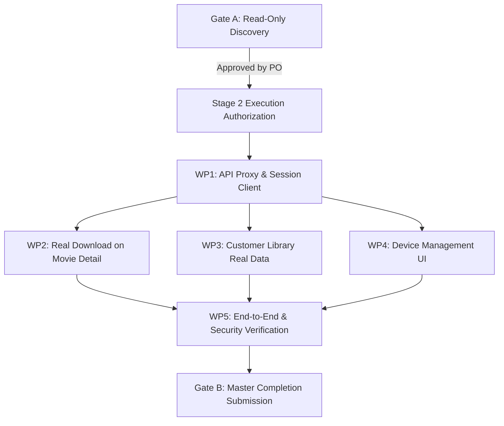

# PHASE 7 STAGE 2 EXECUTION PLAN
**Reference:** GPM-PHASE7-STAGE2-PLAN  
**Date:** 2026-11-03  
**Status:** PROPOSED FOR PRODUCT OWNER APPROVAL (GATE A SUBMISSION)  
**Authority:** Product Owner Directive (POD-06 Option B / POD-07)

---

## 1. Plan Overview & Objectives

This execution plan provides the concrete, multi-stage engineering roadmap to complete Phase 7 Stage 2 ("Customer Downloads, Device Management & Customer Library Integration").

### Key Principles:
1. **Preserve Accepted Invariants:**
   - No schema migrations (`0014` prohibited).
   - Domain Setup file unmodified (SHA-256 intact).
   - Customer streaming lockout maintained (`CUSTOMER_STREAMING_ENABLED=false` -> 503 `STREAMING_COMING_SOON`).
   - No regression of Phase 6 or Phase 7 Stage 1 accepted features.
2. **Real Customer Experience:**
   - Eliminate synthetic Blob downloads.
   - Eliminate hardcoded/mock customer library views.
   - Connect authenticated customer flows to live Fastify APIs and Cloudflare R2 bucket.
3. **Graceful Degradation & High Observability:**
   - Clear feedback for limit breaches (403 `DEVICE_LIMIT_EXCEEDED`, 403 `DOWNLOAD_LIMIT_EXCEEDED`, 409 `CONCURRENT_DOWNLOAD_ACTIVE`).

---

## 2. Work Packages Breakdown

### Work Package 1: Frontend/Backend API Proxy & Session Integration
- **Objective:** Enable seamless session exchange between Next.js frontend (port 3000) and Fastify backend (port 3001).
- **Tasks:**
  1. Configure Next.js rewrites in `next.config.ts` mapping `/api/v1/:path*` to `http://127.0.0.1:3001/api/v1/:path*`.
  2. Implement an authenticated API client utility (`src/services/apiClient.ts`) ensuring `credentials: 'include'` and CSRF/error handling.
  3. Wire frontend `AuthContext` to backend session endpoints (`/api/v1/auth/login`, `/me`, `/logout`), while maintaining fallback test fixtures if necessary.
- **Verification:** Login via frontend sets `gifted_session` cookie; subsequent `/api/v1/auth/me` verifies authenticated customer identity.

---

### Work Package 2: Real Customer Download Experience on Movie Detail Page
- **Objective:** Replace synthetic Blob generation with secure Cloudflare R2 download authorization and delivery reporting.
- **Tasks:**
  1. Create `src/hooks/useMovieDownload.ts` encapsulating:
     - Access pre-check (`GET /api/v1/commercial/me/access/:contentId`).
     - Authorization call (`POST /api/v1/download/authorize`).
     - Direct browser navigation to the signed R2 URL (`window.location.assign` or hidden anchor trigger).
     - Delivery reporting (`POST /api/v1/download/report-delivery`).
  2. Update `src/app/movies/[slug]/page.tsx`:
     - Replace lines 84-95 (Blob creation) with `useMovieDownload`.
     - Render download state machine: `idle`, `authorizing`, `downloading`, `completed`, `error`.
     - Render informative error dialogs for `DEVICE_LIMIT_EXCEEDED`, `DOWNLOAD_LIMIT_EXCEEDED`, and `ACCESS_DENIED`.
- **Verification:** Clicking "Download" calls backend, generates signed R2 URL, triggers media file stream, and records completed attempt.

---

### Work Package 3: Customer Library Integration (Real Entitlements & Downloads)
- **Objective:** Replace mock data in `/library` with live backend data from commercial and download engines.
- **Tasks:**
  1. Create `src/hooks/useCustomerLibraryData.ts` to fetch:
     - Commercial entitlements via `GET /api/v1/commercial/me/library`.
     - Active download licenses via `GET /api/v1/download/licenses`.
     - Download history via `GET /api/v1/download/history`.
  2. Refactor `src/app/library/page.tsx`:
     - **Tab: Offline Downloads:** Display live active licenses, remaining quota (e.g., "4/5 downloads remaining"), expiration date, and a "Download Again" action. Include collapsible "Download Activity History" audit log.
     - **Tab: Active Passes & Entitlements:** Display live active rentals, purchases, and subscriptions with expiration timers.
     - **Tab: Continue Watching:** Display a refined banner explaining that online streaming is launching in Phase 8, highlighting offline download availability for instant offline playback.
- **Verification:** Purchases, downloads, and quotas dynamically reflect the customer's database records.

---

### Work Package 4: Recognized Device Management UI
- **Objective:** Give customers full visibility and control over their registered devices under the POD-07 subscription device limit policy.
- **Tasks:**
  1. Enhance backend `DeviceController.listCustomerDevices` to include `{ effectiveLimit, currentCount, remainingSlots }` in response.
  2. Build `src/components/devices/CustomerDeviceManager.tsx`:
     - Render current device badge (`isCurrentDevice`).
     - Render device cards: Name, platform/browser, last active timestamp.
     - Render plan device capacity meter (e.g. "2 of 2 slots used").
     - Implement "Remove Device" action with confirmation modal, calling `DELETE /api/v1/devices/:id`.
  3. Embed `CustomerDeviceManager` into `/library` as a dedicated tab/section.
- **Verification:** Removing a device frees up a slot; adding a device beyond the limit returns 403 `DEVICE_LIMIT_EXCEEDED` and prompts the user to manage devices.

---

### Work Package 5: End-to-End Automated Testing & Security Verification
- **Objective:** Verify security, accessibility, and end-to-end functionality across both backend and frontend layers.
- **Tasks:**
  1. Write integration/E2E test suite (`backend/tests/e2e/phase7_customer_journey.test.ts`):
     - Complete flow: Customer auth -> Check access -> Download authorization -> Delivery reporting -> History & licenses verification -> Device limit enforcement & device removal.
  2. Run security adversarial audit:
     - Cross-customer device deletion attempt (verify 403).
     - Cross-customer download reporting attempt (verify 404/403).
     - Direct access to `/api/v1/playback/stream/:id` (verify 503 `STREAMING_COMING_SOON`).
  3. Verify frontend accessibility (a11y) for keyboard navigation and screen readers on all modals, tabs, and buttons.
- **Verification:** All tests pass 100%, zero regressions, complete audit documentation produced.

---

## 3. Execution Schedule & Gates

- **Gate A (CURRENT):** Discovery complete, deliverables created. Awaiting PO approval.
- **Stage 2 Implementation:** Triggered only upon explicit PO directive.
- **Gate B:** Final verification, test evidence, and walk-through submission for final acceptance.
