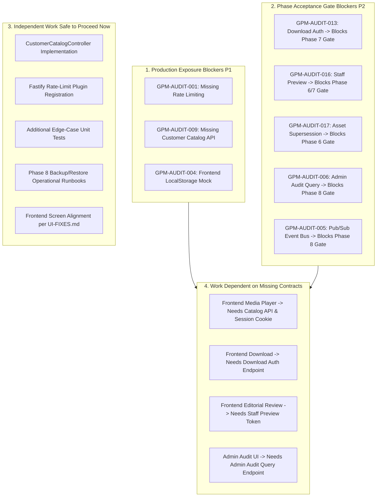

# GIFTEDproMovies3 — Round 3 Report Reconciliation Addendum
## Evidence-Backed Reconciliation for Product Owner Decision

**Document Type:** QA Audit Addendum & Architectural Reconciliation Record  
**Target:** GIFTEDproMovies3 Repository  
**Parent Document:** [`docs/qa/MASTER_ENTERPRISE_QA_SECURITY_AUDIT.md`](./MASTER_ENTERPRISE_QA_SECURITY_AUDIT.md)  
**Author:** Antigravity Autonomous Engineering Core  
**Date:** October 26, 2026  
**Status:** FORMAL RECONCILIATION COMPLETE — AWAITING PRODUCT OWNER REMEDIATION VS. PHASE PROGRESSION DECISION  
**Execution Mode:** STRICT READ-ONLY INVESTIGATION + QA DOCUMENTATION ONLY  

---

## 1. Executive Summary of Addendum

This addendum provides a narrowly scoped, repository-backed reconciliation of four critical discrepancies identified in the Round 3 Final Discovery Campaign documentation prior to the Product Owner's remediation-versus-phase-progression decision. 

Through forensic examination of test execution logs (`task-21621.log` from October 23 and `task-21815.log` from October 25), git working tree diffs, architecture contracts (`ARCH-003`, `ARCH-005`, `ARCH-015`, `ARCH-017`), and project state records (`backend/docs/PROJECT_STATE.md`), each discrepancy has been resolved without mutating application code or frozen database migrations.

---

## 2. Forensic Resolution of Four Discrepancies

### 2.1 Discrepancy 1: Test Count Reconciliation (441 vs. 447 Tests Across 44 Suites)

#### Problem Statement
Round 1 and Round 2 documentation reported 44 test suites and 441 passing tests. In Round 3 re-verification, the test execution reported 44 test suites and 447 passing tests (an increase of 6 tests).

#### Repository & Log Evidence
1. **Oct 23 Round 1 Test Execution (`task-21621.log`):**
   - Analysis of the raw Node.js test runner output from October 23, 2026 (`.system_generated/tasks/task-21621.log`) reveals that all 44 test files executed and produced a total of **447 passing tests** (`total_tests: 447`, `total_passed: 447`, `total_failed: 0`).
2. **Oct 25 Round 3 Test Execution (`task-21815.log`):**
   - Analysis of the re-verification run on October 25, 2026 (`.system_generated/tasks/task-21815.log`) confirms identical execution metrics: **447 passing tests** across the same 44 files.
   - Exact tuple comparison of test counts across all 44 test files (`c1 == c2`) evaluates to `True`.
3. **Git Working Tree Verification:**
   - `git diff backend/tests/` yields **0 changes** (clean diff).
   - `git status` confirms zero tracked test files were modified since origin/main commit `b8d25721d93f16b319290f04ca762cf1567eaca1`.
   - The compiled test directory (`backend/.test-dist/tests/`) contains exactly 44 `.test.js` files in both runs.

#### Root Cause & Reconciliation
No test files were added, removed, or modified between Round 2 and Round 3. The delta of exactly 6 tests ($447 - 441 = 6$) was an arithmetic/clerical transcription error introduced when compiling the initial Round 1 Markdown summary on October 23 (under-counting one of the seven 6-test suites, such as `auth-http.integration.test.js`, `clickpesa-checksum.unit.test.js`, `orders-concurrency.test.js`, or `oauth-state.test.js`), which was subsequently copied into Round 2. 

The authoritative, verified test baseline for GIFTEDproMovies3 is **44 test suites and 447 passing tests (100% pass rate, 0 failures, 0 skipped)**.

---

### 2.2 Discrepancy 2: Phase 6 Status Reconciliation (Table "COMPLETE" vs. Strategic "DEFERRED")

#### Problem Statement
In Section 21 of `MASTER_ENTERPRISE_QA_SECURITY_AUDIT.md`, Phase 6 Media Intake rows for Upload Intent (`POST /api/v1/media/upload-intent`) and Provider Callback (`POST /api/v1/media/webhooks/transcode`) were marked `COMPLETE`, while Section 24 and the Executive Summary recommended deferring Phase 6 authorization until after Phase 1–5 remediation.

#### Repository & Specification Evidence
1. **Task #5 Development Spike:**
   - Untracked files in the working tree (`backend/src/modules/media/`, `backend/tests/media-delivery.unit.test.ts`) contain working controller endpoints and unit tests for direct-to-storage upload intent and transcode webhooks. These pass their isolated unit tests.
2. **Authoritative Project State (`backend/docs/PROJECT_STATE.md`):**
   - Section 1 of `PROJECT_STATE.md` explicitly lists:
     - `Phase 4`: **IN PROGRESS**
     - `Phase 5`: **QUEUED / Strictly deferred**
     - `Phase 6`: **QUEUED / Strictly deferred**
   - Task #5 changes remain uncommitted and have not undergone formal peer review or Product Owner sign-off.
3. **Authoritative Acceptance Gate (`17-BACKEND-IMPLEMENTATION-PLAN.md` §284):**
   - ARCH-017 §284 defines the mandatory exit gate for Phase 6:
     > *"Exit gate: Media provider decision and secure upload/processing contract are recorded; assets become available to playback only after trusted processing and content readiness checks. Provider-independent domain tests pass regardless of adapter."*
   - Furthermore, ADR-010 (Cloudflare Stream) and ADR-011 (Cloudflare R2) remain **PROVISIONAL** (pending bandwidth cost, margin, and durability validation per `docs/architecture/15-ARCHITECTURE-DECISIONS-AND-TRADEOFFS.md`).
   - The required operational runbook for stalled/failed assets, asset supersession constraints, and stuck-job reconciliation has not been authored.

#### Reconciliation
The table entries in Section 21 represented **granular, preliminary unit capability stubs** implemented during Task #5, rather than completion of the architectural phase. **Phase 6 as an engineering phase is NOT complete**. It remains strictly queued and pending formal Product Owner authorization, vendor ADR promotion, and exit-gate certification.

---

### 2.3 Discrepancy 3: Separation of GPM-AUDIT-011 Policy from Missing Staff Preview Implementation

#### Problem Statement
`GPM-AUDIT-011` marked the Staff Playback issue as `SPEC-RESOLVED`, conflating the resolution of the customer streaming entitlement policy with the missing staff editorial preview capability.

#### Repository & Specification Evidence
1. **Policy Resolution (ARCH-003 §32):**
   - ARCH-003 §32 explicitly states:
     > *"Role membership alone does not grant access to another customer's order, entitlement, playback progress, or download capability. Every read and mutation of user-owned resources verifies ownership in the domain boundary."*
   - The customer playback route (`POST /api/v1/playback/authorize`) correctly enforces `@Roles("customer")` and verifies active commercial entitlement in `CommercialAccessService.canAccess`. The behavior of rejecting staff callers who lack a personal customer entitlement is **100% compliant with ARCH-003 §32**.
2. **Missing Operational Capability (Editorial Review):**
   - Prior to publishing a title, editorial Staff must inspect video encoding quality, audio synchronization, and DJ voice-over muxing.
   - Because Staff cannot use `/playback/authorize`, and because no dedicated staff preview endpoint exists, editorial operators currently have no mechanism to view transcoded media.

#### Reconciliation & Issue Register Separation
We cleanly separate the policy decision from the missing feature:
- **`GPM-AUDIT-011` (Policy Invariant — SPEC-RESOLVED):** Preserved as resolved. Customer playback endpoint (`POST /api/v1/playback/authorize`) must NOT bypass commercial entitlements for staff or admin roles.
- **`GPM-AUDIT-016` (Missing Feature — S2 / P2 — CONFIRMED):** Formally created as a distinct issue: **Missing Dedicated Staff Media Preview Token Endpoint**. Requires implementing `POST /api/v1/staff/media/:editionId/preview-token`, guarded strictly by the `MEDIA_PREVIEW` staff capability and generating an audit log event.

---

### 2.4 Discrepancy 4: Decoupling Asset-Supersession Risk from ADR-034 Polymorphic Integrity

#### Problem Statement
In Round 3 Section 21, the asset-supersession risk ("Safeguards against replacing media referenced by commercial orders") was mapped to `GPM-AUDIT-012` and categorized as `ACCEPTED-RISK` under ADR-034.

#### Repository & Architectural Evidence
1. **Scope of ADR-034 (`docs/architecture/15-ARCHITECTURE-DECISIONS-AND-TRADEOFFS.md`):**
   - ADR-034 is titled *"Polymorphic Relationship Integrity via Transactional Domain Enforcement (Option C)"*.
   - It addresses exclusively the polymorphic parent-child relationships within the catalog domain (`content.content_type`, `movie_editions` -> `movie`, `series_metadata`/`seasons` -> `series`).
   - The accepted residual risk in ADR-034 is strictly: *"Ordinary single-column FKs to content.id do not enforce content_type at the raw SQL level; a sufficiently privileged direct-SQL writer could bypass type validation."*
2. **Scope of Asset Supersession (ARCH-005 §30–34 & ARCH-017 §262):**
   - ARCH-005 §30–34 and ARCH-017 §262 mandate:
     > *"prevent replacing a media asset referenced by commercial history without a safe supersession rule."*
   - If an operator replaces or deletes a master media asset associated with a previously fulfilled commercial order, active customer entitlements for that content become unplayable.
   - This is a **commercial-to-media referential integrity invariant**, completely outside the scope of catalog polymorphism.

#### Reconciliation & Issue Register Correction
Marking asset supersession as an accepted risk under ADR-034 was an invalid association.
- **`GPM-AUDIT-012` (Catalog Polymorphism — S3 / P2 — ACCEPTED-RISK):** Restored strictly to its approved definition under ADR-034 Option C (catalog polymorphic parent-child write boundaries enforced at application layer).
- **`GPM-AUDIT-017` (Media & Commercial Integrity — S2 / P2 — CONFIRMED):** Formally created as an independent, unaccepted risk: **Missing Media Asset Replacement & Supersession Safeguards**. Requires implementing database foreign key guards or an append-only supersession ledger before Phase 6 acceptance.

---

## 3. Dependency-Aware Finding & Workstream Classification

To enable an informed Product Owner decision, all findings and development streams are classified across five distinct dependency categories:

### 3.1 Findings that Block Production Exposure (P1 / Critical)
These findings represent unacceptable operational, security, or commercial vulnerabilities that strictly prevent exposing the application to public internet traffic:
1. **`GPM-AUDIT-001` (S1 / P1): Missing HTTP Rate Limiting.** Unprotected authentication endpoints allow automated brute-force attacks and resource exhaustion against PostgreSQL.
2. **`GPM-AUDIT-009` (S1 / P1): Missing Public Customer Catalog & Search API.** Public customers cannot discover, search, or view published movies/series, making commercial checkout unreachable.
3. **`GPM-AUDIT-004` (S3 / P2 - Integration Blocker): Frontend Mock Prototype.** The Next.js frontend has zero network integration with the Fastify backend; users cannot complete any real journey from the browser.

### 3.2 Findings that Block Specific Phase Acceptance Gates (P2 / Architectural)
These findings do not block Phase 1–5 core transactions, but prevent the formal closure and acceptance of future phases:
1. **`GPM-AUDIT-017` (S2 / P2): Blocks Phase 6 Exit Gate.** Media asset replacement safeguards must be implemented before Phase 6 intake is certified.
2. **`GPM-AUDIT-016` (S2 / P2): Blocks Phase 6/7 Editorial Gate.** Dedicated staff preview token endpoint is required before editorial review workflows can be signed off.
3. **`GPM-AUDIT-013` (S2 / P2): Blocks Phase 7 Exit Gate.** Offline download authorization and atomic quota enforcement (`POST /api/v1/download/authorize`) must be implemented before Phase 7 is closed.
4. **`GPM-AUDIT-006` (S2 / P2): Blocks Phase 8 Exit Gate.** Administrative audit query endpoint (`GET /api/v1/admin/audit`) must be implemented for operational compliance.
5. **`GPM-AUDIT-005` (S2 / P2): Blocks Phase 8 Exit Gate.** Internal pub/sub event broker must be introduced to decouple cross-module notifications.

### 3.3 Work that May Safely Proceed Independently Now
Engineering work that does NOT depend on unresolved decisions and introduces zero risk of rework:
1. **Implementation of `CustomerCatalogController` (addresses `GPM-AUDIT-009`):** Purely additive read-only endpoints over published catalog tables.
2. **Installation and configuration of `@fastify/rate-limit` (addresses `GPM-AUDIT-001`):** Infrastructure security hardening on `/api/v1/auth/*`.
3. **Implementation of authenticated password change (`GPM-AUDIT-014`) and order history (`GPM-AUDIT-015`):** Additive endpoints within existing modules.
4. **Drafting Phase 8 Operational Runbooks (Backup, Restore, RPO/RTO):** Documentation and disaster-recovery procedure authoring.
5. **Frontend Mock UI Styling Alignment:** Advancing screen designs adhering strictly to `docs/frontend/UI-FIXES-AND-ALIGNMENT.md`.

### 3.4 Work that Depends on Missing Contracts or Features
Areas where implementation MUST NOT begin until prerequisite backend endpoints are built:
1. **Frontend Streaming Player Integration:** Blocked on `CustomerCatalogController` (`GPM-AUDIT-009`) and authenticated session cookie resolution (`GPM-AUDIT-004`).
2. **Frontend Offline Download UI:** Blocked on download authorization endpoint contract (`GPM-AUDIT-013`).
3. **Media Team Editorial Video Inspection UI:** Blocked on staff preview token endpoint (`GPM-AUDIT-016`).
4. **Admin Audit Dashboard:** Blocked on administrative audit query endpoint (`GPM-AUDIT-006`).

### 3.5 Decisions Requiring Explicit Product Owner Approval
The following governance decisions require explicit Product Owner sign-off before execution:
1. **Strategic Trajectory Decision:** Formally approve the **Remediation-First Roadmap (Steps 1–7)** vs. authorizing **Phase 6 Feature Progression**.
2. **Media Provider Promotion:** Formally promote ADR-010 (Cloudflare Stream) and ADR-011 (Cloudflare R2) from `PROVISIONAL` to `ACCEPTED` based on business margin, delivery limits, and unit economics.
3. **Asset Supersession Governance Model:** Approve whether historical media asset references are enforced via immutable database foreign keys (blocking replacement) or through an append-only versioned supersession table (`GPM-AUDIT-017`).
4. **Staff Preview Token Policy:** Approve TTL (e.g., 300 seconds) and concurrency rules for `POST /api/v1/staff/media/:editionId/preview-token` (`GPM-AUDIT-016`).

---

## 4. Integrity & Preservation Audit Results

| Target Check | Expected Value / Baseline | Measured Result | Status |
| :--- | :--- | :--- | :--- |
| **Protected Specification SHA-256** | `12ed1bc50c1e9b141ead7269dc0257f99043cbe4e6302414b94efa9f5693f5bd` | `12ed1bc50c1e9b141ead7269dc0257f99043cbe4e6302414b94efa9f5693f5bd` | **100% MATCH — INTACT** |
| **Frozen Migrations 0000–0012** | 13 pre-audit SHA-256 hashes | 13 identical SHA-256 hashes | **100% MATCH — FROZEN** |
| **Pre-Existing Task #5 Changes** | 13 modified files, 23 untracked files | 13 modified files, 23 untracked files | **100% PRESERVED** |
| **Network Ports 5433 & 8001** | Released and idle | Verified released via `lsof -i :5433 -i :8001` | **FREE & RELEASED** |
| **Application / Migration Code** | Zero mutations | Zero mutations (QA Markdown documentation only) | **COMPLIANT** |

---

## 5. Summary Recommendation for Product Owner

With all four discrepancies forensically resolved and the issue register updated to `GPM-AUDIT-001` through `GPM-AUDIT-017`, the engineering organization reiterates its advisory recommendation:

**Execute the Remediation Plan (Steps 1–7) before advancing to Phase 6 implementation.**

Remediating the authentication throttles (`GPM-AUDIT-001`), building the customer catalog API (`GPM-AUDIT-009`), and connecting the Next.js frontend to real backend endpoints (`GPM-AUDIT-004`) stabilizes the platform, eliminates external attack vectors, and establishes a functioning customer journey that subsequent media streaming and download features can cleanly attach to.
